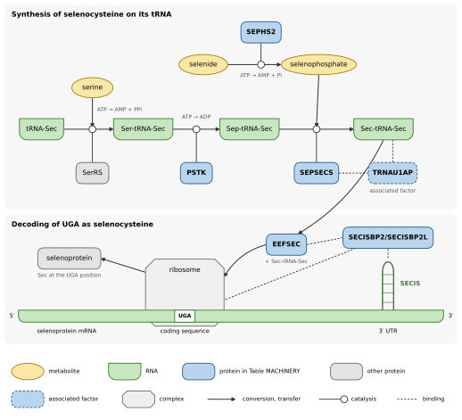

<!-- Draft. Citations use Pandoc keys from references.bib; [REF: …] marks references still to add. -->

# Introduction

<!-- Revised after the comments of 2026-10-16. [REF: …] marks references still to add. -->

Selenoproteins carry selenocysteine (Sec), an amino acid encoded by UGA, which is otherwise a stop codon. Selenium is
an essential trace element, with a narrow range between deficiency and toxicity [@Rayman2012]. Selenocysteine is a more reactive analogue of cysteine, and most selenoproteins are oxidoreductases in
which it forms the catalytic site: glutathione peroxidases (GPX) and thioredoxin reductases (TXNRD) maintain redox
homeostasis, and iodothyronine deiodinases (DIO) activate and inactivate thyroid hormones [@Labunskyy2014]. Selenoprotein sets differ between lineages, which have lost selenoprotein genes or replaced
their selenocysteine by cysteine [@Mariotti2012; @Jiang2012]. Selenocysteine is inserted by a dedicated machinery. In
eukaryotes, a stem–loop structure in the 3′ untranslated region of selenoprotein mRNAs, the selenocysteine insertion
sequence (SECIS) element, is bound by SECIS-binding protein 2 (SECISBP2), which recruits the selenocysteine-specific
elongation factor eEFSec (EEFSEC) and the selenocysteine-charged tRNA-Sec to the UGA codon [@Copeland2003; @Labunskyy2014]. Selenocysteine is synthesised on its tRNA: seryl-tRNA-Sec is phosphorylated by
O-phosphoseryl-tRNA-Sec kinase (PSTK), then converted to selenocysteinyl-tRNA-Sec by selenocysteine synthase (SecS,
encoded by SEPSECS), using selenophosphate made by selenophosphate synthetase 2 (SEPHS2) [@Xu2006]. This machinery
(Figure SCHEME) is expected in any genome that encodes selenoproteins.

<!-- Figure drawn by figures/machinery_scheme.py (make machinery-scheme); figures/machinery_scheme.pdf for print,
figures/machinery_scheme.svg for editing. -->

Figure SCHEME. The selenocysteine machinery of eukaryotes. Top, synthesis of selenocysteine on its tRNA: seryl-tRNA
synthetase (SerRS) charges tRNA-Sec with serine, PSTK phosphorylates the seryl group, and SEPSECS converts
O-phosphoseryl-tRNA-Sec (Sep-tRNA-Sec) into selenocysteinyl-tRNA-Sec (Sec-tRNA-Sec) with selenophosphate, which
SEPHS2 makes from selenide and ATP [@Xu2006]. Bottom, decoding of UGA: EEFSEC carries Sec-tRNA-Sec to the ribosome at
the UGA codon, and the SECIS-binding protein (SECISBP2 or SECISBP2L), bound to the SECIS element in the 3′
untranslated region, binds EEFSEC and the ribosome [@Copeland2003; @Labunskyy2014]. TRNAU1AP (SECp43), an associated
factor, binds Sec-tRNA-Sec and is found in complexes with SEPSECS [@SmallHoward2006]. Gene names as in Table
MACHINERY, whose proteins are drawn in blue; shapes follow the Systems Biology Graphical Notation [@LeNovere2009].

Because gene prediction programs read UGA as a stop codon, selenoprotein genes are often truncated, split or missing
in genome annotations [@Mariotti2015]. A gene missing from an annotation is invisible to the analyses that start from
annotated genes, such as proteomic searches, transcriptome quantification and orthology inference. In vertebrate
genomes, most selenoprotein genes are misannotated in public databases unless a dedicated pipeline is used, and even
then about one in five remains wrong [@Tico2026]. Outside vertebrates, and for genomes without such a pipeline, the
situation is largely unmeasured.

Programs dedicated to selenoproteins find their genes either by homology to known selenoprotein families, such as
Selenoprofiles [@Mariotti2010; @Tico2026], or from SECIS elements, such as Seblastian, which predicts selenoprotein
genes upstream of the SECIS elements found by SECISearch3 [@Mariotti2013]; tRNA-Sec genes have their own detectors
[@Santesmasses2017]. These methods were built from well-studied lineages, and the SECIS models in particular from
vertebrate and other model genomes: the seed of the Rfam SECIS family, for example, derives from a survey of metazoan
SECIS elements and contains no tunicate sequence [@Lambert2002; @Kalvari2020]. How they perform on divergent genomes is
not known in advance.

The appendicularian *Oikopleura dioica* is a planktonic tunicate found in the oceans worldwide [@Masunaga2020].
Appendicularians are among the most abundant zooplankton, and the filter-feeding houses that they discard contribute
to the vertical flux of carbon in the ocean [@Masunaga2022; @Robison2005]. Meta-omic studies now aim at the metabolism of whole plankton communities [@Stec2017;
@Heal2021], and depend on the annotated genomes of their members. The short life cycle, transparent body and
invariant embryonic cell lineages of *O. dioica* make it a model for developmental biology [@Wang2020], and its small
and compact genome, which has lost many genes conserved in other chordates, makes it a model for evolution by gene
loss [@Denoeud2010; @Albalat2016]. *O. dioica* has even lost its peroxisomes [@Zarsky2015; @Kienle2016;
@Bliznina2021], which raises the question of how it detoxifies reactive oxygen species, a function in which several
selenoproteins take part.

*O. dioica* comprises at least three cryptic species, not yet formally described: animals found in the main islands
of Japan and in Okinawa do not interbreed [@Masunaga2022], and the genomes of the three species are extensively
rearranged relative to each other [@Plessy2024]. A genome assembly is public for each: OdB3 from Norway
[@Denoeud2010], OSKA2016 from near Osaka [@Wang2020] and OKI2018 from Okinawa [@Bliznina2021]. How the annotations of
the three assemblies represent selenoprotein genes has not been examined.

Tunicate selenoproteins are known mostly from ascidians, where they show a dynamic evolution. *Ciona intestinalis*
has 19 selenoprotein genes [@Jiang2010] and a selenocysteine-containing deiodinase was characterised in *Halocynthia
roretzi* [@Shepherdley2004]. A survey of the thyroid hormone toolkit across chordates found that tunicate deiodinase
sequences in public databases often lack parts of the protein [@Esposito2021], an example of how annotation errors
limit comparative studies. No appendicularian selenoproteome has been described; to our knowledge, the only
appendicularian selenoprotein gene reported is the selenophosphate synthetase SEPHS2 of *O. dioica*, with its SECIS
element [@Mariotti2015]. <!-- TODO: confirm by a full-text screen of the large surveys (SelenoDB 2.0, Secmarker,
Baclaocos 2019, Trenz 2021, Esposito 2021). -->

*O. dioica* adds difficulties to the annotation of these genes. Like other tunicates, it transcribes many genes as
operons, whose transcripts are resolved into individual mRNAs by trans-splicing [@Ganot2004; @Satou2006]; annotation pipelines can merge the genes of an operon into a single gene model [REF: example]. In
addition, part of its introns use non-canonical GA–AG splice sites, which gene predictors model poorly
[@Denoeud2010]. Selenoprotein genes can also take unexpected forms: in ascidians, the selenophosphate synthetase gene
produces an alternative isoform that does not carry selenocysteine [@Mariotti2015].

<!-- TODO (once the results are complete): why the selenoproteome of O. dioica matters, for example whether a lineage
that lost many genes kept the full selenocysteine system or reduced it, as insects and nematodes did; and the
selenoproteome size of marine organisms (Lobanov et al. 2007). -->

<!-- To revise once the results are complete: list the concrete contributions. -->
Here we establish the selenoproteome of *O. dioica*, and we use the genomes of six other appendicularian species,
together with the selenoproteomes of other tunicates, to extrapolate a baseline for appendicularians. We built a
pipeline that combines the detection of selenoprotein genes, of their selenocysteine machinery and of SECIS elements
with annotation and transcript evidence. With their default parameters, current tools did not recover this baseline
in appendicularian genomes; we provide lineage-specific models and settings that do, and the data to evaluate them.
We hope that these data will help build defaults that apply to more lineages.

# Results

<!-- Figures to be numbered. -->

## A pipeline for selenoprotein genes, their machinery and SECIS elements

We wrote a Nextflow pipeline that brings together, for each genome, the evidence needed to annotate selenoprotein
genes (Figure PIPELINE, tube map). It predicts selenoprotein genes and the genes of the selenocysteine machinery with
Selenoprofiles; aligns independently the selenocysteine-containing sequences of the same profiles with miniprot and
calls the selenocysteine codons that they align to; searches SECIS elements downstream of each prediction; and
searches tRNA-Sec genes with two methods. When a gene annotation is given, it classifies each predicted
selenocysteine codon according to the annotated coding sequence that overlaps it, and when transcripts are given, it
counts those that support the codon. A MultiQC report summarises the results of all genomes. By default, the pipeline
uses the settings of the underlying tools: the eukaryotic and machinery profile sets of Selenoprofiles for eukaryotes,
the Rfam SECIS model at its gathering threshold, and the Rfam tRNA-Sec model together with Secmarker.

The pipeline's test runs every process on three small genomes. On human chromosome 22, it predicted selenoprotein O
(SELENOO) with its selenocysteine codon, found by both Selenoprofiles and miniprot, supported by a transcript and
correctly annotated in a test annotation; in the yeast genome, which has no selenoprotein, it predicted none.
Chromosome 22 carries no tRNA-Sec gene. The SECIS element of human SELENOO scored only 16 bits with the Rfam model,
below its gathering threshold of 35 bits; the test therefore lowers the threshold to 15 bits so that the SECIS search
is exercised.

## Default settings miss part of the selenoproteome of *O. dioica*

We ran the pipeline with its default settings on the three *O. dioica* assemblies and the genomes of six other
appendicularians, and compared its predictions with a baseline of 18 selenoprotein genes curated in each
*O. dioica* assembly (Methods). The pipeline found 13 of the 18 selenocysteine codons in OKI2018, 14 in OSKA2016 and 13
in OdB3, nearly all through Selenoprofiles; miniprot found 6, 6 and 3. Transcripts supported almost all the codons
found (13 of 13, 14 of 14 and 12 of 13). Two genes were missed in all three assemblies: selenoprotein K (SELENOK), and
SEPHS2, which Selenoprofiles predicted but without calling its selenocysteine codon. Other genes were missed in one or
two assemblies, for reasons that include assembly gaps. No SECIS element reached the gathering threshold in any of the
nine genomes (see below), whereas tRNA-Sec was found, by both methods, in every genome.

The public annotations represent these genes poorly. Of the selenocysteine codons predicted by Selenoprofiles, 5 of 12
fall in a correctly annotated coding sequence in the RefSeq annotation of OKI2018, none of 14 in the OSKA2016
annotation and none of 21 in the OdB3 annotation; in the other cases, the annotated coding sequence ends at the codon,
skips it, lies on one side of it or is absent.

With the same settings, the pipeline performed as expected on vertebrates, from which its tools were mostly built. It
predicted 30 selenoprotein genes in human and in mouse and 47 in zebrafish, found the complete machinery in all
three, and 27 of 34, 24 of 36 and 47 of 50 of the selenocysteine codons that it checked fell in correctly annotated
coding sequences of their RefSeq annotations. In other tunicates, it predicted 16 to 25 selenoprotein genes per
genome, including 19 in *Ciona robusta*, the number reported for this genome [@Jiang2010], and the machinery genes,
including PSTK and SECp43. In the three *Ciona* species, SEPHS2 was predicted with a residue other than
selenocysteine, consistent with its alternative isoform that does not carry selenocysteine [@Mariotti2015]. The Rfam
SECIS model was strict even in vertebrates: it supported 12 of the 30 predictions in human and in mouse and 10 of 47
in zebrafish, against 0 to 2 per genome in the other tunicates and none in appendicularians. Results on the
appendicularians were identical between two releases of the pipeline (0.1.2 and 0.2.0).

## Appendicularian profiles recover the selenocysteine machinery

With the standard profiles, Selenoprofiles did not find PSTK in any of the three *O. dioica* assemblies, although its
transcripts are expressed, and did not call the selenocysteine codon of SEPHS2. We therefore extended each profile of
the machinery set with appendicularian proteins: the predictions of the standard profiles in the appendicularian
genomes, and the PSTK and SEPHS2 proteins reconstructed from *O. dioica* transcripts (Methods). The OdB3 assembly
contributed no sequence and served as a test. With these profiles, the machinery was found in every *O. dioica*
assembly, including PSTK, whose predicted gene models in OKI2018 and OdB3 match the curated ones, and SEPHS2 with its
selenocysteine codon (Table MACHINERY). In the fragmented assemblies of *O. longicauda*, *B. stygius* and *M.
erythrocephalus*, PSTK was predicted only as fragments, which Selenoprofiles discards but which match the PSTK of
other appendicularians more closely than its relative KTI12. A search of each genome with the PSTK proteins of the
other genomes (tblastn), followed by a comparison with KTI12, supported the loci of *O. longicauda* and *M.
erythrocephalus* (38 and 50 bits closer to PSTK than to KTI12) and the PSTK transcripts of the three *O. dioica*
transcriptomes (66 to 84 bits), and left that of *B. stygius* ambiguous (24 bits), like the divergent PSTK of *O.
vanhoeffeni* (13 bits); in *F. borealis* it found no PSTK-like sequence at all, so that the gene may be missing from
that assembly. SEPHS2 was predicted with its selenocysteine codon in seven of the nine genomes; it was not found in
*B. stygius* and only partially in *M. erythrocephalus*. SecS (SEPSECS), eEFSec (EEFSEC), a SECIS-binding protein
and tRNA-Sec were found in every genome; the SECIS-binding protein is a co-ortholog of vertebrate SECISBP2 and
SECIS-binding protein 2-like (SECISBP2L), as shown below. Selenoprofiles also searches for SECp43 (TRNAU1AP), which binds
tRNA-Sec in complexes with SecS and SEPHS2 [@SmallHoward2006] but is an associated factor whose role is debated:
selenoprotein synthesis did not depend on it in mouse liver and neurons [@Mahdi2015], whereas it enhanced the
translation of several selenoproteins in glioblastoma stem cells [@Zhang2026]. We therefore report it separately.
SECp43 was found only in *F. borealis*, whereas the standard profile found it in all other tunicates and in the
vertebrates. The same search, applied to the eight oikopleurid genomes and the three *O. dioica* transcriptomes,
found only proteins at most 6 bits closer to SECp43 than to TIA1-like RNA-binding proteins, whereas the SECp43
proteins of the other genomes were 65 to 434 bits closer, and it recovered the SECp43 of *F. borealis* (Methods).
SECp43 is therefore absent from the Oikopleuridae, and was most parsimoniously lost in their ancestor.

## Orthology of the machinery genes

> **Provisional section (2026-10-22).** Draft written from the results at commit 806e317, after curation of the
> sequence sets (`results/tables/stage2_machinery_rbh.tsv`, `results/trees/`, `results/tables/stage2_machinery_lba.tsv`);
> domain analysis from `results/tables/stage2_machinery_domains.tsv` and `stage2_machinery_domain_conflicts.tsv`
> (and their `_pmsf` versions, 2026-10-23); other tunicates from `results/tables/stage1_machinery_rbh.tsv`.
> Numbers, figure and table numbers, and wording are to be checked before submission.

Selenoprofiles predicts homologs of its profile families, not necessarily orthologs of the named human genes. We
therefore compared each appendicularian machinery protein with the human proteome (reciprocal best hits; Methods;
Table MACHINERY).
SecS proteins were reciprocal best hits of human SEPSECS in all nine genomes, and eEFSec proteins of human EEFSEC in
seven; in the fragmented assemblies of *B. stygius* and *M. erythrocephalus*, the human protein matched another locus
better. The SECp43 of *F. borealis* was a reciprocal best hit of TRNAU1AP. Best hits did not assign the three other
genes. The PSTK proteins of *O. dioica* and *O. albicans* had no hit in the human proteome, and that of
*O. vanhoeffeni* scored 48 bits, whereas the PSTK predicted with the standard profile in each of the ten other
tunicates was a reciprocal best hit of human PSTK (55 to 108 bits). The SECIS-binding proteins of all nine genomes
were closer to human SECISBP2L than to SECISBP2, by 2 to 38 bits, as were those of nine of the ten other tunicates and
of the two amphioxus species; the *Halocynthia roretzi* protein was closer to SECISBP2 by 1 bit. The selenocysteine SEPHS hit human SEPHS1 and SEPHS2
within 9 bits of each other; best hits do not separate these paralogs outside mammals [@Mariotti2015].

For these three families, we built maximum-likelihood trees that include the proteins they must be told apart from:
the related kinase KTI12 for PSTK, the SPS1- and SPS2-type proteins of Mariotti et al. [-@Mariotti2015] for SEPHS,
and human SECISBP2 and SECISBP2L for the SECIS-binding proteins (Methods). To place the appendicularians among
tunicates, the trees include ten other tunicates, seven ascidians and three salps, and two amphioxus species.
Appendicularian proteins evolve fast, those of *O. dioica* about twice as fast as those of *Ciona* [@Berna2012],
which exposes their position in trees to long-branch attraction [@Bergsten2005]. We therefore reanalysed each tree
under a site-heterogeneous model (LG+C60 with posterior mean site frequencies, PMSF) [@Wang2017], after removing the
fastest-evolving sites, and with approximately unbiased (AU) tests of alternative positions (Table LBA). Figure TREES
shows the PMSF trees.

The appendicularian PSTK are PSTK and not KTI12: the two families separated with 100% support in every analysis.
The appendicularian proteins (*O. dioica*, *O. albicans* and *O. vanhoeffeni*; the fragments of the other genomes were
left out) formed a clade (100%), apart from the other tunicates, which formed their own clade (97 to 100%). In every
analysis but one, the appendicularian clade grouped with the PSTK of the insect-gut fungi *Smittium* and
*Zancudomyces*, which also lie on long branches (56% in the maximum-likelihood tree, 84% with PMSF, 60 to 77% after
site removal); without these fungi, it branched as the sister of all other PSTK (94%). Two long branches grouped
together is the pattern expected from long-branch attraction. A tree grouping the appendicularians with the other
tunicates was not rejected (AU test, p = 0.27). The position of the appendicularian PSTK within the family is
therefore unresolved.

The SECIS-binding proteins of the eight oikopleurid genomes formed a clade in every analysis (99 to 100%), which the
*F. borealis* protein joined in all but one (47 to 77%). This appendicularian clade grouped with the SECIS-binding
proteins of the other tunicates in the maximum-likelihood tree (70%) and under PMSF (93%), and when 10 to 30% of the
fastest sites were removed (53 to 68%); with 40% removed, the oikopleurid proteins still grouped with the other
tunicates (76%), and the *F. borealis* protein moved next to a nematode protein. In every tree, vertebrate SECISBP2
and SECISBP2L formed one clade (79 to 98%) that excluded the tunicate and amphioxus proteins. This agrees with the
origin of the two vertebrate paralogs by a duplication in early vertebrates, SECISBP2L-type proteins being the only
SECIS-binding proteins of invertebrate deuterostomes [@Donovan2009]. The appendicularian protein is thus the
ortholog of the single tunicate SECIS-binding protein, a co-ortholog of vertebrate SECISBP2 and SECISBP2L, which
explains its best hits to SECISBP2L.

Appendicularians have two SEPHS genes. The second copy, found in OKI2018, *O. longicauda*, *O. albicans* and
*O. vanhoeffeni*, carries a residue other than selenocysteine (alanine or serine where aligned). In every analysis it
fell inside the glycine forms of the other tunicates (75 to 99%), next to the *Phallusia mammillata* protein in the
maximum-likelihood tree and under PMSF (79 and 95%); these glycine forms include the *Botryllus schlosseri* protein
labelled SPS1 by Mariotti et al. [-@Mariotti2015]. The tunicate SEPHS other than the appendicularian
selenocysteine copies formed a clade in every analysis (82 to 95%): the duplication that produced the selenocysteine
and glycine forms of tunicates therefore preceded the divergence of appendicularians. The selenocysteine SEPHS2 of
the seven oikopleurid genomes formed a clade in every analysis (100%), which the *F. borealis* protein joined only
under C20 and PMSF (83 and 76%). Its position was unstable: at the base of the animal SEPHS under C20 and PMSF
(support of the parent node 39 and 56%), and outside a group that includes kinetoplastid, stramenopile and
amoebozoan proteins in the maximum-likelihood tree and in every site-removal analysis. AU tests rejected its
placement inside the clade of all tunicate SEPHS (p = 0.011 under the maximum-likelihood model, 0.0045 under PMSF)
and next to the selenocysteine copies of the other tunicates (p = 0.0047 and 0.0009). Neither composition nor branch
length explained the rejection: no SEPHS failed the composition test, and the second appendicularian copy, placed
consistently, has the longer path (2.5 against 1.3 substitutions per site from the common ancestor of tunicate and
vertebrate SEPHS). The appendicularian selenocysteine SEPHS2 is thus either a divergent ortholog of the tunicate
selenocysteine copy whose signal these models do not recover, or a separate SEPHS2 lineage. In both cases it is a
selenocysteine SEPHS2, by the residue at its catalytic site [@Mariotti2015].

To test whether these positions are supported along the whole protein, we split each alignment in two at a domain
boundary of the human protein and analysed each part on the same sequences (Methods; Table DOMAINS). In each family,
the data of each part rejected the tree of the other part (AU test, p ≤ 0.0023), but the differences lay in weakly
supported nodes: no clade with 95% support or more in one tree was incompatible with a clade so supported in the
other, except for arrangements within appendicularians, other tunicates, amniotes, cephalochordates or nematodes, and
among the prokaryotic and alveolate SEPHS near the root (Table DOMAINS). For PSTK, the appendicularian clade was recovered from the
kinase domain (100%) and from the C-terminal region (97%), without the insect-gut fungi, and its position remained
unresolved: sister to all other PSTK in the kinase tree (57%), next to dipteran PSTK in the C-terminal tree (54%).
Neither part rejected a grouping with the other tunicates (p = 0.44 and 0.32). Under PMSF, the clade fell next to
the insect-gut fungi in the kinase tree (42%) and next to fly, *Trichinella* and *Aphanomyces* proteins in the
C-terminal tree (70%), and the grouping with the other tunicates was still not rejected (p = 0.64 and
0.30). For the SECIS-binding proteins, the
L7Ae domain reproduced the full-length result: oikopleurid proteins with those of the other tunicates (81%), and
vertebrate SECISBP2 and SECISBP2L in one clade that excluded them (95%). The region upstream of the L7Ae domain
placed the oikopleurid proteins next to vertebrate SECISBP2, in a group with the other tunicate proteins (67% and
67%). Neither part rejected the grouping of appendicularians with the other tunicates (p = 0.38 and 0.49); the short
*F. borealis* protein (315 residues) fell elsewhere in both trees. Under PMSF, the L7Ae domain grouped the
oikopleurid proteins with those of the other tunicates more strongly (91%; vertebrate clade 96%), and neither part
rejected the grouping (p = 0.38 and 0.51). For SEPHS, under the selected model, the N-terminal half rejected none of
the tested positions of the appendicularian selenocysteine clade (with the tunicate selenocysteine copies, p = 0.45;
inside the clade of all tunicate SEPHS, p = 0.33; at the position of an ortholog, p = 0.19), whereas the C-terminal
half rejected the position of an ortholog (p = 0.0034; p = 0.08 for the other two). The N-terminal tree, however,
grouped both appendicularian copies with the SPS2 of dipterans and of the louse *Pediculus humanus* (84%; the second
copy with these insect proteins, 94%), whereas in the C-terminal tree the second copy fell inside the tunicate
glycine forms (77 and 83%) and the insect proteins grouped with *Rhodnius prolixus* SPS2 (100%). This was the only
conflict supported by 90% or more that involved the position of an appendicularian protein under that model. Under
PMSF, this grouping disappeared: the second copy fell next to the tunicate glycine forms in both halves (39 to 65%),
and both halves rejected the position of an ortholog for the selenocysteine clade (p = 0.016 and 0.011), but not its
placement inside the clade of all tunicate SEPHS (p = 0.22 and 0.071). The only strongly supported conflict between
the PMSF trees concerned the other tunicates: the C-terminal half grouped all tunicate SEPHS, with the second
appendicularian copy, with the vertebrate proteins (95%), whereas the N-terminal half grouped the vertebrate
proteins with those of amphioxus and protostomes (95%). The non-rejection of orthology by the N-terminal half under
the selected model thus came with a grouping that the site-heterogeneous model does not support, and under that
model both halves reject the position of an ortholog, as the full-length alignment does.

| Gene | Orthology | *O. dioica* OKI2018 | *O. dioica* OSKA2016 | *O. dioica* OdB3 | *O. longicauda* | *O. albicans* | *O. vanhoeffeni* | *B. stygius* | *M. erythrocephalus* | *F. borealis* |
|---|---|---|---|---|---|---|---|---|---|---|
| tRNA-Sec | not tested (RNA gene) | found | found | found | found (4 loci) | found (2 loci) | found (2 loci) | found | found (2 loci) | found |
| SEPHS2 | selenocysteine at the catalytic site; outside the tunicate SEPHS in the trees (AU p at most 0.011) | selenocysteine | selenocysteine | selenocysteine | selenocysteine | selenocysteine | selenocysteine | not found | partial | selenocysteine |
| SEPHS, second copy | ortholog of the tunicate glycine form (75 to 99%) | found | not found | not found | found | found | found | not found | not found | not found |
| PSTK | PSTK, not KTI12 (100%); position within PSTK unresolved (AU p = 0.27) | found | found | found | fragment | found | found | fragment | fragment | not found |
| SEPSECS | reciprocal best hit in all nine genomes | found | found | found | found | found | found | found | found | found |
| EEFSEC | reciprocal best hit; best hit only in *B. stygius* and *M. erythrocephalus* | found | found | found | found | found | found | found | found | found |
| SECISBP2/SECISBP2L | co-ortholog of SECISBP2 and SECISBP2L; with the other tunicates (70%, C60 93%) | found | found | found | found | found | found | found | found | found |
| TRNAU1AP (associated factor) | reciprocal best hit (*F. borealis*) | not found | not found | not found | not found | not found | not found | not found | not found | found |

<!-- Table generated by stage2/machinery_table.py (make machinery-table; results/tables/stage2_machinery_table.md),
from the census, the reciprocal best hits and the long-branch analyses; the orthology column is provisional. -->

Table MACHINERY. Selenocysteine machinery, and the associated factor SECp43, found with the appendicularian profiles,
with the evidence for their orthology. "Selenocysteine": SEPHS2 predicted with its selenocysteine codon; "found":
predicted; "partial": predicted only with an in-frame stop codon or frameshift, or without alignment at the
selenocysteine position; "fragment": discarded by Selenoprofiles but supported by similarity (Methods); "not found":
no prediction; for tRNA-Sec, loci found by both methods. The second SEPHS copy carries a residue other than
selenocysteine. Orthology: reciprocal best hits against the human proteome, or the maximum-likelihood trees and their
long-branch analyses, with bootstrap supports or AU tests (see text); this column is provisional. Several copies in
an assembly may reflect duplicated haplotypes or contamination [@Pichon2019].

<!-- Provisional section, notes:
- Figure TREES: figures/phylogeny_<family>_collapsed_pmsf.{png,pdf} (make machinery-lba-figures); supplementary
  figures: the maximum-likelihood trees, collapsed (figures/phylogeny_<family>_collapsed.*) and full
  (figures/phylogeny_<family>.*). Table LBA: results/tables/stage2_machinery_lba.tsv.
- Domain analysis (2026-10-22, local run, make machinery-domains): Table DOMAINS from
  results/tables/stage2_machinery_domains.tsv and stage2_machinery_domain_conflicts.tsv; supplementary figures
  figures/phylogeny_<family>_collapsed_domain_<domain>.pdf (make machinery-domain-figures). Supports quoted in the
  text that are not in the tables (57, 54, 67, 81, 84, 94, 77, 83%) were read from the domain trees in
  results/trees/domains/. PMSF versions (2026-10-23, Deigo, make machinery-domains-pmsf):
  results/tables/stage2_machinery_domains_pmsf.tsv, stage2_machinery_domain_conflicts_pmsf.tsv and
  figures/phylogeny_<family>_collapsed_domain_<domain>_pmsf.pdf; supports quoted (42, 70, 91, 96, 39 to 65%) read
  from results/trees/domains/*.pmsf.treefile.
- Reciprocal best hits of the other tunicates: results/tables/stage1_machinery_rbh.tsv (regenerated 2026-10-23,
  make machinery-rbh); the stage 1 predictions of the standard profiles. SEPHS of the other tunicates: best hit SEPHS1
  for most copies, SEPHS2 within 5 bits for the selenocysteine copies of B. schlosseri and S. clava.
- The second SEPHS copy was not found in OSKA2016 and OdB3: to check (assembly or prediction).
- Decision of 2026-10-24 (docs/plan.md): B. stygius, M. erythrocephalus and F. borealis are held out of stage 2 and
  used at the end for the census; at the next rerun, the statements of this section that rely on them (SECp43 loss,
  PSTK fragments, their columns in Table MACHINERY) move to the census section. Bacterial-like sequences: one strict
  HGT screen at the end (no false positive; contamination is the default explanation).
-->

## The Rfam SECIS model does not separate appendicularian SECIS elements from genomic background

In stage 1, no SECIS element reached the Rfam gathering threshold (35 bits) downstream of any selenoprotein gene
predicted in the nine genomes. To see whether the threshold alone was too strict, we scored with the same model,
without threshold, the 3′ sequences of all Selenoprofiles predictions and, as background, 200 random genomic windows
of the same length per genome (Figure SECIS-1). Predictions fall into two groups: 143 with a selenocysteine codon (below, selenocysteine
predictions), and 578 others. The others are mostly homologs with cysteine at the selenocysteine position (375, of which 235 in the EhSEP2 family),
predictions whose alignment does not cover the selenocysteine position of their profile (122, labelled "unaligned"), homologs of
selenocysteine machinery proteins that are not selenoproteins (40, such as eEFSec and SECIS-binding proteins), and predictions
with another amino acid or a stop codon at the selenocysteine position (41).

Of the 143 3′ sequences that follow predictions with a selenocysteine codon, 96 (67%) had no hit at all, even when every hit
of at least 0 bits was reported. This was not caused by fragmented assemblies separating coding sequences from their UTRs: in the
chromosome-scale assembly OKI2018, 5 of 12 had no hit. The remaining 47 scored from 12 to
31 bits; 18 reached 20 bits, and none reached the threshold. Random windows rarely had a hit (45 of 1,800), but those
hits reached 22.6 bits. Lowering the threshold to 20 bits would therefore have recovered at most four SECIS elements
per genome while accepting background hits, and most selenoprotein 3′ sequences would still have no hit. The Rfam
model does not recognise most appendicularian SECIS elements, rather than recognising them below its threshold.

> **Provisional paragraph (2026-10-24, step 1 of the plan in docs/plan.md; `results/tables/stage2_secis_hits*.tsv`,
> `make secis-hits`).** Restricted to the validated hits of the six *Oikopleura* assemblies; it is to replace the two
> paragraphs above, which count all predictions of the nine genomes (decision of 2026-10-24 on the genome sets).

Restricted to the hits that the orthology analysis supports, the result is the same. In the six *Oikopleura*
assemblies, the first round of hit validation gave no evidence against any of the 111 predictions with a
selenocysteine codon: each has its best human hit in its family or in a related gene (MIEN1 for the chr2-type
SELENOW, SEPHS1 for SEPHS2), or no hit, and none has bacterial or fungal nearest relatives in the tree of its family
(Methods). Fourteen of them lie less than 500 nucleotides from the end of their contig (11 in *O. longicauda*),
which leaves no room for a SECIS element. With RF00031, 41 of the 111 3′ sequences had a hit, 15 reached 20 bits and
4 reached 25 bits, whereas the best random window of each genome scored 13.2 to 22.6 bits and no cysteine homolog of
these genomes reached 20 bits. Hits of 20 bits or more followed SELENOW (5 of 30 predictions), GPX (4 of 39), DIO
(2 of 22), SEPHS2 (2 of 3), SELENOF (1 of 7) and TXNRD (1 of 5) predictions, and none of the SELENOO (2), SELENOS (1),
SELENOT (1) and MsrA (1) predictions.

## Gold-standard gene models in three *O. dioica* assemblies

> **Provisional section (2026-10-24, step 2 of the plan in docs/plan.md; `results/tables/gold_standard.tsv`,
> `curation/gold_standard/`, `make gold-standard`).**

To train SECIS models and appendicularian profiles on reliable sequences, we built a gene model for each curated
selenocysteine codon of the three *O. dioica* assemblies, from their transcripts, their public annotations and the
stage 1 predictions (Methods; Figure REANNOTATION). Of the 54 codons (18 genes in each assembly), 53 received a model;
the exception is OdB3 SELENOO, whose exon with the selenocysteine codon is not in the assembly. All 53 models are
complete, from an ATG to a stop codon, through the selenocysteine. All but one are supported by transcripts; OdB3
GPX_chr1a, without transcript, joins the two GenBank models that split the gene at the selenocysteine codon, and its
protein then aligns to the other assemblies along its whole length. Fifty-one models have a 3′ UTR from transcripts
(median 310 nucleotides, from 4 to 892).

In six genes the assembly does not encode the protein of the transcripts, because it lacks or adds bases in the
coding sequence: SELENOS (13 nucleotides absent from the assembly), SELENOO (5 nucleotides) and DIO_chr1 (a
frameshift in its 3′ part) in OKI2018, SELENOW_PAR (2 nucleotides) in OSKA2016, and DIO_PAR and GPX_PAR (1
nucleotide added in the assembly) in OdB3. In each case the transcript protein is more similar to the same gene in
the other assemblies than the protein encoded by the assembly, or much longer (OKI2018 SELENOO, whose assembly frame
gives only the last 70 residues); in OKI2018 DIO_chr1, for example, the assembly frame ends in a C-terminus
unrelated to the other assemblies, whereas the transcript protein ends, as they do, in the sequence VEYVGGPGPFGYDL.
For these genes, the gold standard gives the transcript protein and a model mapped from the transcript.

The 170 introns of the models include 19 GA-AG, 7 GC-AG and 1 GG-AG introns (16%), against 12.4% of non-GT-AG
introns in the *O. dioica* reference annotation [@Denoeud2010; @Frey2020]. DIO_PAR, SELENOT, SELENOW_chr2 and TXNRD
have a GA-AG intron in each of the three assemblies. The nine splice sites of other types lie in five models: OKI2018
SELENOO (4 sites) and DIO_chr1 (1 site), mapped from transcripts onto an assembly that lacks bases, where they mark
the alignment around the missing bases (RefSeq places GT-AG or GA-AG introns a few nucleotides away in SELENOO),
OSKA2016 SELENOO (2 sites), and OKI2018 GPX_chr1a and OSKA2016 GPX_chr1b (1 site each).

The public annotations rarely give the selenoproteins (Figure REANNOTATION). Of the 53 models, three have the
selenocysteine declared by the public annotation, all in RefSeq (OKI2018 DIO_PAR, GPX_PAR and SELENOF), and in DIO_PAR one intron lies 11
nucleotides away from the GA-AG intron supported by the transcripts. In two more RefSeq models (GPX_chr1a and
GPX_chr2) the codon is in the frame of the coding sequence but translated as X. Elsewhere the codon is read as a stop
codon that ends the coding sequence (12 models: 2 in OKI2018, 3 in OSKA2016, 7 in OdB3), skipped in an intron of
the coding sequence (12 models, 10 of them in OSKA2016), read in another frame (OdB3 GPX_PAR and SEPHS2, where the
coding sequence starts near the codon in another frame), or the coding sequence starts after it (9 models; 5 in
OKI2018, where it starts at an internal ATG of the right exon chain in GPX_chr1b, SELENOT, SELENOW_chr2 and SEPHS2)
or ends before it (3 models, among them OKI2018 SELENOS, whose frame is lost where the assembly lacks 13 bases).
Ten have no annotated coding sequence at all (SELENOK, SELENOW_PAR, SELENOW_chr1a and the two SELENOW genes of the
chr1 pair in OKI2018; SELENOK and SELENOW_PAR in OSKA2016; SELENOW_PAR, SELENOW_chr1a and SELENOW_pair2 in OdB3).
SELENOW_PAR in OKI2018 and OdB3, and the SELENOW pair in OKI2018, lie in the 3′ UTR of the annotated mRNA of
another protein, as expected from genes of an operon whose mRNAs are separated by trans-splicing; OSKA2016
SELENOW_chr2 is also known from a transcript that reads through into the next gene. The annotations also join or
split genes at the selenocysteine codon: the OdB3 annotation splits five genes there into two or three models
(DIO_PAR, DIO_chr1, GPX_chr1a, GPX_chr1b and SELENOS), and the OSKA2016 annotation joins SEPHS2 to the upstream gene
and the two genes of the SELENOW pair into one model, and splits SELENOO into three models.

Figure REANNOTATION (two pages, `figures/reannotation_page.pdf` and `figures/reannotation_page2.pdf`). Reannotation of
the 18 selenoprotein genes in three *O. dioica* assemblies, grouped by family (page 1: glutathione peroxidases,
deiodinases, thioredoxin reductase, SELENOO and SEPHS2; page 2: the Rdx family, SELENOW paralogs and SELENOT, then
SELENOF, SELENOK and SELENOS). For each gene, top: in each assembly, the public models
(grey; RefSeq for OKI2018, ANISEED for OSKA2016, GenBank for OdB3) above the gold-standard model (blue), in gene
orientation, positioned by their distance in nucleotides to the selenocysteine TGA (dashed red line); thick boxes,
coding exons; thin boxes, untranslated exons; coloured introns, splice sites other than GT-AG (drawn length
unchanged); hatched boxes, coding sequences in another frame than the gold standard; green boxes, best hit of the
*Oikopleura* SECIS model in the 2,000 nucleotides after the stop codon, shortened at the next selenoprotein coding
sequence, with its bit score (open boxes would mark hits below 20 bits; there are none); stretches of more than 1,500 nucleotides without exon are shortened (break marks). Middle: the human
protein (UniProt), the *Ciona intestinalis* protein (stage 1 prediction on its genome) and the three gold-standard
proteins, placed on the coordinates of the human protein by local alignment (those of OSKA2016 and OdB3 through the
OKI2018 protein), with the Pfam domains of the human protein and the residues aligned to its selenocysteine; lines,
residues outside the aligned part. Bottom: the public models of each assembly and what distinguishes them from the
gold standard, notes on the gold-standard models, and the accessions of the reference proteins.

## An *Oikopleura* SECIS model trained on the gold-standard genes

A first appendicularian model, built by bootstrap from RF00031 on the 3′ sequences of stage 1 predictions in seven
oikopleurid genomes (Methods), gave at least 25 bits to 42 of the 53 gold-standard *O. dioica* genes. Its
evaluation was not independent: its training sequences included those of OKI2018 and OdB3, whose SECIS elements are
near-identical to those of OSKA2016, and it scored the 6,000 nucleotides after the selenocysteine codon rather than
the 3′ region of each gene. We therefore trained a second model in the same way on the gene models of the previous
section and evaluated it on families and species left out of training (Methods).

The positive windows were the 2,000 nucleotides after the stop codon of the 53 gold-standard models and of 58
selenocysteine predictions of *O. longicauda* (22), *O. albicans* (20) and *O. vanhoeffeni* (16), shortened at the
next selenoprotein coding sequence on the same strand (SELENOW_pair2, before SELENOW_pair1, in the three *O. dioica*
assemblies) or at a contig end (20 windows of the three other species). The negative windows were random windows of
the six assemblies and of four non-target tunicates (*Ciona intestinalis*, *Ciona savignyi*, *Styela clava* and
*Thalia democratica*), drawn away from the positive windows; the positive windows shuffled with their dinucleotide
composition preserved; and the windows after the stop codons of 180 cysteine homologs.

In the four species folds, where the windows of one species were left out of training (the three *O. dioica*
assemblies together), the model detected 84 of the 111 left-out windows above its training threshold (the best score
of the training random windows, 19.6 to 21.6 bits), all of them also above the best evaluation negative of their
fold. Three evaluation negatives passed the training threshold (0.32 per Mb), all random windows of non-target
tunicates (21.6 to 23.1 bits). Of the 53 *O. dioica* windows, 49 were detected, and no negative passed the
threshold (19.7 bits); the four below it are SELENOO in OKI2018 and OSKA2016, and GPX_PAR and SELENOF in OSKA2016.
Sixty-four left-out windows scored at least 25 bits and 43 at least 30 bits. Of the 27 windows not detected, 19 had
no hit with any of the four models compared below, and 9 of these 19 are shortened by a contig end. In the twelve
family folds, the model detected 81 of the 111 windows, with 0.72 negatives per Mb above the training thresholds.
On the same windows and thresholds, RF00031 detected 27 windows in the species folds and 26 in the family folds, and
a model built from the RF00031 seed sequences and the appendicularian seeds of each fold detected 66 and 65 (0.32
and 0.25 negatives per Mb). The first appendicularian model detected 82 in both (0.64 and 0.50 negatives per Mb),
but it had been trained on most of the left-out windows.

The final model, trained on the 111 windows, converged in seven rounds on 76 seeds (18 in OKI2018, 12 in OSKA2016, 9
in OdB3, 20 in *O. longicauda*, 9 in *O. albicans* and 8 in *O. vanhoeffeni*); the best score of the training random
windows was 17.8 bits in the last round, and the consensus is 66 nucleotides long. The seeds start a median of 127
nucleotides after the stop codon (quartiles 67 and 238). The 53 *O. dioica* windows, which are training data for this
model, score 25.6 to 59.1 bits (median 40.4; Figure REANNOTATION). We use this model with a threshold of 20 bits for
SECIS elements in the 3′ windows of genes: at that score, about one evaluation negative window of 2,000 nucleotides
in 1,500 passed in the species folds (3 of 4,691). Scans of whole genomes call for a threshold set on genome-wide background
(Stage 2).

<!-- Figure SECIS-2 shows the first model; to redraw with the new model (held-out scores of
results/tables/stage2_secis_v2_heldout.tsv against the evaluation negatives). Next (step 4): genome-wide scans and
their threshold; SECIS elements without a known selenoprotein gene. -->

# Methods

<!-- Stage 2 subsections are placeholders until stage 2 is run. -->

## Genome assemblies, annotations and transcripts

Genes are named by the symbols of their human orthologs (HGNC), given at their first mention (the human tRNA-Sec gene
is TRU-TCA1-1); appendicularian
orthologs take the same symbols, and selenoprotein families the root of their members' symbols (for example GPX for
glutathione peroxidases).

We analysed three assemblies of *O. dioica*: OKI2018 (RefSeq GCF_907165135.1, with its RefSeq annotation)
[@Bliznina2021], OSKA2016 (genome and transcript models from the ANISEED download archives
`Oidioi_genome_fasta_gff3.zip` and `Oidioi_transcripts_fasta_gff3.zip`) [@Wang2020] and OdB3 (GenBank
GCA_000209535.1, with its GenBank annotation) [@Denoeud2010]. At NCBI, the OKI2018 assembly is named OKI2018_I68;
it is the OKI2018_I69 assembly of Bliznina et al. [-@Bliznina2021], I69 being the identifier of the sequenced
individual, and we use the NCBI name for consistency with the database. The six other appendicularian genomes are
those of *Oikopleura longicauda* (GCA_004367895.1), *Oikopleura albicans* (GCA_004367875.1), *Oikopleura vanhoeffeni*
(GCA_004367855.1), *Bathochordaeus stygius* (GCA_004367955.1), *Mesochordaeus erythrocephalus* (GCA_004367975.1) and
*Fritillaria borealis* (GCA_004368075.1) [@Naville2019]; they have no public gene annotation. As non-target genomes
for SECIS models, we used four other tunicates: *Ciona intestinalis* (GCF_018327825.1), *Ciona savignyi*
(GCA_054131345.1), *Styela clava* (GCF_964204865.1) and *Thalia democratica* (GCF_965202585.1). These tunicates,
with *Ciona robusta* (KH assembly, GCF_000224145.3, the genome of the published *Ciona* selenoproteome, formerly named
*C. intestinalis*) and *Halocynthia roretzi* (GCA_013436055.1), were also analysed with the default settings, to compare the
appendicularians with other tunicates. As positive controls for the default settings, we used the human
(GRCh38.p14, GCF_000001405.40), mouse (GRCm39, GCF_000001635.27) and zebrafish (GRCz11, GCF_000002035.6) genomes, with
their RefSeq annotations.

Transcript evidence came from one source per *O. dioica* assembly: for OKI2018, the Trinity transcriptome assembled
by Bliznina et al. [-@Bliznina2021] (109,877 sequences; Zenodo, <https://doi.org/10.5281/zenodo.23472675>); for OSKA2016,
the Trinity assembly of Wang et al. [-@Wang2015] (GEO GSE64421, 86,898 sequences); for OdB3, the cDNA collection of
the genome project (Genoscope, 207,355 sequences: 7,862 clone contigs and 199,493 single reads) [@Denoeud2010],
also distributed by the now offline OikoBase. All files were retrieved by a script that checks their MD5 sums.

## Selenoprotein gene pipeline

We wrote a Nextflow [@DiTommaso2017] pipeline, based on the nf-core template [@Ewels2020], that runs the following
steps on each genome; all tools run from container images. Stage 1 analysed all genomes (appendicularians,
other tunicates and vertebrate controls) in one run of release 0.2.0 with default parameters.

*Selenoprotein genes.* Selenoprofiles 4.5.8 [@Mariotti2010; @Tico2026] searched the profiles of eukaryotic
selenoprotein families and of the selenocysteine machinery (profile sets `eukarya` and `machinery`), with the Selenoprofiles data
set (profiles, Gene Ontology tables and UniRef50 tag database) downloaded from its server; the MD5 sums of the
archives used are recorded. Independently, miniprot 0.11 [@Li2023] aligned to the genome the selenocysteine-containing
sequences of the same profiles. A TGA codon was called a selenocysteine codon when miniprot aligned it to a query selenocysteine, or
when the query selenocysteine was the first residue after the end of the alignment and the next genomic codon was TGA, since
miniprot tends to stop before a C-terminal selenocysteine. Selenocysteine codons found by both methods at the same position were merged.

*SECIS elements.* Infernal 1.1.5 [@Nawrocki2013] `cmsearch` searched, with the Rfam SECIS model RF00031
[@Kalvari2020], the 6,000 nucleotides downstream of each Selenoprofiles prediction, at the Rfam gathering threshold.
A SECIS element counted as support for a prediction, not as a filter.

*tRNA-Sec.* Secmarker 1.0.0 [@Santesmasses2017] and `cmsearch` with the Rfam tRNA-Sec model RF01852 (gathering
threshold) searched each genome. Predictions overlapping on the same strand were merged into loci; a locus was
considered supported when found by both tools and, where Secmarker reported it, carrying the discriminator base G73.

*Annotation check.* For the genomes with an annotation, each selenocysteine codon predicted by Selenoprofiles was classified
according to the annotated coding sequences overlapping it, following the classes of Ticó et al. [-@Tico2026]: well
annotated (selenocysteine codon inside the CDS, in frame, with or without the selenocysteine declared), stop codon (CDS ending at the selenocysteine
codon), skipped (CDS on both sides of the codon but not over it), upstream or downstream (CDS entirely on one side),
out of frame, spliced (CDS boundary inside the codon) or absent. The same predictions were also assessed with
`selenoprofiles assess`, identifying annotated transcripts by the `Parent` of their CDS features.

*Transcript support.* Transcripts were aligned to their genome with minimap2 2.30 [@Li2018] (`-x splice
--secondary=no`). A transcript supported a selenocysteine codon when the three nucleotides of the codon lay inside one aligned
exon of its primary alignment; for each codon we recorded the number of supporting transcripts and the extension of
the longest one 3′ of the codon.

Results of all genomes were summarised with MultiQC [@Ewels2016]. The pipeline's test profile runs every process
on human chromosome 22 (with an annotation of SELENOO and a transcript covering its selenocysteine codon), the yeast
genome and a fragment of the *Escherichia coli* genome, with the SECIS threshold lowered to 15 bits; modules and
pipeline are also tested with nf-test [@Forer2025].

## Baseline curation

<!-- To complete: reference proteins, selenocysteine context, criteria; tables in curation/ of the analysis repository. -->

The baseline lists, for each of the three *O. dioica* assemblies, the selenocysteine codons of the selenoprotein genes, placed
by aligning curated reference proteins and checking the residues around the selenocysteine, and supported by transcripts and
by comparison between assemblies. Assembly errors at a gene were recorded, not corrected.

## Gold-standard gene models

> **Provisional section (2026-10-24, step 2; `curation/gold_standard.py`).**

For each curated selenocysteine codon of OKI2018, OSKA2016 and OdB3, the transcripts of the assembly were aligned to
it with minimap2 [@Li2018] (`-x splice:hq -un`, primary alignments), without preference for GT-AG splice sites,
which otherwise displaces the junctions of the atypical introns of *O. dioica* and creates false indels. Junctions
were then placed by moving each intron within 8 nucleotides to the position of lowest cost, the number of mismatches
between transcript and genome plus a splice-site cost of log10(f(GT-AG)/f(site))/2, with the intron frequencies of the
*O. dioica* reference annotation (GT-AG 87.6%, GA-AG 9%, GC-AG 2.7%, GG-AG 0.7%, other sites taken as 0.1%)
[@Denoeud2010], the factor 2 being the log10 cost of a mismatch at 1% divergence. A transcript supported the gene when
an aligned exon held the codon as TGA. Candidate models were the exon chains of the supporting transcripts, of the
annotated mRNAs and of the stage 1 Selenoprofiles predictions holding the codon, and the transcript chains extended
with the exons of overlapping annotated or predicted models beyond their ends, and, where the annotation split a
gene at the TGA, the annotated model ending at the codon joined to the next model downstream; an extension that
placed the start codon beyond a transcript whose own model was complete was kept only when the added residues
aligned to the same gene in another assembly. Each candidate was read on the genome sequence spliced along its chain: the frame of the
TGA was extended upstream to the first ATG after the previous stop codon (or the first ATG of the frame when the
chain has no stop upstream), and downstream to the next stop codon. Candidates were ranked by the presence of the
curated protein context of the selenocysteine, the absence of unsupported splice sites outside the four intron
classes, not being contradicted by most of the supporting transcripts, a length within 90% of the longest, a stop codon, an ATG start, transcript support, length, not the
annotated mRNA of another protein (an annotated mRNA whose coding sequence lies elsewhere, such as the upstream gene of
an operon) and, last, an annotated exon chain; 3′ UTR exons that overlapped the coding sequence of a downstream
annotated gene (read-through transcripts) were left out, and the UTRs were cut at the coding sequence of another
selenoprotein gene of the table when the exon chain reached it (one transcript holding both genes of the SELENOW
pair in OKI2018). Among the candidates equal to the first one on every criterion before length, the one whose
protein aligned best to the same gene in the other assemblies (mean global alignment score) replaced it when its
score was higher by 20 (about 10 bits), so that exons beyond the transcripts, taken from the annotation or from a
prediction, were chosen by similarity rather than by length. When the transcripts differed from the assembly by indels in the coding sequence, the
transcript protein replaced the assembly protein when its identity to the same gene in the other assemblies,
counted on the part of each reference protein that both proteins cover (global alignments with BLOSUM62 and free
end gaps, Biopython [@Cock2009]), was higher by more than 0.02, or, at a similar identity, when it was complete and
either more than 10% longer while the assembly protein was not complete, or more than twice as long (a frame broken by
the assembly); the model was then the transcript chain mapped onto the assembly. The models are
given in GFF3 with the selenocysteine declared (`transl_except`), with their proteins, 3′ UTRs, the 2,000
nucleotides of genome that follow each stop codon, and a table of all candidates.

## Appendicularian profiles of the selenocysteine machinery

Each Selenoprofiles profile of the machinery set (SEPHS2, PSTK, SecS, eEFSec, SECIS-binding protein 2 and SECp43) was
extended with appendicularian proteins: the predictions of the standard profiles in the appendicularian genomes other
than OdB3, labelled "homologue" or "selenocysteine" and at least half as long as the median sequence of the profile,
and the proteins reconstructed from *O. dioica* transcripts (PSTK from the OKI2018 and OSKA2016 transcriptomes, SEPHS2
with its selenocysteine from the OSKA2016 transcriptome). The added proteins were aligned to the standard profile with
MAFFT `--add --keeplength` [@Katoh2013], which keeps the columns of the profile and therefore its configuration, and
the extended alignments were built into profiles with `selenoprofiles build`, using all their sequences as BLAST
queries. The profiles keep the standard names; given to the pipeline with `--selenoprofiles_overrides`, they replace
the standard profiles of the same name.

## Census of the selenocysteine machinery

We ran Selenoprofiles with these profiles on the nine genomes. For each genome without a PSTK prediction, we
reran Selenoprofiles with the PSTK profile, keeping the predictions that its last filter discards, and compared
each of them (blastp [@Altschul1997]) with the PSTK proteins found in the other genomes and with KTI12, a related
kinase. This test needs proteins of a related family to compare with, and was not applied to the other genes. A discarded prediction counted as a fragment of the gene when its best hit was a protein of
the gene with an E-value of at most 10^-10^. tRNA-Sec loci were those of stage 1 found by both methods.

## Absence tests

For a machinery gene or associated factor missing from appendicularian genomes, the stage 1 predictions of the gene
in the other genomes were searched in each appendicularian genome and in the *O. dioica* transcriptomes with tblastn
(E-value at most 10^-3^). Hits less than 20 kb apart on the same strand formed a locus, whose translated hits
(genomes) or whose open reading frame around the best hit (transcripts) gave a candidate protein. Each candidate was
compared by blastp with the proteins of the gene (the profile sequences and the stage 1 predictions of the other
genomes) and with proteins of related families: TIA1-like RNA-binding proteins from the Selenoprofiles UniRef50
database for SECp43, KTI12 for PSTK. The margin, the score of the best hit to the gene minus that of the best hit to
the related family, classified the candidate as supported (at least 30 bits), ambiguous (10 to 30 bits) or a related
protein. The stage 1 predictions of the gene, scored in the same way, served as positive controls.

## Orthology of the machinery genes

> **Provisional section (2026-10-22).** Draft of the methods of the reciprocal best hits, trees, long-branch
> analyses and domain analysis (`stage2/machinery_rbh.py`, `stage2/machinery_phylogeny.py`,
> `stage2/machinery_lba.py`, `stage2/machinery_domains.py`, `figures/phylogeny_collapsed.py`); to be checked before
> submission.

*Reciprocal best hits.* Each machinery protein predicted with the appendicularian profiles was compared by blastp
(legacy BLAST 2.2.26, E-value at most 10^-3^) [@Altschul1997] with the human RefSeq proteins of the GRCh38.p14
annotation, each assigned to its gene through that annotation. The best hit gave the human gene; the difference
between its score and that of the best hit to another gene gave a margin, and margins below 10 bits were called
ambiguous. The best human protein was then searched in the appendicularian genome with tblastn (E-value at most
10^-3^); the hit was reciprocal when its best locus overlapped the prediction.

*Trees.* Each tree combined the sequences of the Selenoprofiles profile (at most three per taxonomic group, the
longest kept); the stage 1 predictions in the other tunicates, in two cephalochordates and in the vertebrate controls;
the predictions of the appendicularian profiles in the nine appendicularian genomes; and the proteins reconstructed
from *O. dioica* transcripts. The other tunicates were the six analysed in stage 1 and four genomes added for this
analysis, *Botryllus schlosseri* (GCF_051294905.1), *Phallusia mammillata* (GCF_965637545.1), *Pegea* sp.
(GCA_034620365.1) and *Salpa thompsoni* (GCA_047495815.1); the cephalochordates were *Branchiostoma floridae*
(GCF_000003815.2) and *Branchiostoma lanceolatum* (GCF_035083965.1). These six genomes were run through the pipeline
with the default settings, like the other stage 1 genomes. For PSTK and the SECIS-binding proteins, which have no
selenocysteine, the RefSeq proteins of a genome replaced its predictions, which cover only the region of the profile:
for each gene whose proteins had PSTK or KTI12 (respectively SECISBP2 or SECISBP2L) as best human hit (blastp,
E-value at most 10^-5^), the longest isoform. Predictions shorter than half the median length of the profile
sequences were left out (a fifth for the SECIS-binding proteins, whose tunicate predictions often cover only the
C-terminal domain). The PSTK tree included KTI12 as outgroup: the human and *O. dioica* proteins, the KTI12 of the
RefSeq proteomes and the KTI12 entries of the Selenoprofiles UniRef50 database. The SEPHS tree included the 101 SPS1-
and SPS2-type proteins of Mariotti et al. [-@Mariotti2015], translated from the codon alignments of their
Supplemental Material S8 with selenocysteine codons as X, and human SEPHS1 and SEPHS2; it was rooted on the
prokaryotic selenophosphate synthetases. The tree of the SECIS-binding proteins included human SECISBP2 and SECISBP2L
and was rooted on the non-animal sequences of the profile. Taxonomic groups were assigned from genus names or genome
codes (`config/taxon_groups.tsv`).

The sequence sets were then curated, and each removal recorded with its reason. The stage 1 predictions in the human
genome were left out, human being represented by its RefSeq proteins of the family; identical sequences were kept
once, under the name of the genome or RefSeq record; and, after a first alignment, sequences covering less than half
of the core columns (columns where at least half of the sequences have a residue) were removed and the others
realigned. Appendicularian, curated and other tunicate sequences, the subject of the trees, were kept even when
partial.

Sequences were aligned with MAFFT 7.520 L-INS-i (`--localpair --maxiterate 1000`) [@Katoh2013] and trimmed with
ClipKIT 2.14.0 in gappy mode [@Steenwyk2020], which removed the columns with at least 90% gaps, among them insertions
found in a few sequences only, such as retained introns or rare isoforms (at least 50% gaps for the SECIS-binding
proteins). Trees were inferred with IQ-TREE 2.3.6 [@Minh2020], with ModelFinder [@Kalyaanamoorthy2017] restricted to
the LG, WAG and JTT matrices and 1,000 ultrafast bootstrap replicates [@Hoang2017]. The alignments had 83 sequences
and 419 sites for PSTK (selected model LG+F+I+R5), 117 and 454 for SEPHS (LG+R6) and 81 and 444 for the
SECIS-binding proteins (LG+I+R6). PSTK and SEPHS were also analysed under LG+C20+F+G [REF: Le, Lartillot and Gascuel 2008]. In the
display trees, nodes with less than 50% support were collapsed into polytomies and clades of a single taxonomic
group were drawn as one tip, except for appendicularians, other tunicates and cephalochordates; supports were kept on
their bipartitions when the trees were rerooted.

*Long-branch analyses.* Each tree was reanalysed (1) under LG+C60+F+G with posterior mean site frequencies (PMSF)
[@Wang2017; REF: Le, Lartillot and Gascuel 2008], with the maximum-likelihood tree as guide tree and 1,000 ultrafast
bootstrap replicates; (2) after removal of the fastest-evolving 10, 20, 30 and 40% of the sites [REF: slow-fast
method], ranked by their empirical Bayesian rates (IQ-TREE `-wsr`) under the selected model on the
maximum-likelihood tree, each reduced alignment being analysed as above; and (3) for PSTK, without the long-branched
proteins of the insect-gut fungi *Smittium* and *Zancudomyces*. In each tree, we read as unrooted bipartitions the
support of the appendicularian clade (the largest clade of appendicularian sequences in the maximum-likelihood tree,
followed with the same sequences in every analysis), of that clade with the other tunicate proteins of the same form
(for SEPHS, the selenocysteine copies, the glycine forms being left out), and, for PSTK, of the family against KTI12.

AU tests [REF: Shimodaira 2002] compared the unconstrained tree with the best trees found under topological
constraints (IQ-TREE `-g`), with 10,000 RELL replicates. For each family, the constraint grouped the appendicularian
clade with the other tunicate proteins of the same form. For SEPHS, two more constraints placed the appendicularian
selenocysteine clade inside the clade of all tunicate SEPHS, and at the position expected for an ortholog: grouped
with the tunicate selenocysteine copies, with the tunicate glycine forms and the second appendicularian copy as their
sister group. These two were tested under the selected model and under LG+C60+F+G with the site frequencies of the
PMSF analysis. The composition of each sequence was compared with that of the alignment by the chi-square test of
IQ-TREE, and path lengths were measured in the maximum-likelihood trees from the most recent common ancestor of the
tunicate and vertebrate SEPHS.

*Domain analysis* (`stage2/machinery_domains.py`). Each trimmed alignment was split in two at a domain boundary of
the human protein, taken from the InterPro entries of the CATH-Gene3D, SUPERFAMILY and Pfam databases for the UniProt
sequences: PSTK (Q8IV42), kinase domain (residues 1-263, P-loop NTPase domains at 20-88 and 140-263) and C-terminal
region (264-348); SEPHS2 (Q99611), N-terminal half (1-238, with the AIR synthase-related N-terminal domain, PF00586)
and C-terminal half (239-448, with the C-terminal domain, PF02769); SECISBP2 (Q96T21), region upstream of the L7Ae
domain (1-631) and L7Ae domain (632-854, PF01248). The UniProt coordinates were carried to the human sequence of the
alignment by a global pairwise alignment (Biopython, BLOSUM62), and each column was assigned to the domain of the
human residue it holds, or of the last human residue before it. Sequences with residues in less than 30% of the
columns of either part were left out (one PSTK, one SEPHS and five SECIS-binding proteins), so that both parts were
analysed on the same sequences (PSTK 82 sequences, 294 and 125 columns; SEPHS 116, 234 and 220; SECIS-binding
proteins 76, 253 and 191). For each part, a tree was inferred as above, constrained trees were searched as in the
long-branch analyses, and AU tests compared, on the data of that part, the trees of both parts, the full-length tree
pruned to the same sequences and the constrained trees. Clades with ultrafast bootstrap support of at least 95%, and
of at least 90%, in the tree of one part were tested for compatibility with the clades so supported in the tree of
the other part. The analysis was repeated under LG+C60+F+G with PMSF, the site frequencies of each part being
estimated on its maximum-likelihood tree; the full-length PMSF tree, pruned, was added to the tested trees.

## SECIS scores against genomic background

For each prediction, Selenoprofiles writes the sequence downstream of the predicted coding sequence, up to 6,000
nucleotides or the end of the contig. We scored these 3′ sequences with Infernal 1.1.5 `cmsearch` on their top
strand, with the default filters, reporting all hits of at least 0 bits, and kept the best score of each sequence.
Predictions were grouped into those with a selenocysteine codon (label "selenocysteine") and the others (cysteine homologs,
predictions not aligned at the selenocysteine position, homologs of the selenocysteine machinery). As background, we drew from each genome
200 windows of 6,000 nucleotides, at positions chosen uniformly over the contigs of at least that length and on a
random strand, and scored them the same way. For the curated *O. dioica* selenoprotein genes, we scored the 6,000 nucleotides
that follow each selenocysteine codon on its strand.

*Validated hits* (provisional, 2026-10-24). For the SECIS analyses, a selenocysteine prediction was left out only on
evidence against it from the first round of hit validation: a best human hit (reciprocal best-hit analysis) in an
unrelated family, MIEN1 counting as related to SELENOW and SEPHS1 to SEPHS2, or nearest relatives in the tree of its
family (the smallest side of a bipartition holding it and non-appendicularian sequences) that are all bacterial,
archaeal, fungal or of other non-animal groups. The curated *O. dioica* genes were always kept.

## First appendicularian SECIS model

Training sequences were the 3′ sequences that follow Selenoprofiles predictions labelled "selenocysteine" in seven
oikopleurid genomes (OKI2018, OdB3, *O. longicauda*, *O. albicans*, *O. vanhoeffeni*, *B. stygius* and
*M. erythrocephalus*); OSKA2016 and *F. borealis* were held out. The background for training was 200 random windows
per training genome, drawn as above with a different random seed from the windows used for evaluation. Round 0
selected, as seeds, the best RF00031 hit of each training sequence scoring at least 15 bits. Each round then aligned
the seeds to the current model with `cmalign` (in the first round, RF00031, from which the consensus secondary
structure is inherited), built a model with `cmbuild` (default options), calibrated it with `cmcalibrate -L 0.2`, and
searched the training sequences and the background with `cmsearch` as above. The next seeds were the best hits of
the training sequences scoring above the best background hit of that round. Rounds stopped when the set of seed
sequences did not change, which happened at round 5; the best background hit was 29.3, 23.7, 21.6, 21.0 and 24.8 bits
in rounds 1 to 5. The final model was built from the last seeds and calibrated with default `cmcalibrate` settings.
The procedure is implemented in `stage2/build_secis_model.py` of the analysis repository.

## *Oikopleura* SECIS model

Positive windows were the 2,000 nucleotides that follow the stop codon of each selenoprotein gene on its strand: the
gold-standard models of OKI2018, OSKA2016 and OdB3, and, in *O. longicauda*, *O. albicans* and *O. vanhoeffeni*, the
selenocysteine predictions kept by the first round of hit validation, whose frame was extended on the genome to the
next stop codon (at most 600 nucleotides). Windows were shortened at the next selenoprotein coding sequence
downstream on the same strand and at contig ends, and left out when shorter than 100 nucleotides. Negative windows
were 200 random windows of 2,000 nucleotides per genome, in the six assemblies and in four non-target tunicates
(*C. intestinalis*, *C. savignyi*, *S. clava* and *T. democratica*), drawn uniformly over the contigs at least that
long, on a random strand, and drawn again when they overlapped a positive window; one random seed gave the windows
used for training and another those used for evaluation. Further negatives were the positive windows shuffled with
their dinucleotide composition preserved [@Altschul1985] and the windows after the stop codons of the cysteine
homologs kept by the first round of hit validation, except those overlapping a positive window. All windows were
scored with `cmsearch` on their top strand, reporting hits of at least 0 bits.

Training started from RF00031. Round 0 seeds were the best RF00031 hit of each training window scoring at least 15
bits. Each round aligned the seeds to the current model (`cmalign`), built a model (`cmbuild`), calibrated it
(`cmcalibrate -L 0.2`) and searched the training windows and the training random windows of the training genomes;
the next seeds were the best hit of each training window scoring above the best random-window hit. In decreasing
order of score, a seed was then dropped when it overlapped an earlier seed in the genome or was at least 90%
identical to one (identical bases over the length of the shorter sequence, in a global alignment with free end gaps;
Biopython [@Cock2009]). Rounds stopped when the seed set no longer changed, or after eight rounds.

Evaluation used one fold per family, whose positive windows in the six assemblies were left out, and one per
species, the three *O. dioica* assemblies being left out together because their SECIS elements are near-identical.
In each fold, all windows were scored with the model of the fold, with RF00031, with a model built from the RF00031
seed sequences and the final seeds of the fold aligned together to RF00031, and with the first appendicularian model.
For each model, the training threshold was the best score of the training random windows of the training genomes.
Left-out positive windows were counted above this threshold and above the best score of the evaluation negatives of
the fold: the evaluation random windows of the left-out genomes (of the six assemblies, for a family fold) and of
the non-target tunicates, the shuffled left-out windows and the left-out cysteine windows. Evaluation negatives
above the training threshold were counted per megabase. The final model was trained in the same way on all positive
windows and calibrated with the default `cmcalibrate` settings. The procedure is implemented in
`stage2/secis_model_training.py` of the analysis repository (`make secis-v2`); the model is
`results/models/oikopleura_secis.cm`.

## Stage 2

<!-- To write after stage 2: leave-one-genome-out evaluation; non-target genomes; threshold; lineage reference
proteins and profile HMMs; re-calling. -->

## Data and code availability

The pipeline is available at <https://github.com/oist/LuscombeU_Selenoproteins_Pipeline> (release 0.2.0 for
stage 1). The analysis, from data download to figures, is at <https://github.com/oist/LuscombeU_Oikopleura_Selenoproteins>.
The OKI2018 Trinity transcriptome is on Zenodo (<https://doi.org/10.5281/zenodo.23472675>).
[Other Zenodo DOIs to add: pipeline release, machinery profiles and SECIS models.]

# Acknowledgements

We thank Léa Picard for discussion on the phylogenies, and Amir Ghaffarian and Nicholas M. Luscombe for the AI
infrastructure in the research unit. We are grateful for the help and support provided by the Scientific Computing
and Data Analysis section of Core Facilities at OIST.

<!--
Notes for the next pieces
- References to add: review of selenocysteine insertion; selenocysteine biosynthesis (PSTK, SecS); Rfam; Infernal; SECISearch3; miniprot;
  minimap2; Nextflow; nf-core; MultiQC; reference-list entry for the Zenodo record of the OKI2018 transcriptome
  (title and creators to copy from the record).
- SelenoDB 2.0 and the Selenoprofiles expectation table were used for the chordate comparison (Ciona gene lists;
  vertebrates); say so in the Methods.
-->
