<!-- Draft. Citations use Pandoc keys from references.bib; [REF: …] marks references still to add. -->

# Introduction

<!-- Revised after the comments of 2026-10-16. [REF: …] marks references still to add. -->

Selenoproteins carry selenocysteine (Sec), an amino acid encoded by UGA, which is otherwise a stop codon. Selenium is
an essential trace element, with a narrow range between deficiency and toxicity [@Rayman2012]. Selenocysteine is a more reactive analogue of cysteine, and most selenoproteins are oxidoreductases in
which it forms the catalytic site: glutathione peroxidases (GPX) and thioredoxin reductases (TXNRD) maintain redox
homeostasis, and iodothyronine deiodinases (DIO) activate and inactivate thyroid hormones [@Labunskyy2014]. Selenoprotein sets differ between lineages, which have lost selenoprotein genes or replaced
their selenocysteine by cysteine [@Mariotti2012; @Jiang2012; @Tico2026review; @Tico2026vertebrates]. Selenocysteine is inserted by a dedicated machinery. In
eukaryotes, a stem–loop structure in the 3′ untranslated region of selenoprotein mRNAs, the selenocysteine insertion
sequence (SECIS) element, is bound by SECIS-binding protein 2 (SECISBP2), which recruits the selenocysteine-specific
elongation factor eEFSec (EEFSEC) and the selenocysteine-charged tRNA-Sec to the UGA codon [@Copeland2003; @Labunskyy2014]. Selenocysteine is synthesised on its tRNA: seryl-tRNA-Sec is phosphorylated by
O-phosphoseryl-tRNA-Sec kinase (PSTK), then converted to selenocysteinyl-tRNA-Sec by selenocysteine synthase (SecS,
encoded by SEPSECS), using selenophosphate made by selenophosphate synthetase 2 (SEPHS2) [@Xu2006]. This machinery
(Figure SCHEME) is expected in any genome that encodes selenoproteins.

<!-- Figure drawn by figures/machinery_scheme.py (make machinery-scheme); figures/machinery_scheme.pdf for print,
figures/machinery_scheme.svg for editing. -->

Figure SCHEME. The selenocysteine machinery of eukaryotes. Top, synthesis of selenocysteine on its tRNA: seryl-tRNA
synthetase (SerRS) charges tRNA-Sec with serine, PSTK phosphorylates the seryl group, and SEPSECS converts
O-phosphoseryl-tRNA-Sec (Sep-tRNA-Sec) into selenocysteinyl-tRNA-Sec (Sec-tRNA-Sec) with selenophosphate, which
SEPHS2 makes from selenide and ATP [@Xu2006]. Bottom, decoding of UGA: EEFSEC carries Sec-tRNA-Sec to the ribosome at
the UGA codon, and the SECIS-binding protein (SECISBP2 or SECISBP2L), bound to the SECIS element in the 3′
untranslated region, binds EEFSEC and the ribosome [@Copeland2003; @Labunskyy2014]. TRNAU1AP (SECp43), an associated
factor, binds Sec-tRNA-Sec and is found in complexes with SEPSECS [@SmallHoward2006]. Gene names as in Table
MACHINERY, whose proteins are drawn in blue; shapes follow the Systems Biology Graphical Notation [@LeNovere2009].

Because gene prediction programs read UGA as a stop codon, selenoprotein genes are often truncated, split or missing
in genome annotations [@Mariotti2015]. A gene missing from an annotation is invisible to the analyses that start from
annotated genes, such as proteomic searches, transcriptome quantification and orthology inference. In vertebrate
genomes, most selenoprotein genes are misannotated in public databases unless a dedicated pipeline is used, and even
then about one in five remains wrong [@Tico2026]. Outside vertebrates, and for genomes without such a pipeline, the
situation is largely unmeasured.

Programs dedicated to selenoproteins find their genes either by homology to known selenoprotein families, such as
Selenoprofiles [@Mariotti2010; @Tico2026], or from SECIS elements, such as Seblastian, which predicts selenoprotein
genes upstream of the SECIS elements found by SECISearch3 [@Mariotti2013]; tRNA-Sec genes have their own detectors
[@Santesmasses2017]. These methods were built from well-studied lineages, and the SECIS models in particular from
vertebrate and other model genomes: the seed of the Rfam SECIS family, for example, derives from a survey of metazoan
SECIS elements and contains no tunicate sequence [@Lambert2002; @Kalvari2020]. How they perform on divergent genomes is
not known in advance.

The appendicularian *Oikopleura dioica* is a planktonic tunicate found in the oceans worldwide [@Masunaga2020].
Appendicularians are among the most abundant zooplankton, and the filter-feeding houses that they discard contribute
to the vertical flux of carbon in the ocean [@Masunaga2022; @Robison2005]. Meta-omic studies now aim at the metabolism of whole plankton communities [@Stec2017;
@Heal2021], and depend on the annotated genomes of their members. The short life cycle, transparent body and
invariant embryonic cell lineages of *O. dioica* make it a model for developmental biology [@Wang2020], and its small
and compact genome, which has lost many genes conserved in other chordates, makes it a model for evolution by gene
loss [@Denoeud2010; @Albalat2016]. *O. dioica* has even lost its peroxisomes [@Zarsky2015; @Kienle2016;
@Bliznina2021], which raises the question of how it detoxifies reactive oxygen species, a function in which several
selenoproteins take part.

*O. dioica* comprises at least three cryptic species, not yet formally described: animals found in the main islands
of Japan and in Okinawa do not interbreed [@Masunaga2022], and the genomes of the three species are extensively
rearranged relative to each other [@Plessy2024]. A genome assembly is public for each: OdB3 from Norway
[@Denoeud2010], OSKA2016 from near Osaka [@Wang2020] and OKI2018 from Okinawa [@Bliznina2021]. How the annotations of
the three assemblies represent selenoprotein genes has not been examined.

Tunicate selenoproteins are known mostly from ascidians, where they show a dynamic evolution. *Ciona intestinalis*
has 19 selenoprotein genes [@Jiang2010] and a selenocysteine-containing deiodinase was characterised in *Halocynthia
roretzi* [@Shepherdley2004]. A survey of the thyroid hormone toolkit across chordates found that tunicate deiodinase
sequences in public databases often lack parts of the protein [@Esposito2021], an example of how annotation errors
limit comparative studies. No appendicularian selenoproteome has been described; to our knowledge, the only
appendicularian selenoprotein gene reported is the selenophosphate synthetase SEPHS2 of *O. dioica*, with its SECIS
element [@Mariotti2015]. <!-- TODO: confirm by a full-text screen of the large surveys (SelenoDB 2.0, Secmarker,
Baclaocos 2019, Trenz 2021, Esposito 2021). -->

*O. dioica* adds difficulties to the annotation of these genes. Like other tunicates, it transcribes many genes as
operons, whose transcripts are resolved into individual mRNAs by trans-splicing [@Ganot2004; @Satou2006]; annotation pipelines can merge the genes of an operon into a single gene model [REF: example]. In
addition, part of its introns use non-canonical GA–AG splice sites, which gene predictors model poorly
[@Denoeud2010]. Selenoprotein genes can also take unexpected forms: in ascidians, the selenophosphate synthetase gene
produces an alternative isoform that does not carry selenocysteine [@Mariotti2015].

<!-- TODO (once the results are complete): why the selenoproteome of O. dioica matters, for example whether a lineage
that lost many genes kept the full selenocysteine system or reduced it, as insects and nematodes did; and the
selenoproteome size of marine organisms (Lobanov et al. 2007). -->

<!-- To revise once the results are complete: list the concrete contributions. -->
Here we establish the selenoproteome of *O. dioica*, and we use the genomes of six other appendicularian species,
together with the selenoproteomes of other tunicates, to extrapolate a baseline for appendicularians. We built a
pipeline that combines the detection of selenoprotein genes, of their selenocysteine machinery and of SECIS elements
with annotation and transcript evidence. With their default parameters, current tools did not recover this baseline
in appendicularian genomes; we provide lineage-specific models and settings that do, and the data to evaluate them.
We hope that these data will help build defaults that apply to more lineages.

# Results

<!-- Figures to be numbered. -->

## A pipeline for selenoprotein genes, their machinery and SECIS elements

We wrote a Nextflow pipeline that brings together, for each genome, the evidence needed to annotate selenoprotein
genes (Figure PIPELINE, tube map). It predicts selenoprotein genes and the genes of the selenocysteine machinery with
Selenoprofiles; aligns independently the selenocysteine-containing sequences of the same profiles with miniprot and
calls the selenocysteine codons that they align to; searches SECIS elements downstream of each prediction; and
searches tRNA-Sec genes with two methods. When a gene annotation is given, it classifies each predicted
selenocysteine codon according to the annotated coding sequence that overlaps it, and when transcripts are given, it
counts those that support the codon. A MultiQC report summarises the results of all genomes. By default, the pipeline
uses the settings of the underlying tools: the eukaryotic and machinery profile sets of Selenoprofiles for eukaryotes,
the Rfam SECIS model at its gathering threshold, and the Rfam tRNA-Sec model together with Secmarker.

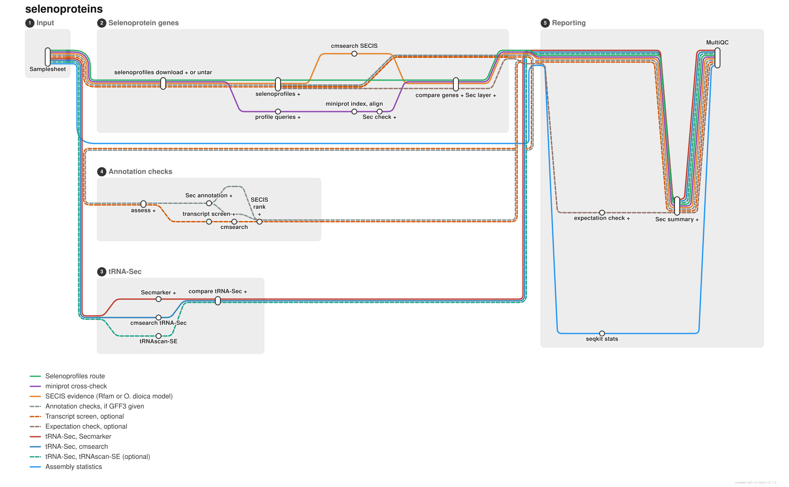

Figure PIPELINE (`figures/pipeline_metro.svg`, copied from `docs/images/selenoproteins_metro.svg` of the pipeline
repository). Tube map of the pipeline: input samplesheet; selenoprotein genes (Selenoprofiles, miniprot cross-check,
SECIS search); tRNA-Sec genes (Secmarker, cmsearch, optionally tRNAscan-SE); annotation checks when a GFF3 annotation
is given, with the optional transcript screen; reporting (assembly statistics, selenocysteine summary, optional
expectation check, MultiQC). Dashed lines, optional routes.

The pipeline's test runs every process on three small genomes. On human chromosome 22, it predicted selenoprotein O
(SELENOO) with its selenocysteine codon, found by both Selenoprofiles and miniprot, supported by a transcript and
correctly annotated in a test annotation; in the yeast genome, which has no selenoprotein, it predicted none.
Chromosome 22 carries no tRNA-Sec gene. The SECIS element of human SELENOO scored only 16 bits with the Rfam model,
below its gathering threshold of 35 bits; the test therefore lowers the threshold to 15 bits so that the SECIS search
is exercised.

## Default settings miss part of the selenoproteome of *O. dioica*

We ran the pipeline with its default settings on the three *O. dioica* assemblies and the genomes of six other
appendicularians, and compared its predictions with a baseline of 18 selenoprotein genes curated in each
*O. dioica* assembly (Methods). The pipeline found 13 of the 18 selenocysteine codons in OKI2018, 14 in OSKA2016 and 13
in OdB3, nearly all through Selenoprofiles; miniprot found 6, 6 and 3. Transcripts supported almost all the codons
found (13 of 13, 14 of 14 and 12 of 13). Two genes were missed in all three assemblies: selenoprotein K (SELENOK), and
SEPHS2, which Selenoprofiles predicted but without calling its selenocysteine codon. Other genes were missed in one or
two assemblies, for reasons that include assembly gaps. No SECIS element reached the gathering threshold in any of the
nine genomes (see below), whereas tRNA-Sec was found, by both methods, in every genome.

The public annotations represent these genes poorly. Of the selenocysteine codons predicted by Selenoprofiles, 5 of 12
fall in a correctly annotated coding sequence in the RefSeq annotation of OKI2018, none of 14 in the OSKA2016
annotation and none of 21 in the OdB3 annotation; in the other cases, the annotated coding sequence ends at the codon,
skips it, lies on one side of it or is absent.

With the same settings, the pipeline performed as expected on vertebrates, from which its tools were mostly built. It
predicted 30 selenoprotein genes in human and in mouse and 47 in zebrafish, found the complete machinery in all
three, and 27 of 34, 24 of 36 and 47 of 50 of the selenocysteine codons that it checked fell in correctly annotated
coding sequences of their RefSeq annotations. In other tunicates, it predicted 16 to 25 selenoprotein genes per
genome, including 19 in *Ciona robusta*, the number reported for this genome [@Jiang2010], and the machinery genes,
including PSTK and SECp43. In the three *Ciona* species, SEPHS2 was predicted with a residue other than
selenocysteine, consistent with its alternative isoform that does not carry selenocysteine [@Mariotti2015]. The Rfam
SECIS model was strict even in vertebrates: it supported 12 of the 30 predictions in human and in mouse and 10 of 47
in zebrafish, against 0 to 2 per genome in the other tunicates and none in appendicularians. Results on the
appendicularians were identical between two releases of the pipeline (0.1.2 and 0.2.0).

## Appendicularian profiles recover the selenocysteine machinery

With the standard profiles, Selenoprofiles did not find PSTK in any of the three *O. dioica* assemblies, although its
transcripts are expressed, and did not call the selenocysteine codon of SEPHS2. We therefore extended each profile of
the machinery set with appendicularian proteins: the predictions of the standard profiles in the appendicularian
genomes, and the PSTK and SEPHS2 proteins reconstructed from *O. dioica* transcripts (Methods). The OdB3 assembly
contributed no sequence and served as a test. With these profiles, the machinery was found in every *O. dioica*
assembly, including PSTK, whose predicted gene models in OKI2018 and OdB3 match the curated ones, and SEPHS2 with its
selenocysteine codon (Table MACHINERY). In the fragmented assemblies of *O. longicauda*, *B. stygius* and *M.
erythrocephalus*, PSTK was predicted only as fragments, which Selenoprofiles discards but which match the PSTK of
other appendicularians more closely than its relative KTI12. A search of each genome with the PSTK proteins of the
other genomes (tblastn), followed by a comparison with KTI12, supported the loci of *O. longicauda* and *M.
erythrocephalus* (38 and 50 bits closer to PSTK than to KTI12) and the PSTK transcripts of the three *O. dioica*
transcriptomes (66 to 84 bits), and left that of *B. stygius* ambiguous (24 bits), like the divergent PSTK of *O.
vanhoeffeni* (13 bits); in *F. borealis* it found no PSTK-like sequence at all, so that the gene may be missing from
that assembly. SEPHS2 was predicted with its selenocysteine codon in seven of the nine genomes; it was not found in
*B. stygius* and only partially in *M. erythrocephalus*. SecS (SEPSECS), eEFSec (EEFSEC), a SECIS-binding protein
and tRNA-Sec were found in every genome; the SECIS-binding protein is a co-ortholog of vertebrate SECISBP2 and
SECIS-binding protein 2-like (SECISBP2L), as shown below. Selenoprofiles also searches for SECp43 (TRNAU1AP), which binds
tRNA-Sec in complexes with SecS and SEPHS2 [@SmallHoward2006] but is an associated factor whose role is debated:
selenoprotein synthesis did not depend on it in mouse liver and neurons [@Mahdi2015], whereas it enhanced the
translation of several selenoproteins in glioblastoma stem cells [@Zhang2026]. We therefore report it separately.
SECp43 was found only in *F. borealis*, whereas the standard profile found it in all other tunicates and in the
vertebrates. The same search, applied to the eight oikopleurid genomes and the three *O. dioica* transcriptomes,
found only proteins at most 6 bits closer to SECp43 than to TIA1-like RNA-binding proteins, whereas the SECp43
proteins of the other genomes were 65 to 434 bits closer, and it recovered the SECp43 of *F. borealis* (Methods).
SECp43 is therefore absent from the Oikopleuridae, and was most parsimoniously lost in their ancestor.

## Orthology of the machinery genes

> **Provisional section (2026-10-22).** Draft written from the results at commit 806e317, after curation of the
> sequence sets (`results/tables/stage2_machinery_rbh.tsv`, `results/trees/`, `results/tables/stage2_machinery_lba.tsv`);
> domain analysis from `results/tables/stage2_machinery_domains.tsv` and `stage2_machinery_domain_conflicts.tsv`
> (and their `_pmsf` versions, 2026-10-23); other tunicates from `results/tables/stage1_machinery_rbh.tsv`.
> Numbers, figure and table numbers, and wording are to be checked before submission.

Selenoprofiles predicts homologs of its profile families, not necessarily orthologs of the named human genes. We
therefore compared each appendicularian machinery protein with the human proteome (reciprocal best hits; Methods;
Table MACHINERY).
SecS proteins were reciprocal best hits of human SEPSECS in all nine genomes, and eEFSec proteins of human EEFSEC in
seven; in the fragmented assemblies of *B. stygius* and *M. erythrocephalus*, the human protein matched another locus
better. The SECp43 of *F. borealis* was a reciprocal best hit of TRNAU1AP. Best hits did not assign the three other
genes. The PSTK proteins of *O. dioica* and *O. albicans* had no hit in the human proteome, and that of
*O. vanhoeffeni* scored 48 bits, whereas the PSTK predicted with the standard profile in each of the ten other
tunicates was a reciprocal best hit of human PSTK (55 to 108 bits). The SECIS-binding proteins of all nine genomes
were closer to human SECISBP2L than to SECISBP2, by 2 to 38 bits, as were those of nine of the ten other tunicates and
of the two amphioxus species; the *Halocynthia roretzi* protein was closer to SECISBP2 by 1 bit. The selenocysteine SEPHS hit human SEPHS1 and SEPHS2
within 9 bits of each other; best hits do not separate these paralogs outside mammals [@Mariotti2015].

For these three families, we built maximum-likelihood trees that include the proteins they must be told apart from:
the related kinase KTI12 for PSTK, the SPS1- and SPS2-type proteins of Mariotti et al. [-@Mariotti2015] for SEPHS,
and human SECISBP2 and SECISBP2L for the SECIS-binding proteins (Methods). To place the appendicularians among
tunicates, the trees include ten other tunicates, seven ascidians and three salps, and two amphioxus species.
Appendicularian proteins evolve fast, those of *O. dioica* about twice as fast as those of *Ciona* [@Berna2012],
which exposes their position in trees to long-branch attraction [@Bergsten2005]. We therefore reanalysed each tree
under a site-heterogeneous model (LG+C60 with posterior mean site frequencies, PMSF) [@Wang2017], after removing the
fastest-evolving sites, and with approximately unbiased (AU) tests of alternative positions (Table LBA). Figure TREES
shows the PMSF trees.

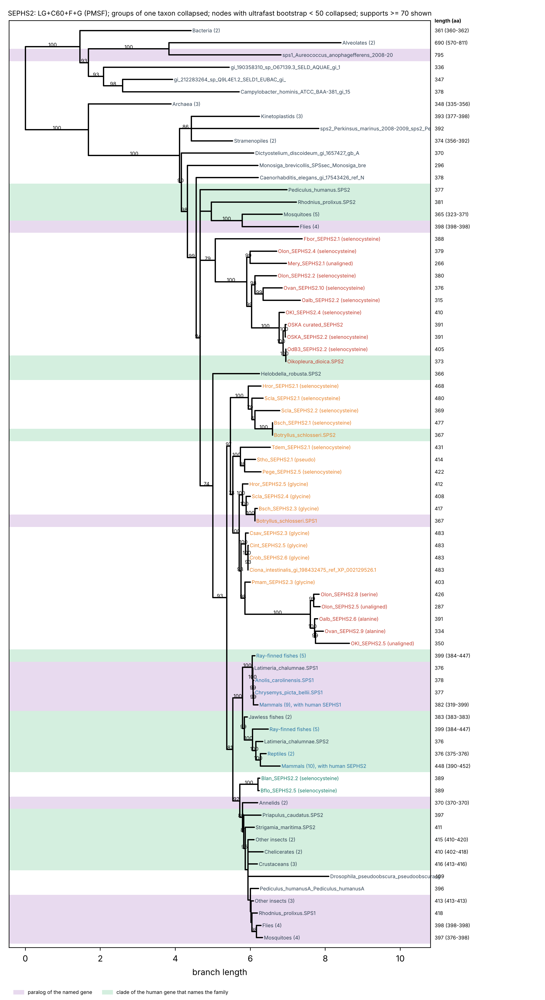
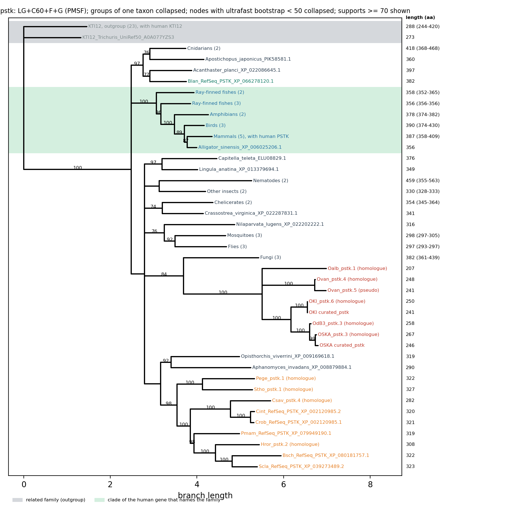
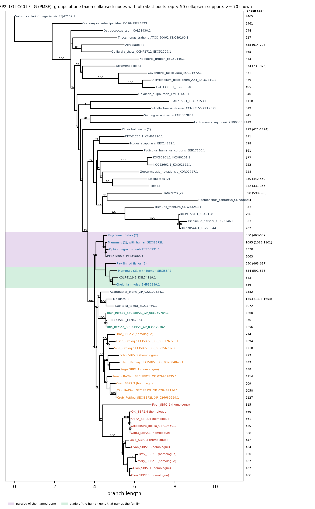

Figure TREES (`figures/phylogeny_<family>_collapsed_pmsf.pdf`). Trees of SEPHS, PSTK and the SECIS-binding proteins
under LG+C60+F+G with posterior mean site frequencies, with 1,000 ultrafast bootstrap replicates; clades collapsed by
taxonomic group (Methods).

The appendicularian PSTK are PSTK and not KTI12: the two families separated with 100% support in every analysis.
The appendicularian proteins (*O. dioica*, *O. albicans* and *O. vanhoeffeni*; the fragments of the other genomes were
left out) formed a clade (100%), apart from the other tunicates, which formed their own clade (97 to 100%). In every
analysis but one, the appendicularian clade grouped with the PSTK of the insect-gut fungi *Smittium* and
*Zancudomyces*, which also lie on long branches (56% in the maximum-likelihood tree, 84% with PMSF, 60 to 77% after
site removal); without these fungi, it branched as the sister of all other PSTK (94%). Two long branches grouped
together is the pattern expected from long-branch attraction. A tree grouping the appendicularians with the other
tunicates was not rejected (AU test, p = 0.27). The position of the appendicularian PSTK within the family is
therefore unresolved.

The SECIS-binding proteins of the eight oikopleurid genomes formed a clade in every analysis (99 to 100%), which the
*F. borealis* protein joined in all but one (47 to 77%). This appendicularian clade grouped with the SECIS-binding
proteins of the other tunicates in the maximum-likelihood tree (70%) and under PMSF (93%), and when 10 to 30% of the
fastest sites were removed (53 to 68%); with 40% removed, the oikopleurid proteins still grouped with the other
tunicates (76%), and the *F. borealis* protein moved next to a nematode protein. In every tree, vertebrate SECISBP2
and SECISBP2L formed one clade (79 to 98%) that excluded the tunicate and amphioxus proteins. This agrees with the
origin of the two vertebrate paralogs by a duplication in early vertebrates, SECISBP2L-type proteins being the only
SECIS-binding proteins of invertebrate deuterostomes [@Donovan2009]. The appendicularian protein is thus the
ortholog of the single tunicate SECIS-binding protein, a co-ortholog of vertebrate SECISBP2 and SECISBP2L, which
explains its best hits to SECISBP2L. Vertebrate SECISBP2L also supports selenoprotein synthesis: zebrafish embryos
without Sbp2 still make a subset of selenoproteins, and only the loss of both genes abolishes their synthesis
[@Kiledjian2022], and selenoprotein synthesis that depends on SECISBP2L is required for oligodendrocyte
differentiation [@Dai2022].

Appendicularians have two SEPHS genes. The second copy, found in OKI2018, *O. longicauda*, *O. albicans* and
*O. vanhoeffeni*, carries a residue other than selenocysteine (alanine or serine where aligned). In every analysis it
fell inside the glycine forms of the other tunicates (75 to 99%), next to the *Phallusia mammillata* protein in the
maximum-likelihood tree and under PMSF (79 and 95%); these glycine forms include the *Botryllus schlosseri* protein
labelled SPS1 by Mariotti et al. [-@Mariotti2015]. The tunicate SEPHS other than the appendicularian
selenocysteine copies formed a clade in every analysis (82 to 95%): the duplication that produced the selenocysteine
and glycine forms of tunicates therefore preceded the divergence of appendicularians. The selenocysteine SEPHS2 of
the seven oikopleurid genomes formed a clade in every analysis (100%), which the *F. borealis* protein joined only
under C20 and PMSF (83 and 76%). Its position was unstable: at the base of the animal SEPHS under C20 and PMSF
(support of the parent node 39 and 56%), and outside a group that includes kinetoplastid, stramenopile and
amoebozoan proteins in the maximum-likelihood tree and in every site-removal analysis. AU tests rejected its
placement inside the clade of all tunicate SEPHS (p = 0.011 under the maximum-likelihood model, 0.0045 under PMSF)
and next to the selenocysteine copies of the other tunicates (p = 0.0047 and 0.0009). Neither composition nor branch
length explained the rejection: no SEPHS failed the composition test, and the second appendicularian copy, placed
consistently, has the longer path (2.5 against 1.3 substitutions per site from the common ancestor of tunicate and
vertebrate SEPHS). The appendicularian selenocysteine SEPHS2 is thus either a divergent ortholog of the tunicate
selenocysteine copy whose signal these models do not recover, or a separate SEPHS2 lineage. In both cases it is a
selenocysteine SEPHS2, by the residue at its catalytic site [@Mariotti2015].

To test whether these positions are supported along the whole protein, we split each alignment in two at a domain
boundary of the human protein and analysed each part on the same sequences (Methods; Table DOMAINS). In each family,
the data of each part rejected the tree of the other part (AU test, p ≤ 0.0023), but the differences lay in weakly
supported nodes: no clade with 95% support or more in one tree was incompatible with a clade so supported in the
other, except for arrangements within appendicularians, other tunicates, amniotes, cephalochordates or nematodes, and
among the prokaryotic and alveolate SEPHS near the root (Table DOMAINS). For PSTK, the appendicularian clade was recovered from the
kinase domain (100%) and from the C-terminal region (97%), without the insect-gut fungi, and its position remained
unresolved: sister to all other PSTK in the kinase tree (57%), next to dipteran PSTK in the C-terminal tree (54%).
Neither part rejected a grouping with the other tunicates (p = 0.44 and 0.32). Under PMSF, the clade fell next to
the insect-gut fungi in the kinase tree (42%) and next to fly, *Trichinella* and *Aphanomyces* proteins in the
C-terminal tree (70%), and the grouping with the other tunicates was still not rejected (p = 0.64 and
0.30). For the SECIS-binding proteins, the
L7Ae domain reproduced the full-length result: oikopleurid proteins with those of the other tunicates (81%), and
vertebrate SECISBP2 and SECISBP2L in one clade that excluded them (95%). The region upstream of the L7Ae domain
placed the oikopleurid proteins next to vertebrate SECISBP2, in a group with the other tunicate proteins (67% and
67%). Neither part rejected the grouping of appendicularians with the other tunicates (p = 0.38 and 0.49); the short
*F. borealis* protein (315 residues) fell elsewhere in both trees. Under PMSF, the L7Ae domain grouped the
oikopleurid proteins with those of the other tunicates more strongly (91%; vertebrate clade 96%), and neither part
rejected the grouping (p = 0.38 and 0.51). For SEPHS, under the selected model, the N-terminal half rejected none of
the tested positions of the appendicularian selenocysteine clade (with the tunicate selenocysteine copies, p = 0.45;
inside the clade of all tunicate SEPHS, p = 0.33; at the position of an ortholog, p = 0.19), whereas the C-terminal
half rejected the position of an ortholog (p = 0.0034; p = 0.08 for the other two). The N-terminal tree, however,
grouped both appendicularian copies with the SPS2 of dipterans and of the louse *Pediculus humanus* (84%; the second
copy with these insect proteins, 94%), whereas in the C-terminal tree the second copy fell inside the tunicate
glycine forms (77 and 83%) and the insect proteins grouped with *Rhodnius prolixus* SPS2 (100%). This was the only
conflict supported by 90% or more that involved the position of an appendicularian protein under that model. Under
PMSF, this grouping disappeared: the second copy fell next to the tunicate glycine forms in both halves (39 to 65%),
and both halves rejected the position of an ortholog for the selenocysteine clade (p = 0.016 and 0.011), but not its
placement inside the clade of all tunicate SEPHS (p = 0.22 and 0.071). The only strongly supported conflict between
the PMSF trees concerned the other tunicates: the C-terminal half grouped all tunicate SEPHS, with the second
appendicularian copy, with the vertebrate proteins (95%), whereas the N-terminal half grouped the vertebrate
proteins with those of amphioxus and protostomes (95%). The non-rejection of orthology by the N-terminal half under
the selected model thus came with a grouping that the site-heterogeneous model does not support, and under that
model both halves reject the position of an ortholog, as the full-length alignment does.

| Gene | Orthology | *O. dioica* OKI2018 | *O. dioica* OSKA2016 | *O. dioica* OdB3 | *O. longicauda* | *O. albicans* | *O. vanhoeffeni* | *B. stygius* | *M. erythrocephalus* | *F. borealis* |
|---|---|---|---|---|---|---|---|---|---|---|
| tRNA-Sec | not tested (RNA gene) | found | found | found | found (4 loci) | found (2 loci) | found (2 loci) | found | found (2 loci) | found |
| SEPHS2 | selenocysteine at the catalytic site; outside the tunicate SEPHS in the trees (AU p at most 0.011) | selenocysteine | selenocysteine | selenocysteine | selenocysteine | selenocysteine | selenocysteine | not found | partial | selenocysteine |
| SEPHS, second copy | ortholog of the tunicate glycine form (75 to 99%) | found | not found | not found | found | found | found | not found | not found | not found |
| PSTK | PSTK, not KTI12 (100%); position within PSTK unresolved (AU p = 0.27) | found | found | found | fragment | found | found | fragment | fragment | not found |
| SEPSECS | reciprocal best hit in all nine genomes | found | found | found | found | found | found | found | found | found |
| EEFSEC | reciprocal best hit; best hit only in *B. stygius* and *M. erythrocephalus* | found | found | found | found | found | found | found | found | found |
| SECISBP2/SECISBP2L | co-ortholog of SECISBP2 and SECISBP2L; with the other tunicates (70%, C60 93%) | found | found | found | found | found | found | found | found | found |
| TRNAU1AP (associated factor) | reciprocal best hit (*F. borealis*) | not found | not found | not found | not found | not found | not found | not found | not found | found |

<!-- Table generated by stage2/machinery_table.py (make machinery-table; results/tables/stage2_machinery_table.md),
from the census, the reciprocal best hits and the long-branch analyses; the orthology column is provisional. -->

Table MACHINERY. Selenocysteine machinery, and the associated factor SECp43, found with the appendicularian profiles,
with the evidence for their orthology. "Selenocysteine": SEPHS2 predicted with its selenocysteine codon; "found":
predicted; "partial": predicted only with an in-frame stop codon or frameshift, or without alignment at the
selenocysteine position; "fragment": discarded by Selenoprofiles but supported by similarity (Methods); "not found":
no prediction; for tRNA-Sec, loci found by both methods. The second SEPHS copy carries a residue other than
selenocysteine. Orthology: reciprocal best hits against the human proteome, or the maximum-likelihood trees and their
long-branch analyses, with bootstrap supports or AU tests (see text); this column is provisional. Several copies in
an assembly may reflect duplicated haplotypes or contamination [@Pichon2019].

<!-- Provisional section, notes:
- Figure TREES: figures/phylogeny_<family>_collapsed_pmsf.{png,pdf} (make machinery-lba-figures); supplementary
  figures: the maximum-likelihood trees, collapsed (figures/phylogeny_<family>_collapsed.*) and full
  (figures/phylogeny_<family>.*). Table LBA: results/tables/stage2_machinery_lba.tsv.
- Domain analysis (2026-10-22, local run, make machinery-domains): Table DOMAINS from
  results/tables/stage2_machinery_domains.tsv and stage2_machinery_domain_conflicts.tsv; supplementary figures
  figures/phylogeny_<family>_collapsed_domain_<domain>.pdf (make machinery-domain-figures). Supports quoted in the
  text that are not in the tables (57, 54, 67, 81, 84, 94, 77, 83%) were read from the domain trees in
  results/trees/domains/. PMSF versions (2026-10-23, Deigo, make machinery-domains-pmsf):
  results/tables/stage2_machinery_domains_pmsf.tsv, stage2_machinery_domain_conflicts_pmsf.tsv and
  figures/phylogeny_<family>_collapsed_domain_<domain>_pmsf.pdf; supports quoted (42, 70, 91, 96, 39 to 65%) read
  from results/trees/domains/*.pmsf.treefile.
- Reciprocal best hits of the other tunicates: results/tables/stage1_machinery_rbh.tsv (regenerated 2026-10-23,
  make machinery-rbh); the stage 1 predictions of the standard profiles. SEPHS of the other tunicates: best hit SEPHS1
  for most copies, SEPHS2 within 5 bits for the selenocysteine copies of B. schlosseri and S. clava.
- The second SEPHS copy was not found in OSKA2016 and OdB3: to check (assembly or prediction).
- Decision of 2026-10-24 (docs/plan.md): B. stygius, M. erythrocephalus and F. borealis are held out of stage 2 and
  used at the end for the census; at the next rerun, the statements of this section that rely on them (SECp43 loss,
  PSTK fragments, their columns in Table MACHINERY) move to the census section. Bacterial-like sequences: one strict
  HGT screen at the end (no false positive; contamination is the default explanation).
-->

## The Rfam SECIS model does not separate appendicularian SECIS elements from genomic background

In stage 1, no SECIS element reached the Rfam gathering threshold (35 bits) downstream of any selenoprotein gene
predicted in the nine genomes. To see whether the threshold alone was too strict, we scored with the same model,
without threshold, the 3′ sequences of all Selenoprofiles predictions and, as background, 200 random genomic windows
of the same length per genome (Figure SECIS-1). Predictions fall into two groups: 143 with a selenocysteine codon (below, selenocysteine
predictions), and 578 others. The others are mostly homologs with cysteine at the selenocysteine position (375, of which 235 in the EhSEP2 family),
predictions whose alignment does not cover the selenocysteine position of their profile (122, labelled "unaligned"), homologs of
selenocysteine machinery proteins that are not selenoproteins (40, such as eEFSec and SECIS-binding proteins), and predictions
with another amino acid or a stop codon at the selenocysteine position (41).

Of the 143 3′ sequences that follow predictions with a selenocysteine codon, 96 (67%) had no hit at all, even when every hit
of at least 0 bits was reported. This was not caused by fragmented assemblies separating coding sequences from their UTRs: in the
chromosome-scale assembly OKI2018, 5 of 12 had no hit. The remaining 47 scored from 12 to
31 bits; 18 reached 20 bits, and none reached the threshold. Random windows rarely had a hit (45 of 1,800), but those
hits reached 22.6 bits. Lowering the threshold to 20 bits would therefore have recovered at most four SECIS elements
per genome while accepting background hits, and most selenoprotein 3′ sequences would still have no hit. The Rfam
model does not recognise most appendicularian SECIS elements, rather than recognising them below its threshold.

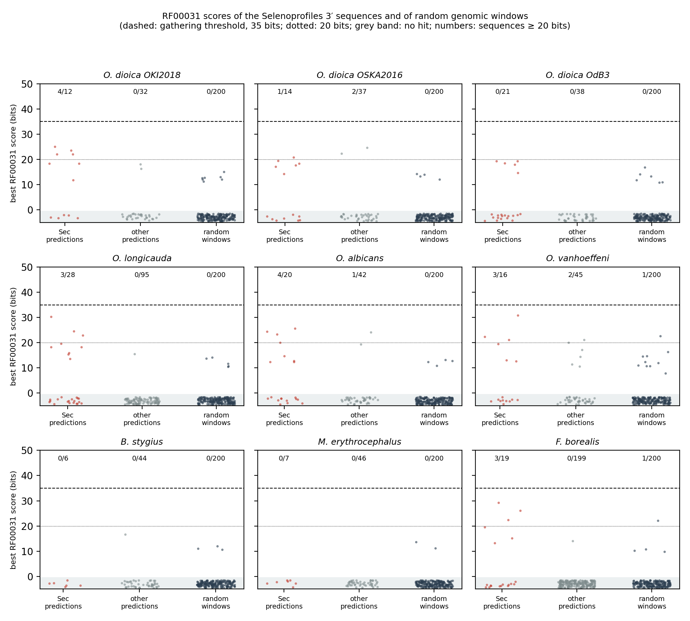

Figure SECIS-1 (`figures/stage1_secis_scores.pdf`). RF00031 scores of the 3′ sequences that Selenoprofiles writes after
each prediction, for the selenocysteine predictions and the other predictions, and of 200 random genomic windows of
the same length per genome, in the nine appendicularian genomes (best score per sequence; grey band, no hit of 0 bits
or more). Dashed line, gathering threshold (35 bits); dotted line, 20 bits; numbers, sequences of at least 20 bits.

> **Provisional paragraph (2026-10-24, step 1 of the plan in docs/plan.md; `results/tables/stage2_secis_hits*.tsv`,
> `make secis-hits`).** Restricted to the validated hits of the six *Oikopleura* assemblies; it is to replace the two
> paragraphs above, which count all predictions of the nine genomes (decision of 2026-10-24 on the genome sets).

Restricted to the hits that the orthology analysis supports, the result is the same. In the six *Oikopleura*
assemblies, the first round of hit validation gave no evidence against any of the 111 predictions with a
selenocysteine codon: each has its best human hit in its family or in a related gene (MIEN1 for the chr2-type
SELENOW, SEPHS1 for SEPHS2), or no hit, and none has bacterial or fungal nearest relatives in the tree of its family
(Methods). Fourteen of them lie less than 500 nucleotides from the end of their contig (11 in *O. longicauda*),
which leaves no room for a SECIS element. With RF00031, 41 of the 111 3′ sequences had a hit, 15 reached 20 bits and
4 reached 25 bits, whereas the best random window of each genome scored 13.2 to 22.6 bits and no cysteine homolog of
these genomes reached 20 bits. Hits of 20 bits or more followed SELENOW (5 of 30 predictions), GPX (4 of 39), DIO
(2 of 22), SEPHS2 (2 of 3), SELENOF (1 of 7) and TXNRD (1 of 5) predictions, and none of the SELENOO (2), SELENOS (1),
SELENOT (1) and MsrA (1) predictions.

## Gold-standard gene models in three *O. dioica* assemblies

> **Provisional section (2026-10-24, step 2 of the plan in docs/plan.md; `results/tables/gold_standard.tsv`,
> `curation/gold_standard/`, `make gold-standard`; 20 genes since 2026-10-26).**

To train SECIS models and appendicularian profiles on reliable sequences, we built a gene model for each curated
selenocysteine codon of the three *O. dioica* assemblies, from their transcripts, their public annotations and the
stage 1 predictions (Methods; Figure REANNOTATION). The genes are the 18 genes of known selenoprotein families and
two genes found by the screens described below, TXNL1.b and KKSU (Figure CANDIDATES). Of the 60 codons (20 genes in
each assembly), 59 received a model; the exception is OdB3 SELENOO, whose exon with the selenocysteine codon is not
in the assembly. All 59 models are
complete, from an ATG to a stop codon, through the selenocysteine. All but one are supported by transcripts; OdB3
GPX_chr1a, without transcript, joins the two GenBank models that split the gene at the selenocysteine codon, and its
protein then aligns to the other assemblies along its whole length. Fifty-seven models have a 3′ UTR from transcripts
(median 303 nucleotides, from 4 to 695).

In six genes the assembly does not encode the protein of the transcripts, because it lacks or adds bases in the
coding sequence: SELENOS (13 nucleotides absent from the assembly), SELENOO (5 nucleotides) and DIO_chr1 (a
frameshift in its 3′ part) in OKI2018, SELENOW_PAR (2 nucleotides) in OSKA2016, and DIO_PAR and GPX_PAR (1
nucleotide added in the assembly) in OdB3. In each case the transcript protein is more similar to the same gene in
the other assemblies than the protein encoded by the assembly, or much longer (OKI2018 SELENOO, whose assembly frame
gives only the last 70 residues); in OKI2018 DIO_chr1, for example, the assembly frame ends in a C-terminus
unrelated to the other assemblies, whereas the transcript protein ends, as they do, in the sequence VEYVGGPGPFGYDL.
For these genes, the gold standard gives the transcript protein and a model mapped from the transcript.

The 184 introns of the models include 19 GA-AG, 7 GC-AG and 1 GG-AG introns (14.7%), against 12.4% of non-GT-AG
introns in the *O. dioica* reference annotation [@Denoeud2010; @Frey2020]. DIO_PAR, SELENOT, SELENOW_chr2 and TXNRD
have a GA-AG intron in each of the three assemblies. The nine splice sites of other types lie in five models: OKI2018
SELENOO (4 sites) and DIO_chr1 (1 site), mapped from transcripts onto an assembly that lacks bases, where they mark
the alignment around the missing bases (RefSeq places GT-AG or GA-AG introns a few nucleotides away in SELENOO),
OSKA2016 SELENOO (2 sites), and OKI2018 GPX_chr1a and OSKA2016 GPX_chr1b (1 site each).

The public annotations rarely give the selenoproteins (Figures REANNOTATION and CANDIDATES). Of the 59 models, three have the
selenocysteine declared by the public annotation, all in RefSeq (OKI2018 DIO_PAR, GPX_PAR and SELENOF), and in DIO_PAR one intron lies 11
nucleotides away from the GA-AG intron supported by the transcripts. In two more RefSeq models (GPX_chr1a and
GPX_chr2) the codon is in the frame of the coding sequence but translated as X. Elsewhere the codon is read as a stop
codon that ends the coding sequence (17 models: 3 in OKI2018, 5 in OSKA2016, 9 in OdB3), skipped in an intron of
the coding sequence (12 models, 10 of them in OSKA2016), read in another frame (OdB3 GPX_PAR and SEPHS2, where the
coding sequence starts near the codon in another frame), or the coding sequence starts after it (9 models; 5 in
OKI2018, where it starts at an internal ATG of the right exon chain in GPX_chr1b, SELENOT, SELENOW_chr2 and SEPHS2)
or ends before it (3 models, among them OKI2018 SELENOS, whose frame is lost where the assembly lacks 13 bases).
Eleven have no annotated coding sequence at all (SELENOK, SELENOW_PAR, SELENOW_chr1a, the two SELENOW genes of the
chr1 pair and KKSU in OKI2018; SELENOK and SELENOW_PAR in OSKA2016; SELENOW_PAR, SELENOW_chr1a and SELENOW_pair2 in
OdB3). SELENOW_PAR in OKI2018 and OdB3, and the SELENOW pair and KKSU in OKI2018, lie in the 3′ UTR of the annotated mRNA of
another protein, as expected from genes of an operon whose mRNAs are separated by trans-splicing (in OKI2018,
one transcript also holds both genes of the pair; Methods); OSKA2016
SELENOW_chr2 is also known from a transcript that reads through into the next gene. The annotations also join or
split genes at the selenocysteine codon: the OdB3 annotation splits five genes there into two or three models
(DIO_PAR, DIO_chr1, GPX_chr1a, GPX_chr1b and SELENOS), and the OSKA2016 annotation joins SEPHS2 to the upstream gene
and the two genes of the SELENOW pair into one model, and splits SELENOO into three models.

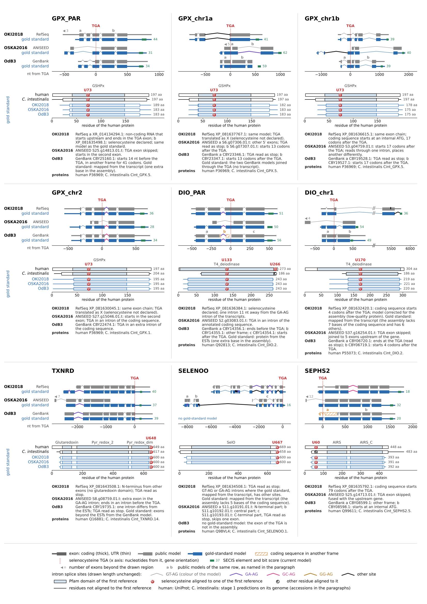
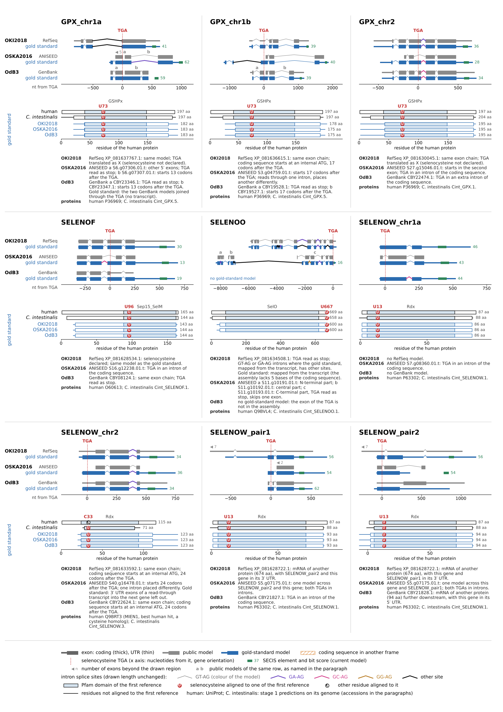

Figure REANNOTATION (two pages, `figures/reannotation_page.pdf` and `figures/reannotation_page2.pdf`). Reannotation of
the 18 selenoprotein genes in three *O. dioica* assemblies, grouped by family (page 1: glutathione peroxidases,
deiodinases, thioredoxin reductase, SELENOO and SEPHS2; page 2: the Rdx family, SELENOW paralogs and SELENOT, then
SELENOF, SELENOK and SELENOS). For each gene, top: in each assembly, the public models
(grey; RefSeq for OKI2018, ANISEED for OSKA2016, GenBank for OdB3) above the gold-standard model (blue), in gene
orientation, positioned by their distance in nucleotides to the selenocysteine TGA (dashed red line); thick boxes,
coding exons; thin boxes, untranslated exons; coloured introns, splice sites other than GT-AG (drawn length
unchanged); hatched boxes, coding sequences in another frame than the gold standard; green boxes, best hit of the
*Oikopleura* SECIS model in the 2,000 nucleotides after the stop codon, shortened at the next selenoprotein coding
sequence, with its bit score (open boxes would mark hits below 20 bits; there are none); stretches of more than 1,500 nucleotides without exon are shortened (break marks). Middle: the human
protein (UniProt), the *Ciona intestinalis* protein (stage 1 prediction on its genome) and the three gold-standard
proteins, placed on the coordinates of the human protein by local alignment (those of OSKA2016 and OdB3 through the
OKI2018 protein), with the Pfam domains of the human protein and the residues aligned to its selenocysteine; lines,
residues outside the aligned part; right column, percentage of residues similar to the OdB3 protein (BLOSUM62 score
above 0, selenocysteine read as cysteine), over the aligned part of a global alignment with free end gaps, internal
gaps counted as differences (OdB3, the first published assembly, is the reference because OKI2018 is the outgroup of
the three: similarity to OKI2018 would not show the shortest distances; no value for SELENOO, which has no OdB3
model). Bottom: the public models of each assembly and what distinguishes them from the
gold standard, notes on the gold-standard models, and the accessions of the reference proteins.

## An *Oikopleura* SECIS model trained on the gold-standard genes

A first appendicularian model, built by bootstrap from RF00031 on the 3′ sequences of stage 1 predictions in seven
oikopleurid genomes (Methods), gave at least 25 bits to 42 of the 53 gold-standard *O. dioica* models of the 18
known genes. Its
evaluation was not independent: its training sequences included those of OKI2018 and OdB3, whose SECIS elements are
near-identical to those of OSKA2016, and it scored the 6,000 nucleotides after the selenocysteine codon rather than
the 3′ region of each gene. We therefore trained a second model in the same way on the gene models of the previous
section and evaluated it on families and species left out of training (Methods).

The positive windows were the 2,000 nucleotides after the stop codon of the 53 gold-standard models of the 18 known
genes (TXNL1.b and KKSU joined the gold standard after the screens below) and of 58
selenocysteine predictions of *O. longicauda* (22), *O. albicans* (20) and *O. vanhoeffeni* (16), shortened at the
next selenoprotein coding sequence on the same strand (SELENOW_pair2, before SELENOW_pair1, in the three *O. dioica*
assemblies) or at a contig end (20 windows of the three other species). The negative windows were random windows of
the six assemblies and of four non-target tunicates (*Ciona intestinalis*, *Ciona savignyi*, *Styela clava* and
*Thalia democratica*), drawn away from the positive windows; the positive windows shuffled with their dinucleotide
composition preserved; and the windows after the stop codons of 180 cysteine homologs.

In the four species folds, where the windows of one species were left out of training (the three *O. dioica*
assemblies together), the model detected 84 of the 111 left-out windows above its training threshold (the best score
of the training random windows, 19.6 to 21.6 bits), all of them also above the best evaluation negative of their
fold. Three evaluation negatives passed the training threshold (0.32 per Mb), all random windows of non-target
tunicates (21.6 to 23.1 bits). Of the 53 *O. dioica* windows, 49 were detected, and no negative passed the
threshold (19.7 bits); the four below it are SELENOO in OKI2018 and OSKA2016, and GPX_PAR and SELENOF in OSKA2016.
Sixty-four left-out windows scored at least 25 bits and 43 at least 30 bits. Of the 27 windows not detected, 19 had
no hit with any of the four models compared below, and 9 of these 19 are shortened by a contig end. In the twelve
family folds, the model detected 81 of the 111 windows, with 0.72 negatives per Mb above the training thresholds.
On the same windows and thresholds, RF00031 detected 27 windows in the species folds and 26 in the family folds, and
a model built from the RF00031 seed sequences and the appendicularian seeds of each fold detected 66 and 65 (0.32
and 0.25 negatives per Mb). The first appendicularian model detected 82 in both (0.64 and 0.50 negatives per Mb),
but it had been trained on most of the left-out windows.

The final model, trained on the 111 windows, converged in seven rounds on 76 seeds (18 in OKI2018, 12 in OSKA2016, 9
in OdB3, 20 in *O. longicauda*, 9 in *O. albicans* and 8 in *O. vanhoeffeni*); the best score of the training random
windows was 17.8 bits in the last round, and the consensus is 66 nucleotides long. The seeds start a median of 127
nucleotides after the stop codon (quartiles 67 and 238). The 53 *O. dioica* windows, which are training data for this
model, score 25.6 to 59.1 bits (median 40.4; Figure REANNOTATION). We use this model with a threshold of 20 bits for
SECIS elements in the 3′ windows of genes: at that score, about one evaluation negative window of 2,000 nucleotides
in 1,500 passed in the species folds (3 of 4,691). Scans of whole genomes call for a threshold set on genome-wide background
(Stage 2).

The 76 seeds come from ten families (GPX 23, SELENOW 19, DIO 12, SEPHS2 6, SELENOF 4, TXNRD 4, and 2 each of
SELENOK, SELENOO, SELENOS and SELENOT) and are diverse (Figure SECIS-MODEL B): over the consensus positions, the
median identity between two seeds is 0.45 (quartiles 0.40 and 0.49), and only 25 of the 2,850 pairs reach 0.7, 23 of
them the same gene in two *O. dioica* assemblies (0.72 to 0.91) and two pairs of GPX copies of *O. albicans* and
*O. vanhoeffeni*. Clustered at 0.7, the seeds form 54 groups, the largest of three (the same gene in the three
*O. dioica* assemblies). Training dropped seeds at least 90% identical to another (Methods), so that the absence of
near-identical groups is partly by construction. The model has 66 consensus positions and 18 base pairs in three
helices (Figure SECIS-MODEL A), as RF00031 has 64 and 18. Between helices 1 and 2, all seeds have UGA on the 5′
strand and GA on the 3′ strand of the internal loop, the conserved bases of the non-Watson–Crick pairs that form the
base of helix 2 in mammalian SECIS elements, part of a kink-turn motif [@Walczak1996; @Latreche2009]; between helices 2 and 3, all have AAA, in a loop of five
nucleotides on the 5′ side below helix 3 (three pairs, at least two of them canonical in 72 seeds). The model
gives the motifs most weight (relative entropy of 1.84 to 1.98 bits per position, against a mean of 0.74), and its
pair emissions weigh paired positions more than their conservation in the seeds would (0.80 bits at position 16 of
helix 2, where the seeds carry 0.05 bits of information). This is the
arrangement of form 2 SECIS elements, in which an additional helix lies above the unpaired adenosines
[@GrundnerCulemann1999; @Krol2002]; no seed has its only AAR motif in the apical loop, as form 1 elements have. Since the seeds
were selected through the model, these features describe what the model recognises, not all appendicularian SECIS
elements.

Pairing in the seeds does not by itself show that the structure is conserved, because the alignment to a covariance
model favours complementary bases, even in non-homologous sequences [@Gao2023]. In the seed alignment, 83%, 83% and 94% of the bases of helices 1, 2 and 3 form
canonical pairs (Watson–Crick or G·U), and the mutual information between the two columns of each of the 18 pairs is
above that of permuted columns (q < 0.05; one seed per group of the clustering). The best hits of the model in
dinucleotide-shuffled windows (decoys; 76 hits of 12.6 to 25.2 bits), aligned in the same way, reach 83%, 78% and
88% (Figure SECIS-MODEL C), with mutual information above permutation at 12 of the 18 pairs; they differ more from
the seeds in the motifs: 70, 56 and 21 of the 76 decoys have the UGA, the GA and an AAR motif at those positions. Covariation tests such as R-scape
[@Rivas2017] are meant for homologous sequences aligned independently of the structure; the seeds belong
to different genes and were aligned to the model, as in structure-based alignments of SECIS elements from many
species [@Chapple2009]. The orthologous SECIS elements of the three *O. dioica* assemblies,
aligned by sequence, offer such a test (Methods). In 19 genes, 18 of the 27 single-base changes from a canonical pair
kept a canonical pair, against 29% expected if the new base were random (with the fraction of transitions, 0.39,
observed at the other unpaired positions; binomial p = 5.5 × 10^-5^), and 10 of the 11 changes at both bases of a
canonical pair kept one (expected 43%; p = 0.0015). The motifs did not change in any of the 152 comparisons of their
positions, whereas 18% of the paired positions and 28% of the other unpaired positions differed between assemblies
(Figure SECIS-MODEL D). The base pairs of the model are therefore maintained in the evolution of *O. dioica* SECIS
elements, and the motifs are invariant.

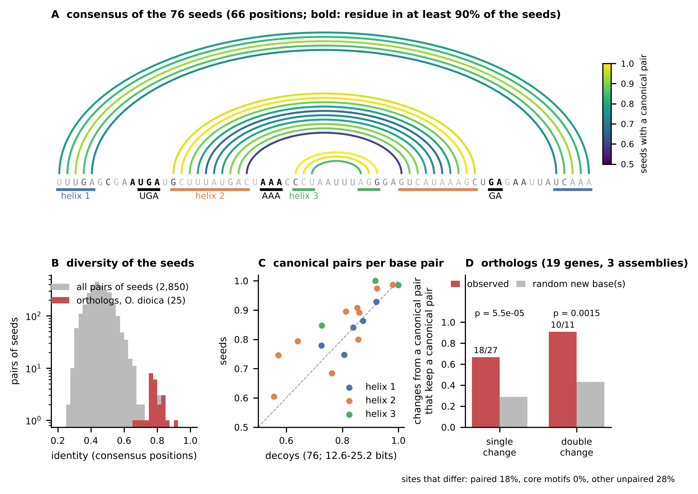

Figure SECIS-MODEL (`figures/secis_model.pdf`). The *Oikopleura* SECIS model. A, consensus structure of the 76 seeds
at the 66 consensus positions: arcs, base pairs, coloured by the fraction of seeds with a canonical pair; sequence
logo of the seeds (information content, bits); relative entropy of the emissions of the model at each position
against its null model (bits; for a base pair, half of the relative entropy of the pair emissions to each position),
coloured by helix, black for the core motifs; bars, helices and motifs. B, identity between two seeds over the
consensus positions, for all pairs of the 76 seeds and for the pairs of orthologs among the 38 *O. dioica* seeds of
17 genes that have one (log scale). C, fraction of canonical pairs at each base pair in the seeds and in decoys (the best hits
of the model in dinucleotide-shuffled windows), aligned to the model in the same way. D, changes between the
orthologous SECIS elements of the three *O. dioica* assemblies at the base pairs of the model: fraction of single and
double changes from a canonical pair that keep a canonical pair, observed and expected for random new bases
(binomial test); below, fraction of positions that differ between the assemblies.

<!-- Figure SECIS-2 shows the first model; to redraw with the new model (held-out scores of
results/tables/stage2_secis_v2_heldout.tsv against the evaluation negatives), or replace by Figure SECIS-MODEL and
Figure SECIS-SCORES. -->

## UGA/SECIS screens outside the known families

> **Provisional section (2026-10-26, step 4 of the plan; `stage2/uga_secis_screen.py`, `make secis-scan` and
> `make uga-screen`; `results/tables/stage2_secis_scan_*.tsv` and `stage2_uga_screen*.tsv`; run of 2026-10-26 with
> the 20 gold-standard genes).**

To look for selenoproteins outside the families known from other organisms, we searched genomes and transcripts for
SECIS elements with the *Oikopleura* model, then for reading frames through a TGA upstream of them (Methods), the
approach that found new selenoproteins in mammals and in *Drosophila* [@Kryukov1999; @Lescure1999; @Castellano2001].

Thresholds for whole genomes were set from shuffled copies of the six *Oikopleura* assemblies, at one expected false
hit per genome: 28 to 29 bits in the *O. dioica* assemblies (113 to 141 Mb, both strands) and 33 bits in the other
*Oikopleura* species (618 to 1,287 Mb). At these thresholds, the scans found 23, 22 and 29 hits in OKI2018, OSKA2016
and OdB3 (0.7 to 0.9 expected false hits), of which 18, 16 and 16 lie at most 3 kb after the coding sequence of one
of the 18 known genes, and two more in each assembly after TXNL1.b and KKSU, described below. In the four non-target tunicates, hits were about as frequent as in their shuffled copies at
each score up to 30 bits (in *C. intestinalis*, 267 against 344 at 15 bits; Figure SECIS-SCORES A), but 9 of their 12
hits at the genome threshold follow a stage 1 selenoprotein prediction: the model recognises some of their SECIS
elements, at scores that background also reaches.

At the genome thresholds, 10 of the 74 hits of the three *O. dioica* assemblies (28.1 to 36.9 bits, where the hits
after selenoprotein genes score 29.0 to 59.1, median 40.4), against 2.4 expected false hits, and 26 of the 64 hits of
the other *Oikopleura* species (33.0 to 49.9 bits; 21 without a gene upstream and 5 after stage 1 predictions without
selenocysteine), against 1.8 expected, follow no selenoprotein gene found by the screens. Searches around them
(Methods; Figure SECIS-SCORES B) explain part of them. Two *O. dioica* hits are copies of the DIO_chr1 SECIS on
additional OdB3 contigs, one of them after the end of a coding sequence identical to OdB3 DIO_chr1, and two lie in
repeated sequences (25 and 53 copies in their assembly). Four belong to one element found in the three assemblies (91
to 96% identity), between the gene of a methionyl-tRNA synthetase (best human hit MARS1) and the TXNL1.b coding
sequence, 0.8 to 1.4 kb upstream of the TXNL1.b codon; one of the hits lies in the 5′ untranslated part of the TXNL1.b
transcript in OSKA2016, and another in an intron of a RefSeq transcript in OKI2018, and no frame through a TGA is
known there. Of the last two, one (OSKA2016 contig S54) is found in the other two assemblies, where it scores 26.5 and
27.0 bits, with no gene within 4 kb upstream, and one (OKI2018 NC_137295.1) has no counterpart in them. In the other
*Oikopleura* species, 8 hits follow, 38 to 1,077 nucleotides before them, a region similar to a gold-standard
selenoprotein (DIO, GPX, SELENOK, SELENOT or SELENOW), including the five after stage 1 predictions without
selenocysteine: copies of known families that stage 1 and the comparative screen missed. One of them, in
*O. longicauda*, lies 69 nucleotides after a region similar to SELENOK whose TGA aligns with the selenocysteine, and
that region follows one similar to CPLANE2, as SELENOK follows a CPLANE2-like gene in *O. dioica*; stage 1 had found
SELENOK in no appendicularian, and the comparative screen in *O. albicans* and *O. vanhoeffeni* only. One more hit lies
in a repeated sequence (19 copies). The four *O. albicans* hits, in two pairs 391 and 411 nucleotides apart, follow a
region similar to the DNA glycosylase OGG1, on two contigs that are probably the two haplotypes of one locus; the 13
others have no protein hit in the 5 kb upstream. In the held-out appendicularians, 5 of the 9 hits without a
selenoprotein gene follow regions similar to GPX, SELENOT or SELENOW (two of them with a stop codon in the aligned
frame). In human and *C. intestinalis*
RefSeq mRNAs, the hits of the *Oikopleura* model above which a frame through a TGA was found score up to 31.5 and
37.3 bits for selenoprotein mRNAs and up to 22.8 and 28.3 bits for the others (Figure SECIS-SCORES C). With RF00031,
the three human mRNAs classed as others above 38 bits are transcripts of GPX1 and DIO1 in which the frame found does
not end at an annotated selenocysteine codon; their hit is the SECIS element of the gene, with the score it has in the
other transcripts of these genes.

<!-- Tables: results/tables/stage2_secis_scan_classes.tsv (classes; evidence) and stage2_secis_orphan_hits.tsv. To
consider: the conserved element between MARS1 and TXNL1.b, and the OSKA2016 S54 element (structure, transcripts). -->

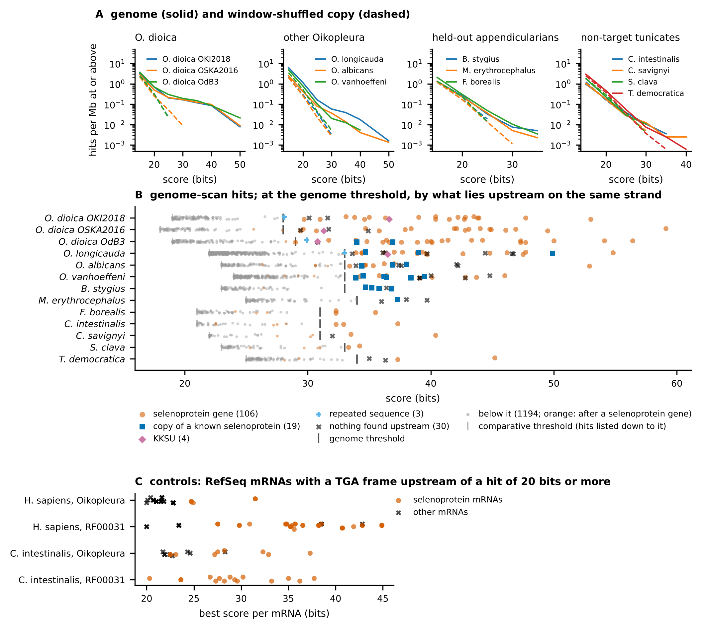

Figure SECIS-SCORES (`figures/secis_scores.pdf`). Scores of the *Oikopleura* SECIS model in genomes and transcripts.
A, hits per megabase (both strands) at or above each score in each genome (solid) and in its copy shuffled in
windows of 1,000 nucleotides (dashed), by group of genomes. B, hits at the genome threshold (grey tick: the score
with one expected false hit in the genome), by what lies upstream on the same strand (colours and symbols; the two
frequent classes drawn partly transparent): a selenoprotein gene (a
gold-standard gene, or a stage 1 selenocysteine prediction for the other genomes), a copy of a known selenoprotein
(found by the comparative screen, by blastx of the 5 kb upstream of the hit against the gold-standard proteins, or by
alignment with the hit of a selenoprotein gene in another assembly), KKSU, a repeated sequence (at least 10 copies of
the hit in the genome), or nothing found by these searches; small symbols, hits below the genome threshold, listed
down to the comparative threshold (light grey tick), orange when they follow a selenoprotein gene. C, controls: best score per RefSeq mRNA among the transcripts with a frame through a TGA upstream of a hit
of 20 bits or more, for human and *C. intestinalis* mRNAs, with the *Oikopleura* model and RF00031.

The transcript screen, on transcript strands with a SECIS hit of 20 bits or more, found the selenocysteine codon of
all 18 known genes in the OKI2018 Trinity transcripts, of 15 in the OSKA2016 transcripts and of 15 of 17 in the OdB3
ESTs. With the public annotations it found 15 (RefSeq), 9 (ANISEED) and 12 (GenBank); the others have no
model that holds the codon in frame, such as SELENOK and SELENOW_chr1a in RefSeq. It found TXNL1.b and KKSU in all six
transcript sets. In the positive controls, it found
16 of the 25 annotated selenoprotein genes in human RefSeq mRNAs with RF00031, and 3 with the *Oikopleura* model; in
*C. intestinalis* RefSeq mRNAs, 11 and 6 of 17.

The comparative screen, which requires a TGA aligned to a TGA in another species upstream of a SECIS hit in both (as
in comparative gene prediction, where conservation around an in-frame TGA indicates a selenocysteine codon
[@Parra2003; @Castellano2004]), found 14 to 15 of the known genes in each *O. dioica* assembly, and KKSU, and 20 of 28, 11 of 20 and 9 of 16 stage 1
selenocysteine predictions in *O. longicauda*, *O. albicans* and *O. vanhoeffeni*. Ten more alignments were copies of
known selenoproteins absent from stage 1: SELENOK in *O. albicans* and *O. vanhoeffeni*, whose C-terminus
...GGUGR aligns with that of *O. dioica* SELENOK (stage 1 found SELENOK in no appendicularian), and copies of TXNRD,
GPX, DIO and SELENOW. In the held-out genomes, six short TGA-containing stretches (five *M. erythrocephalus* contigs
and one *B. stygius* contig) aligned with one another: a repeated element, not a gene.

One gene of no known selenoprotein family was found by both screens in the three *O. dioica* assemblies and by the
comparative screen in *O. albicans*. In *O. dioica* its frame encodes 68 to 70 residues: an N-terminal part rich in
lysine and glycine, a hydrophobic segment (NLDVLMSALMLVLVFYIF(L/V), Kyte–Doolittle mean 2.2) and the
C-terminus RRKF(T/S)NWKPGKKSU, where the TGA is followed directly by a stop codon. The gene lies in the 3′ part of a
RefSeq mRNA of another protein (XM_081776455.1, OKI2018 chromosome 2), is annotated in ANISEED
(Oidioi.CG.OSKA2016.S22.g13919) and GenBank (GSOID_T00008777001), and
supported by the OKI2018 and OSKA2016 transcripts and seven OdB3 ESTs; its SECIS scores 30.8 to 36.6 bits, 222 to
262 nucleotides after the stop codon. The *O. albicans* copy (contig SCLG01000111.1, no transcript data) ends in
RRRFCNWTPGKKSU, with a SECIS of 31.9 bits 395 nucleotides after the stop codon. The family has no blastp hit in the
human RefSeq proteome. A TGA followed by a stop codon may simply end a protein; read as selenocysteine, it would make
this the last residue, as in other C-terminal selenoproteins whose selenocysteine lies among the last residues
(SELENOK, SELENOS). In prokaryotes, selenoprotein families with the selenocysteine close to one end of the protein
were among those that earlier searches missed [@Haft2025].

The transcript screen also found, in the three assemblies, a frame of 168 codons whose best human hit is
thioredoxin-like protein 1 (TXNL1; 40 to 41 % identity), ending ...KKVGUG and a stop codon, with a SECIS of 29.0 to
31.8 bits in the annotated transcripts and ESTs (23.6 in the OSKA2016 transcript assembly), 67 to 95 nucleotides after
the stop codon: the TXNL1 candidate noted earlier (TXNL1.b, examined below). In OKI2018, three genome-scan hits at the genome
threshold follow none of the 20 gold-standard genes: one 1.4 kb upstream of the TXNL1.b codon (similar hits lie 0.8 to
1.3 kb upstream of it in OSKA2016 and OdB3), one on NC_137295.1 (30.1 bits) and one on NC_137291.1 (28.1 bits).

<!-- Table and figure for the screens to add. -->

## Two selenoprotein genes outside the known families

> **Provisional section (2026-10-26, revised 2026-10-27; step 5 of the plan; `stage2/candidate_genes.py`,
> `stage2/txnl1_homologs.py`, `stage2/txnl1_paralogs.py`, `make candidate-genes`, `make txnl1-homologs`,
> `make txnl1-paralogs`; `results/tables/stage2_candidates_*.tsv`, `stage2_txnl1_*.tsv`).**

For the TXNL1 candidate (TXNL1.b below), we had fixed a rule before the screens: the codon at the curated position
must be TGA, and a SECIS hit of at least 20 bits must lie in the 2,000 nucleotides after the next stop codon of its
frame, in each of the three *O. dioica* assemblies (Methods). TXNL1.b and the new family, which we call KKSU after its
C-terminus, both meet it. The SECIS hits score 31.0, 30.7 and 29.0 bits in OKI2018, OSKA2016 and OdB3 for TXNL1.b, 67
to 95 nucleotides after the stop codon, and 36.6, 31.3 and 30.8 bits for KKSU, 222 to 262 nucleotides after it; all
six are also at or above the genome thresholds of the screens (28 to 29 bits). We therefore added both genes to the
baseline and built their gold-standard models (Figure CANDIDATES), keeping them in a figure of their own because their
selenocysteine rests on the TGA and the SECIS hits alone, without a selenoprotein homolog in other organisms. Their
SECIS elements, which were not among the training sequences, have the motifs of the seeds (UGA and GA in the internal
loop, AAA below helix 3, three canonical pairs in helix 3) and differ from the seeds as much as seeds of different
genes differ from each other (identity to the nearest seed 0.61 to 0.68; between a seed and the nearest seed that is
not its ortholog, median 0.62, quartiles 0.59 and 0.66); in helix 3 of KKSU, OSKA2016 and OdB3 have a C·G pair where
OKI2018 has U·A. TXNL1.b encodes 168 residues in the three assemblies (four coding exons) and KKSU 68 to 70 (three
coding exons). The public models with the same exon chains end at the TGA, read as a stop codon, except in OKI2018,
where KKSU lies in the 3′ UTR of the RefSeq mRNA of a 173-residue protein whose best human hit is RING finger protein
11 (XM_081776455.1), as SELENOW_PAR and the SELENOW pair lie in the mRNAs of upstream genes.

TXNL1.b is a paralog of TXNL1 that has lost the thioredoxin domain. Its best hit in the human proteome is TXNL1 (132
to 134 bits, 40 to 42% identity over residues 123 to 281 of the human protein; PITHD1 next, 79 to 82 bits lower), but
each *O. dioica* assembly also encodes a full-length TXNL1, with the thioredoxin and PITH domains (285 residues in
OKI2018, XP_081633344.1, and OdB3), which we call TXNL1.a after the nomenclature guidelines for tunicate genes, where
paralogs that share one human ortholog take the suffixes .a, .b [@Stolfi2015]. Human TXNL1 and TXNL1.a are reciprocal
best hits (205 to 206 bits, 39 to 40% identity over residues 9 to 287 or 289 of the human protein; back to TXNL1 at
205 to 206 bits, thioredoxin TXN 91), and TXNL1.a is the best hit of TXNL1.b in its own assembly (64 to 68% identity over 95% of
TXNL1.b), ahead of a PITHD1 homolog (33 to 34%). The two genes lie on opposite strands of OKI2018 chromosome 2, 2.3 Mb
apart, and of the OdB3 contig FN653019.1, 1.0 Mb apart. In the three assemblies, the three coding introns of TXNL1.b
lie at the positions and phases of three of the five coding introns of TXNL1.a (phase 0, after residues 128, 190 and
245 of TXNL1.a in OKI2018 and OdB3); TXNL1.a has one more intron in the region aligned with TXNL1.b (phase 1, in codon
157) and one in its thioredoxin part (Figure CANDIDATES). The shared introns point to a duplication of genomic
DNA rather than to a retrotransposed copy. In a tree of the PITH regions of the TXNL1 and PITHD1 proteins
and loci of tunicates, *Branchiostoma* and vertebrates, rooted on PITHD1 (Figure TXNL1-TREE), TXNL1.b is the sister of
TXNL1.a (ultrafast bootstrap 92), and the pair is the sister of the TXNL1 of the other Oikopleuridae examined (95),
with *F. borealis* outside them (appendicularian clade, 100): the duplication took place in the *O. dioica* lineage,
after its divergence from these species. The PITHD1 proteins, including the *O. dioica* homolog, form a separate
clade.

TXNL1.b aligns with the PITH domain of human TXNL1 (residues 120 to 283 of 289), and its selenocysteine is aligned with
Gly283; it is followed by one residue (...KKVGUG). At that position, TXNL1.a has a glycine followed by six residues
(...GEAGEAH in OSKA2016 and OdB3, ...GEVGERE in OKI2018), as human TXNL1 (...GKKGESH). Human TXNL1 binds the regulatory
particle of the proteasome [@Andersen2009; @Gao2025]: its PITH domain lies on the RPN11 deubiquitinase and its
thioredoxin domain extends towards RPN2 and RPN13 [@Lee2026], and in the degrading proteasome its C-terminal tail covers
the catalytic groove of RPN11, its last residue, His289, coordinating the zinc of the active site [@Arkinson2025;
@Lee2026]. TXNL1.b has no thioredoxin domain and no CxxC motif, and has one residue after its selenocysteine where
TXNL1.a and human TXNL1 have six.

In the other genomes, only full-length TXNL1 orthologs have the glycine. In the genomes of *O. albicans*,
*O. vanhoeffeni*, *M. erythrocephalus*, *F. borealis* and three salps (*Thalia democratica*, *Pegea* sp. and
*Salpa thompsoni*), the codon aligned to the selenocysteine of TXNL1.b, in a full-length TXNL1 locus, is a glycine
codon followed by six codons and a stop codon, with no SECIS hit after it (4.2 bits in *T. democratica*); in
*Halocynthia roretzi* it is a tryptophan codon. In the RefSeq TXNL1 proteins of three vertebrates, five tunicates and
*Branchiostoma lanceolatum*, the residue at that position is a glycine followed by six residues. No TXNL1 limited to
the PITH region was found outside *O. dioica*, except in *C. intestinalis*, whose RefSeq proteome holds a 123-residue
protein of this kind (XP_078490523.1; a glycine and six residues at that position), grouped with the *Ciona* TXNL1 in
the tree (97) and absent from the *C. robusta* proteome; in *O. longicauda*, two PITH fragments at contig ends group
with the TXNL1 of the Oikopleuridae, not with TXNL1.b. No TXNL1 was found in the RefSeq proteomes of
*Phallusia mammillata* and *B. floridae*, which hold a PITHD1 homolog (blastp, E ≤ 10^-5^), nor in their genomes
(tblastn); in the genomes of *Styela clava* and *Botryllus schlosseri*, whose proteomes hold TXNL1, tblastn found no
locus with TXNL1.b and, with TXNL1.a, only the thioredoxin part of the *B. schlosseri* gene. Among the genomes examined,
TXNL1.b, its selenocysteine and its SECIS are found in *O. dioica* only.

<!-- Supports checked on the rerun of make txnl1-paralogs (2026-10-27; human NP_004777.1 in the tree; supports read by
bipartition): 92, 95, 100, 97. In OSKA2016, TXNL1.a is part of a 756-residue model that also holds a GPR107-like protein,
encoded upstream on the same strand; OKI2018 and OdB3 annotate the two genes separately (579 and 2,152 nt between the
tblastn hits), and no transcript of the three assemblies aligns to both: a merged model, possibly at an operon (to
check with the spliced leader). -->

KKSU was found by tblastn, with the OKI2018 protein or the *O. albicans* frame, in the six *Oikopleura* assemblies (two
loci in *O. longicauda*) and in the held-out *B. stygius* and *M. erythrocephalus*. In all of them the TGA aligned to
the selenocysteine is followed directly by a stop codon, and a SECIS hit follows in the six *Oikopleura* species (21.0
to 36.6 bits; 21.6 bits in *O. vanhoeffeni*, below its genome threshold), but not in the *B. stygius* and
*M. erythrocephalus* contigs. KKSU was not found in *F. borealis*, the other tunicates or *Branchiostoma*, and has no
blastp hit in the RefSeq proteomes of human, mouse, zebrafish, tunicates and *Branchiostoma* (for *S. clava*,
*B. schlosseri*, *P. mammillata* and *B. floridae*, only the proteomes inform): among the genomes examined, it is a
family of the Oikopleuridae.

<!-- tblastn without any hit in Scla, Bsch, Pmam and Bflo: databases checked complete (2026-10-27; 380, 220, 311 and
432 sequences, 377, 496, 240 and 513 Mb). Possible reason, not tested: TXNL1 split into short exons, each below the
E-value threshold in genomes of this size (about 51 bits needed at 377 Mb). The absence of KKSU in these four species
rests on the proteomes. -->

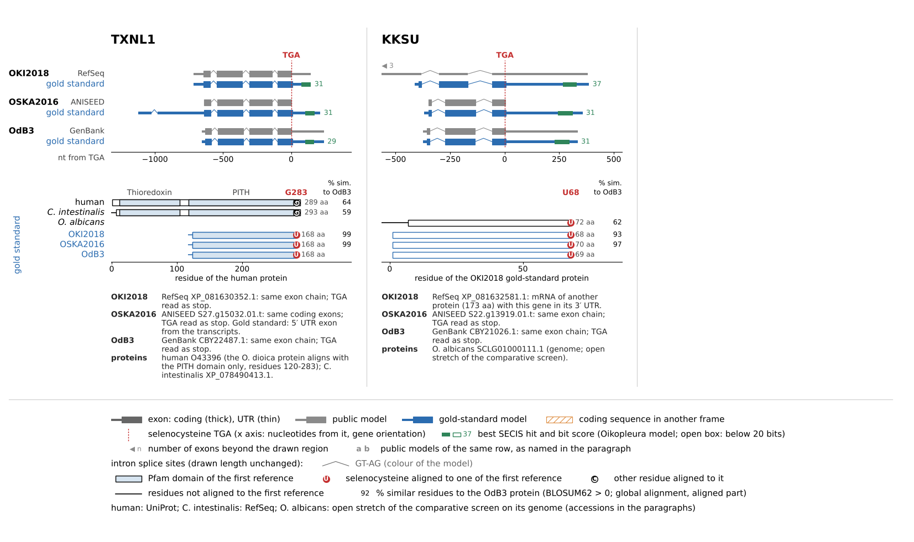

Figure CANDIDATES (`figures/reannotation_candidates.pdf`). Gold-standard models of TXNL1.b and KKSU, two genes outside
the known selenoprotein families, in three *O. dioica* assemblies; drawn as in Figure REANNOTATION. Middle: for TXNL1.b,
the human and *C. intestinalis* TXNL1 proteins (UniProt, RefSeq), with the Pfam domains of the human protein;
the residue aligned to the selenocysteine is a glycine in both; for KKSU, which has no homolog outside the
Oikopleuridae, the *O. albicans* frame of the comparative screen, on the coordinates of the OKI2018 gold-standard
protein. For TXNL1.b, its paralog TXNL1.a in each assembly (black): public model, aligned on the codon aligned to the
selenocysteine of TXNL1.b, and protein (the OSKA2016 model, merged with an upstream GPR107-like gene, drawn for the
part aligned to human TXNL1). Percentage of similar residues to the OdB3 TXNL1.b or KKSU protein as in Figure
REANNOTATION.

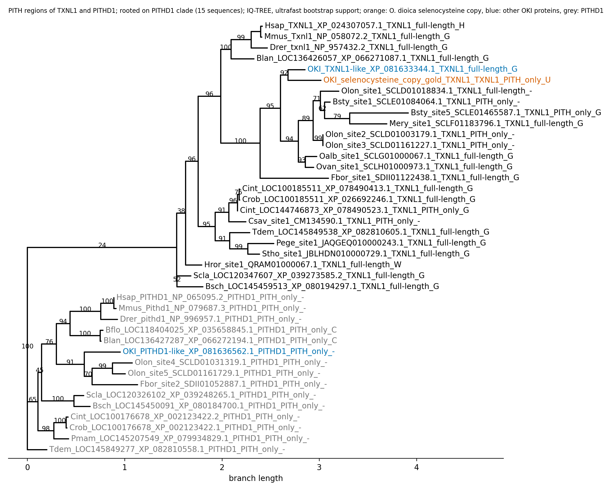

Figure TXNL1-TREE (`figures/txnl1_pith_tree.pdf`; provisional drawing). Maximum-likelihood tree of the PITH regions
of TXNL1 and PITHD1, rooted on the PITHD1 clade, with ultrafast bootstrap supports. Tips: genome, protein (RefSeq) or
genome locus (tblastn site), best human gene, structure (full-length: thioredoxin and PITH; PITH only) and the residue
aligned to the selenocysteine of TXNL1.b (codon for a TGA). Orange, TXNL1.b; blue, other OKI2018 proteins; grey,
PITHD1.

## Settings for appendicularian genomes recover the selenoproteome of *O. dioica* in new assemblies

> **Provisional section (2026-10-29, steps 6 and 7 of the plan in docs/plan.md; `results/tables/stage2_benchmark_*.tsv`,
> `stage2/README.md`, `make stage2-benchmark`).**

We then turned the results above into settings for appendicularian genomes, and tested them on assemblies that had
not contributed to them. Each standard Selenoprofiles profile of a family of the gold standard was extended with the
gold-standard proteins of the three *O. dioica* assemblies, and each profile of the machinery with the stage 1
machinery predictions of these assemblies; KKSU and TXNL1.b, which have no standard profile, received new profiles made
of their gold-standard proteins (Methods). With these profiles, the pipeline used the *Oikopleura* SECIS model at
20 bits, searched in the 2,000 nucleotides after each prediction, the window length on which that threshold was set.
As test assemblies, we used assemblies of the three cryptic species from other individuals: KUM-M3-7f (Okinawa),
AOM-5-5f (Osaka) and Bar2_p4 (Barcelona) [@Plessy2024]. Their reference genes are the gold-standard models of the same
species, aligned to them: 17, 16 and 15 models were carried over complete (one or two with in-frame indels), and the
selenocysteine codon could be placed for 19, 18 and 19 genes; the other models were carried over with a frameshift or
an early stop codon, probably indels of these long-read assemblies, or only in part. Because the gold-standard
assemblies trained the profiles, the fair test builds the profiles without the species tested: we made one set
without each gold-standard assembly, and tested it on that assembly and on the new assembly of the same species.

With these settings, the pipeline found every reference selenocysteine codon in the six assemblies, also when the
profiles did not contain the species tested, against 11 to 14 with the default settings (Table STAGE2). TXNL1.b was
found in all six assemblies, and KKSU also in *O. longicauda*, *O. albicans* and *O. vanhoeffeni*, although its profile
held only *O. dioica* proteins. In the six assemblies, every codon found by Selenoprofiles had a SECIS hit of at least
20 bits after its gene (24.0 bits or more). The two methods of the pipeline complemented each other: Selenoprofiles
found 17 to 19 codons per assembly and miniprot 15 to 18. SELENOT and SEPHS2 were found by Selenoprofiles only, in every
assembly. In the gold-standard models, their selenocysteine codons lie 2 and 1 nucleotides before short introns (42 to 44 nucleotides in SELENOT, 41
to 46 in SEPHS2). In these three assemblies, none of the profile proteins that the pipeline aligned to these
genes with miniprot 0.11 (3 for SELENOT and 26 to 32 for SEPHS2 per assembly) placed the intron next to the codon or
aligned its selenocysteine to the TGA codon. Aligned with the same version, the gold-standard proteins of the three *O.
dioica* assemblies did the same in every assembly: each alignment had a frameshift and no intron at that position, and
placed the selenocysteine against another codon (in OSKA2016, a 2-nucleotide frameshift and a deletion of 13 residues in
SEPHS2, 14 in SELENOT, covering the TGA codon and most of the intron), so that the alignment contained no stop codon.
With miniprot 0.18 and the same proteins, the SEPHS2 intron was placed exactly and the codon found in the three
assemblies; the SELENOT codon was found in OdB3 only. Zero to two genes per assembly were found by miniprot only. The
gene models of Selenoprofiles were close to the reference models without reproducing them: in the median gene they
covered 98 to 100% of the coding bases of the reference, with 99 to 100% of their own coding bases inside it, but their
introns were identical to those of the reference in 5 to 10 of the 15 to 19 genes compared.

| Assembly | Same species as | Reference genes | Default settings | Stage 2 | Stage 2, profiles without the species |
|---|---|---|---|---|---|
| OKI2018 | | 20 | 13 | 20 | 20 |
| KUM-M3-7f | OKI2018 | 19 | 12 | 19 | 19 |
| OSKA2016 | | 20 | 14 | 20 | 20 |
| AOM-5-5f | OSKA2016 | 18 | 12 | 18 | 18 |
| OdB3 | | 19 | 13 | 19 | 19 |
| Bar2_p4 | OdB3 | 19 | 11 | 19 | 19 |

<!-- Table from results/tables/stage2_benchmark_summary.tsv (runs stage1 and default; eval; loo_OKI, loo_OSKA,
loo_OdB3), results of 2026-10-29. -->

Table STAGE2. Selenocysteine codons of the reference genes found by the pipeline, by Selenoprofiles (selenocysteine
label) or miniprot. Reference genes: the gold-standard genes (the OdB3 assembly lacks the codon of SELENOO), or, for
the new assemblies, the gold-standard models of the same species whose codon could be placed on the assembly as a
TGA. Default settings: stage 1, and the same settings on the new assemblies. Stage 2: profiles built from the gold
standard of the three *O. dioica* assemblies, *Oikopleura* SECIS model. Last column: profiles built without the gold
standard of the species of the assembly.

One change to a standard filter was needed. In a first run, SELENOS was missed in four of the six assemblies.
Selenoprofiles had predicted it, with its selenocysteine codon aligned to the selenocysteine of the profile and over
98 to 99% of the profile query, but the standard filter of this family also requires 5 of 9 residues conserved in
vertebrates, and the *O. dioica* SELENOS proteins have 3 or 4 of them; no other SELENOS candidate of the six
assemblies was labelled selenocysteine. We therefore kept this requirement only for predictions not labelled
selenocysteine (Methods). Lowering the weight of splice signals in miniprot, to favour exons at GA–AG introns,
recovered SELENOS by miniprot in three assemblies before this change, but changed no count of codons found after it,
and was not kept.

Outside the reference genes, the pipeline called selenocysteine codons only in selenoprotein genes of the six
assemblies: genes whose codon could not be carried over (GPX_chr1b and SELENOO in AOM-5-5f, probably DIO_chr1 in
KUM-M3-7f, and SELENOO in Bar2_p4, which has no OdB3 model to carry over); other copies of selenoprotein genes (a
second SELENOK 10 kb from the first in KUM-M3-7f, DIO copies in Bar2_p4, the GPX_PAR copy of OSKA2016 found by the
screens, and the haplotype contigs of OdB3); and miniprot calls 3 nucleotides from a codon found in the same gene.

In *O. longicauda*, *O. albicans* and *O. vanhoeffeni*, whose references are the stage 1 predictions kept in step 1
and the KKSU genes, the stage 2 settings found all the reference codons except two fragments of 49 and 55 residues in
*O. albicans*, which Selenoprofiles' length filter removes; they also predicted selenocysteine forms of SELENOS in
*O. longicauda* and *O. albicans*, to be examined with the census. In the three held-out genomes, *B. stygius*,
*M. erythrocephalus* and *F. borealis*, they called 7, 9 and 21 selenocysteine codons, against 6, 7 and 21 with the
default settings, including KKSU in the first two. For the census and for other appendicularian assemblies, we built
final profiles that also contain the validated predictions of the three other *Oikopleura* species, and we deposit
them with the SECIS model, the pipeline configuration and the expected selenoproteome of *O. dioica* (Data and code
availability).

## Orthology of the selenoprotein genes

> **Provisional section (2026-10-30, step 8 of the plan in docs/plan.md; `results/tables/stage2_selenoprotein_table.md`,
> `stage2_selenoprotein_rbh.tsv`, `stage2_selenoprotein_orthology.tsv`, `stage2_selenoprotein_lba.tsv`,
> `results/trees/selenoproteins/`).**

The family names of the gold-standard genes come from the Selenoprofiles profiles that predicted them, and a profile
finds homologs of its family, not necessarily orthologs of a named human gene. As for the machinery, we therefore
compared the proteins with the human proteome and placed them in trees of their families, under the selected model
and under LG+C60 with PMSF, with AU tests of alternative positions (Methods). The trees cover the 12 families in which
the final run predicted appendicularian genes; in the three *O. dioica* assemblies, the gold-standard proteins
replaced the predictions they overlap. Table SELENO-ORTHOLOGY summarises the evidence for the 17 gold-standard genes
of these families; SEPHS2 is treated with the machinery, and TXNL1.b and KKSU above.

The thioredoxin reductase and the glutathione peroxidases were placed with or next to the proteins of the other
tunicates. The *O. dioica*
TXNRD was a reciprocal best hit of human TXNRD1 in the three assemblies (1 to 18 bits ahead of the next human gene),
and the appendicularian TXNRD clade (eight genomes, 100%) was sister to the TXNRD of the other tunicates (92% in the
maximum-likelihood tree, 98% under PMSF). The four *O. dioica* GPX genes had GPX4 as best hit (10 to 58 bits ahead).
In the maximum-likelihood tree they formed one appendicularian clade of eight genomes (48%), sister to a group of
tunicate, amphioxus and vertebrate GPX (78%) whose vertebrate members are GPX4; under PMSF they formed two clades,
GPX_PAR with GPX_chr2 (61%) and GPX_chr1a with GPX_chr1b (100%), the second next to the GPX of the other tunicates
(53%) and the first next to both (49%).

SELENOO, SELENOT and SELENOF were reciprocal best hits of the human gene of their name in each assembly that has a
model, far ahead of any other human gene (469 to 501, 114 to 118 and 95 to 101 bits), but their appendicularian clades were not placed
with the other tunicates. The oikopleurid SELENOO clade (seven genomes, 99 to 100%) was sister to a clade of the
selenocysteine SELENOO of tunicates, a tick, amphioxus and vertebrates (44%, 93% under PMSF), apart from a cysteine
SELENOO paralog of tunicates, amphioxus, turtle and chicken, and its grouping with the selenocysteine SELENOO of the other tunicates was rejected (AU test, p = 0.034
under the selected model and 0.045 under PMSF), whereas a tree in which these tunicate proteins form a clade without
the appendicularians was not (p = 0.47 and 0.59). The appendicularian SELENOT clade (nine genomes, 66 to 75%) branched
between a group of mostly protist, plant and nematode SELENOT proteins and the other animal SELENOT (90 and 86%); its grouping
with the SELENOT of the other tunicates was not rejected (p = 0.13 and 0.20). A placement inside the chordate SELENOT
was rejected under PMSF (p = 0.009), but so was every tree in which the chordate SELENOT form a clade (p = 0.042 and
0.012), because nematode and insect proteins fall among them, so this test does not bear on the appendicularians. The
appendicularian SELENOF clade (nine genomes, 58 to 79%) was next to plant and green-algal SELENOF (Sep15; 33% and
81%); neither its grouping with the other tunicates (p = 0.26 and 0.091) nor a placement inside the chordate SELENOF
(p = 0.41 and 0.13) was rejected.

SELENOK and SELENOS had no hit in the human proteome. Their appendicularian clades, each of five genomes (100%, and
93 to 95%), had the human SELENOK and SELENOS as nearest vertebrate genes. The SELENOS clade was next to two
green-algal proteins (83% and 55%), at the base of the animal SELENOS, which formed a clade with it; neither its
grouping with the SELENOS of the other tunicates (p = 0.19 and 0.51) nor a placement inside the chordate SELENOS
(p = 0.29 and 0.51) was rejected. The SELENOK clade was next to kinetoplastid, green-algal and chelicerate proteins
(33% and 25%). Its grouping with the SELENOK of the other tunicates and its placement inside the chordate SELENOK were
rejected (p ≤ 0.0016 under both models), but so were the trees in which these groups form a clade without the
appendicularians, at nearly the same cost (70.6 against 70.3 log-likelihood units for the other tunicates, 63.1
against 62.9 for the chordates, under the selected model): in these data (181 sites), neither the SELENOK of the
other tunicates nor those of the chordates form a clade, and the tests do not bear on the appendicularian position.

Best hits did not separate the deiodinase paralogs: DIO_PAR had DIO2 as best hit (6 to 12 bits ahead of the next
gene; reciprocal in OKI2018), and DIO_chr1 DIO3 (1 bit ahead). In the maximum-likelihood tree, both genes belonged to
one appendicularian clade of seven genomes (77%); under PMSF, DIO_PAR formed a clade of six genomes (95%) and DIO_chr1
an *O. dioica* clade (100%) next to two alveolate deiodinases (34%). A tree in which the animal deiodinases, the
appendicularian selenocysteine ones included, form a clade without the non-animal proteins was not rejected (p = 0.43
and 0.35). The appendicularian DIO are therefore animal deiodinases whose relationships to DIO1, DIO2 and DIO3 are
not resolved.

The five SELENOW genes of *O. dioica* fell into four appendicularian clades. SELENOW_chr1a was a reciprocal best hit of
human SELENOW (32 to 71 bits ahead of SELENOV), and the two genes of the SELENOW pair had SELENOW as best hit (13 to 19
bits ahead), in an *O. dioica* clade (98 to 99%). SELENOW_PAR had SELENOV as reciprocal best hit, by 0.4 and 2.7 bits (OdB3 and OKI2018);
its clade (six genomes, 99 to 100%) was next to two profile proteins of unrecorded species in the
maximum-likelihood tree (89%), and next to the mammalian SELENOV under PMSF (92%). SELENOV arose in placental mammals by
duplication of SELENOW [@Mariotti2012], so that a SELENOV ortholog is not expected in appendicularians, and the data
did not require this position: neither SELENOW_PAR outside the smallest clade holding human SELENOW and SELENOV
(p = 0.53 and 0.64), nor its grouping with SELENOW_chr1a and the pair (p = 0.33 and 0.34) or with SELENOV (p = 0.21
and 0.20) was rejected; its grouping with SELENOW_chr2 was rejected under the selected model (p = 0.031) and not under
PMSF (p = 0.054). SELENOW_chr2 had human MIEN1 as best hit in the three assemblies (55 to 64 bits), and no hit to SELENOW or
SELENOV. Its clade, of nine genomes (87 and 93%), belonged to a group (77 and 91%) of SELENOW-like proteins with
selenocysteine from zebrafish, tilapia, *Ciona* and amphioxus, an *Artemia* protein with selenocysteine, a *Tribolium* protein
with threonine and human MIEN1, which has cysteine at the selenocysteine position; human SELENOW and SELENOV lay outside
this group. SELENOW_chr2 thus belongs to a SELENOW-like lineage that has a selenocysteine form in fishes, ascidians and
amphioxus and a cysteine form in human. We keep the gold-standard names, which name the profile family.

Thus no test placed an appendicularian selenoprotein outside the animal proteins of its family, and the genes keep
their family names. Their positions within the families are, as for PSTK, mostly unresolved; for SELENOO, as for the
selenocysteine SEPHS2, the data reject the grouping with the orthologs of the other tunicates.

| Gene | Best human hit | Appendicularian clade (sequences, genomes) | Support ML / PMSF | Sister group, ML | Sister group, PMSF | Nearest vertebrate genes |
|---|---|---|---|---|---|---|
| DIO_PAR | DIO2 (3; 1 reciprocal; margin 6.1 to 12 bits) | 26, 7 | 77 / 95* | Appendicularians 42, Other tunicates 4, Alveolates 2, Bacteria 2 (67) | Appendicularians 45, Other tunicates 4, Bacteria 2 (89) | DIO1 (3), DIO2 (3), DIO3 (4) |
| DIO_chr1 | DIO3 (2; 1 reciprocal; margin 1 bits) | 26, 7 | 77 / 100* | Appendicularians 42, Other tunicates 4, Alveolates 2, Bacteria 2 (67) | Alveolates 2 (34) | DIO1 (3), DIO2 (3), DIO3 (4) |
| GPX_PAR | GPX4 (2; 1 reciprocal; margin 55 to 58 bits) | 59, 8 | 48 / 61* | Other tunicates 28, Appendicularians 8, Cephalochordates 4, Mammals 4, Ray-finned fishes 2, Birds 1, Flatworms 1 (78) | Appendicularians 23, Other tunicates 22, Flatworms 1 (49) | GPX4 (6) |
| GPX_chr1a | GPX4 (3; 2 reciprocal; margin 28 to 37 bits) | 59, 8 | 48 / 100* | Other tunicates 28, Appendicularians 8, Cephalochordates 4, Mammals 4, Ray-finned fishes 2, Birds 1, Flatworms 1 (78) | Other tunicates 22, Flatworms 1 (53) | GPX4 (6) |
| GPX_chr1b | GPX4 (3; 0 reciprocal; margin 10.4 to 19.6 bits) | 59, 8 | 48 / 100* | Other tunicates 28, Appendicularians 8, Cephalochordates 4, Mammals 4, Ray-finned fishes 2, Birds 1, Flatworms 1 (78) | Other tunicates 22, Flatworms 1 (53) | GPX4 (6) |
| GPX_chr2 | GPX4 (3; 0 reciprocal; margin 34 to 43 bits) | 59, 8 | 48 / 61* | Other tunicates 28, Appendicularians 8, Cephalochordates 4, Mammals 4, Ray-finned fishes 2, Birds 1, Flatworms 1 (78) | Appendicularians 23, Other tunicates 22, Flatworms 1 (49) | GPX4 (6) |
| SELENOF | SELENOF (3; 3 reciprocal; margin 95.1 to 101 bits) | 10, 9 | 79 / 58 | Land plants 3, Green algae 2 (33) | Land plants 3, Green algae 2 (81) | SELENOM (1) |
| SELENOK | none (3) | 5, 5 | 100 / 100 | Kinetoplastids 3, Green algae 2, Chelicerates 1 (33) | Kinetoplastids 3, Green algae 2, Chelicerates 1 (25) | SELENOK (1) |
| SELENOO | SELENOO (2; 2 reciprocal; margin 469 to 501 bits) | 10, 7 | 99 / 100 | Other tunicates 12, Mammals 5, Ray-finned fishes 4, Cephalochordates 2, Amphibians 1, Birds 1, Chelicerates 1, Lobe-finned fishes 1, Reptiles 1 (44) | Other tunicates 12, Mammals 5, Ray-finned fishes 4, Cephalochordates 2, Amphibians 1, Birds 1, Chelicerates 1, Lobe-finned fishes 1, Reptiles 1 (93) | SELENOO (4) |
| SELENOS | none (2) | 5, 5 | 95 / 93 | Green algae 2 (83) | Green algae 2 (55) | SELENOS (1) |
| SELENOT | SELENOT (3; 3 reciprocal; margin 114 to 118 bits) | 11, 9 | 75 / 66 | Alveolates 6, Kinetoplastids 4, Green algae 3, Land plants 3, Nematodes 3, Stramenopiles 2, Mammals 1 (90) | Alveolates 6, Kinetoplastids 4, Green algae 3, Land plants 3, Nematodes 3, Stramenopiles 2, Mammals 1 (86) | SELENOT (5) |
| SELENOW_chr1a | SELENOW (3; 3 reciprocal; margin 32.3 to 70.5 bits) | 5, 5 | 35 / 40* | Appendicularians 4, Other tunicates 1 (57) | Appendicularians 2, Green algae 1 (42) | SELENOV (2), SELENOW (4) |
| SELENOW_pair1 | SELENOW (3; 0 reciprocal; margin 12.7 to 18.8 bits) | 8, 3 | 99 / 98 | Appendicularians 9, Other tunicates 1 (63) | Appendicularians 9, Green algae 1 (35) | SELENOV (2), SELENOW (4) |
| SELENOW_pair2 | SELENOW (3; 0 reciprocal; margin 14.2 to 17.3 bits) | 8, 3 | 99 / 98 | Appendicularians 9, Other tunicates 1 (63) | Appendicularians 9, Green algae 1 (35) | SELENOV (2), SELENOW (4) |
| SELENOW_PAR | SELENOV (2; 2 reciprocal; margin 0.4 to 2.7 bits) | 7, 6 | 99 / 100 | unclassified 2 (89) | Mammals 3 (92) | SELENOV (2), SELENOW (4) |
| SELENOW_chr2 | MIEN1 (3; outside the family, 55.5 to 63.9 bits above its genes) | 19, 9 | 87 / 93 | Cephalochordates 2, Appendicularians 1, Crustaceans 1, Other insects 1 (80) | Cephalochordates 2, Appendicularians 1 (72) | MIEN1 (3) |
| TXNRD | TXNRD1 (3; 3 reciprocal; margin 1 to 18 bits) | 9, 8 | 100 / 100 | Other tunicates 10 (92) | Other tunicates 10 (98) | TXNRD1 (2), TXNRD3 (3) |

<!-- Table generated by stage2/selenoprotein_table.py (make selenoprotein-table;
results/tables/stage2_selenoprotein_table.md), from the round 2 trees of 2026-10-30. -->

Table SELENO-ORTHOLOGY. Orthology of the gold-standard genes of the selenoprotein families. Best human hit: best human
gene of the final-run predictions that the gold-standard proteins replaced (number of assemblies, of which reciprocal;
margin to the next human gene); "none", no hit. Appendicularian clade: the clade of appendicularian sequences of the
maximum-likelihood tree that holds the gene (sequences, genomes); support: ultrafast bootstrap under the selected
model and under LG+C60+F+G with PMSF (*, the PMSF clade holding the gene has other members). Sister group: taxonomic
groups of the smallest side of a bipartition that holds the clade and other sequences, with its support
("unclassified": profile sequences without species name). Nearest vertebrate genes: human genes in the smallest such
side that holds vertebrate sequences with a known human gene (number of sequences).

## The selenoproteomes of appendicularians

> **Provisional section (2026-10-30, step 9 of the plan in docs/plan.md; `results/tables/stage2_census_genes.md`,
> `stage2_census.tsv`, `stage2_census_loci.tsv`, `stage2_census_contigs.tsv`, `stage2_census_genomes.tsv`,
> `stage2_hgt_screen.tsv`, `stage2_absence_<family>.*.tsv`, `stage2_candidate_transcripts.tsv`,
> `stage2_candidates_rule.tsv`; `make stage2-collect`, `census-contigs`, `census`, `selenoprotein-absence`,
> `candidate-genes`).** Operons: next section.

We then took the census of the selenoprotein genes in the nine appendicularian genomes, from the final stage 2 run
(Methods). Each selenocysteine codon found by Selenoprofiles or miniprot was counted once per locus, and each locus
was assigned to the *O. dioica* gene of the smallest appendicularian clade that holds it and a gold-standard protein
in the trees of the previous section. The UGA/SECIS screens had found a few genes that the final run did not predict;
they were added, without gene model. Before counting, each contig carrying a prediction was compared with the rest of
its genome (GC content, tetranucleotide composition and open reading frame density), and a locus was left out only
on evidence against it (Methods). Table CENSUS gives the result.

The three *O. dioica* assemblies have the 20 genes of the gold standard, except the SELENOO of OdB3, whose
selenocysteine exon is missing from the assembly. The three new assemblies have the same genes: the reference genes
lifted onto them (Table STAGE2) and, among their other loci, loci of the same families where the codon could not be
lifted (DIO in KUM-M3-7f, GPX and SELENOO in AOM-5-5f, SELENOO in Bar2_p4). The other loci are extra copies: the
second GPX_PAR of OSKA2016, a second SELENOK 10 kb from the first in KUM-M3-7f, DIO copies in Bar2_p4, and ten loci of
OdB3, six of them copies of DIO_chr1, probably haplotypes kept in the assembly. The selenoproteome of *O. dioica* is
therefore of 20 genes in each of its three cryptic species.

The other *Oikopleura* species share most of these genes: loci of 11 of the 20 were found in *O. longicauda*, 17 in
*O. albicans* and 15 in *O. vanhoeffeni*, some only by the screens (SELENOK in the three species; DIO_chr1 and TXNRD in
*O. vanhoeffeni*). TXNL1.b was found in none of them, as expected from its origin by duplication in the *O. dioica*
lineage, and the SELENOW pair only in *O. dioica* (and one *O. albicans* screen locus that matches SELENOW_pair1).
Several genes have more copies in these assemblies than in *O. dioica*: DIO_PAR has six loci in *O. longicauda* and
five in *O. albicans*, GPX_PAR eight in *O. longicauda*, and SELENOW_chr2 five in *O. longicauda* and four in
*O. vanhoeffeni*. These assemblies are fragmented (N50 of 2.4 kb for *O. longicauda*) and may keep both haplotypes,
as OdB3 does, so these numbers are upper bounds. Selenoprofiles also predicted selenocysteine forms of SELENOS in
*O. longicauda* and *O. albicans*, which fall in the appendicularian SELENOS clade with the *O. dioica* genes; no SECIS
element was found in the 2,000 nucleotides after them, although the *O. albicans* gene lies on a contig of 547 kb.

In *B. stygius* and *M. erythrocephalus*, whose assemblies have N50 values of 1.3 and 1.9 kb, loci of 8 and 7 of the
20 genes were found, many of them on contigs shorter than 3 kb; genes missing from these assemblies may be present in
the genomes.
The final SELENOK profile gave no candidate prediction at all, before its filters, in *O. albicans*,
*O. vanhoeffeni* and *M. erythrocephalus*, and only a fragment in *O. longicauda*: in these genomes the gene is missed
by the search, not removed by the filters. For the deposited profiles, we built gene models at the screen loci of
*O. longicauda*, *O. albicans* and *O. vanhoeffeni* (97, 98 and 66 residues, the last without its first exon; 51 to
55% identical to the *O. dioica* protein) and added them to the SELENOK profile (Methods). With this profile,
Selenoprofiles predicted the three genes with their selenocysteine. In the held-out genomes, it predicted the
N-terminal part of SELENOK in *M. erythrocephalus*, which the final profile did not find, and a longer part in
*B. stygius* (coverage of the profile 0.88 against 0.67), in both without the exon of the selenocysteine; in
*M. erythrocephalus*, the screen had found that exon on another contig. The release profile also predicts a few more
glycine- and proline-rich fragments without selenocysteine (two in OKI2018, two in *O. longicauda*, one in
*O. albicans*), of the kind that the final profile already predicts in OSKA2016, AOM-5-5f and *F. borealis*.
In *F. borealis*, the only appendicularian outside the Oikopleuridae, 5 of the 20 genes were found (SELENOF, SELENOT,
SELENOW_chr2, SEPHS2 and TXNRD), with seven GPX loci outside the clades of the *O. dioica* GPX genes, and two families
absent from the Oikopleuridae: SELENOL (two loci) and SELENOU (one locus, with a SECIS element of 23.6 bits). KKSU,
found in every oikopleurid genome, was not found in *F. borealis*.

Compared with the other tunicates, analysed with the default settings of stage 1, the appendicularians lack several
families (Table CENSUS-FAMILIES): SELENON was found in eight of the ten other tunicates, FrnE in eight, SELENOH and
MSRB in six, and SELENOI in *C. intestinalis*, but none in any appendicularian; SELENOL was found in nine other
tunicates and, among appendicularians, only in *F. borealis*. SELENOU, found in *F. borealis*, was found in no other
tunicate, but in both amphioxus species. KKSU and TXNL1.b were found only in appendicularians. SELENOW has four to
seven loci in each *Oikopleura* assembly, against one to five in the other tunicates.

To tell absent genes from genes missed by the profiles, these six families were given absence tests, as the
machinery genes were: the selenocysteine forms predicted in the other genomes were searched in the appendicularian
genomes and the *O. dioica* transcriptomes, and each candidate was compared with them and with human proteins of
related families (Methods). The positive controls, the predictions of each family scored in the same way, had
margins of 45 to 1,125 bits. No candidate was found for SELENOH. For SELENON, the only candidate was a 36-residue
fragment of an OSKA2016 transcript, nearly identical to human SELENON, which we attribute to contamination of that
transcriptome. FrnE and SELENOL were found only in *F. borealis* (margins of 177 and 46 bits). MSRB candidates were
found in every appendicularian genome except that of *O. vanhoeffeni*, but each was closer to human MSRB2 or MSRB3
than to the MSRB1-type selenoproteins (margins of −56 to 0 bits): appendicularians have cysteine MSRB of the
MSRB2/MSRB3 type, as predicted by the final run, and no MSRB1. Within the limits of tblastn on these assemblies,
SELENON, SELENOH and MSRB1 are thus absent from the appendicularians, and FrnE and SELENOL from the Oikopleuridae.

SELENOI, in contrast, was found in every appendicularian genome (margins of 42 to 175 bits against human CEPT1 and
CHPT1). SELENOI is the ethanolamine phosphotransferase EPT1, whose vertebrate form carries a selenocysteine about ten
residues before its C-terminus. In each *O. dioica* transcriptome, some transcripts of the gene end with an exon that
has an in-frame TGA at the position aligned to the selenocysteine of human, mouse and zebrafish SELENOI, in the
motif KIIPTKTDU (OKI2018: two of the six isoforms of one Trinity gene; OSKA2016: one of two; OdB3: one of four ESTs
that reach the C-terminus), while the others end with another sequence, VFKIIPTS(I/M)SS(L/I), apparently from an
alternative last exon. Placed on the assemblies, these transcripts give a TGA at the same position of the last exon
in the three cryptic species, but the codons after it differ: a second TGA after two codons in OKI2018, a TAA after
nine codons in OSKA2016 and after 17 in OdB3. No SECIS element was found after the stop codon, by the *Oikopleura*
model or by RF00031, either in the transcripts (255 to 544 nucleotides) or in the 2,000 nucleotides of genome
(Methods). SELENOI therefore does not meet the rule set for the candidate genes and was not counted; whether its TGA
encodes selenocysteine in *O. dioica* is not known. In the other appendicularians, the tblastn alignments did not
reach the codon, except in *F. borealis*, where the codon read in frame just beyond the alignment is ATT
(isoleucine); the ascidian and amphioxus EPT1 proteins of RefSeq end before that position.

The contig checks left out one locus, a *F. borealis* DIO-like prediction whose best human hit is GPX1. No
selenoprotein of the census lies on a contig that looks foreign to its genome together with a non-animal placement.
The checks also bear on the 72 appendicularian sequences, of any label, that the trees place next to bacteria or
fungi, candidates for horizontal gene transfer (Methods). Thirty-five belong to other families (thioredoxins and other
proteins found by the DIO profile, whose animal relatives are not in its tree) or have no hit in the human proteome
although their family has human members. Sixteen lie on contigs that look foreign to their genome: those of
*B. stygius* and *M. erythrocephalus*, cysteine SELENOO, DIO-like proteins and GPX, on contigs of 26 to 324 kb that
are 88 to 93% open reading frames, as bacterial DNA is, against 21 and 15% for the 2-kb windows of these genomes, and
seven of *F. borealis* on contigs of distinct composition. The SELENOO and DIO-like clades that *B. stygius* and
*M. erythrocephalus* share with *F. borealis* are therefore best explained by bacterial contamination of the same
lineage in the three samples. The remaining 21 *F. borealis* sequences, all predicted without intron and 16 of them on
contigs shorter than 3 kb, cannot be tested with these data: the whole *F. borealis* assembly is dense in open reading
frames (80% for its 2-kb windows), including the contigs of its selenoprotein genes with SECIS elements, and most of
its genes are predicted without introns. We found no credible case of horizontal gene transfer in the selenoprotein
families.

| Gene of the clade | *O. dioica* OKI2018 | *O. dioica* OSKA2016 | *O. dioica* OdB3 | *O. longicauda* | *O. albicans* | *O. vanhoeffeni* | *B. stygius* | *M. erythrocephalus* | *F. borealis* |
|---|---|---|---|---|---|---|---|---|---|
| DIO_PAR | 1 (1) | 1 (1) | 2 (2) | 5 (3) +1 | 5 (3) | 2 (2) |  |  |  |
| DIO_chr1 | 1 (0) | 1 (1) | 5 (4) +2 |  |  | +2 |  |  |  |
| GPX_PAR | 1 (1) | 2 (2) | 1 (0) | 7 (5) +1 | 2 (2) +1 | 2 (2) | 1 (0) +1 |  |  |
| GPX_chr1a | 1 (1) | 1 (1) | 2 (2) | 1 (0) | 2 (0) | 2 (1) +1 | 1 (1) | 1 (0) |  |
| GPX_chr1b | 1 (1) | 1 (1) | 1 (1) |  | 1 (1) | 1 (1) +1 |  |  |  |
| GPX_chr2 | 1 (1) | 1 (1) | 1 (1) |  | 1 (1) | 3 (2) |  |  |  |
| SELENOF | 1 (1) | 1 (1) | 1 (1) | 2 (1) | 1 (0) | 1 (0) | 1 (0) | 1 (0) | 1 (0) |
| SELENOK | 1 (1) | 1 (1) | 1 (1) | +1 | +1 | +1 |  | +1 |  |
| SELENOO | 1 (1) | 1 (1) |  |  | 1 (0) |  |  |  |  |
| SELENOS | 1 (0) | 1 (1) | 1 (1) | 1 (0) | 1 (0) |  |  |  |  |
| SELENOT | 1 (1) | 1 (1) | 1 (1) | 2 (1) | 1 (0) | 1 (1) +1 | +1 | 1 (0) | 1 (0) |
| SELENOW_chr1a | 1 (1) | 1 (1) | 1 (1) |  | 1 (1) | 1 (1) | +1 |  |  |
| SELENOW_pair1 | 1 (1) | 1 (1) | 2 (2) |  | +1 |  |  |  |  |
| SELENOW_pair2 | 1 (1) | 1 (1) | 2 (2) |  |  |  |  |  |  |
| SELENOW_PAR | 1 (1) | 1 (0) | 1 (1) |  | 1 (1) | 1 (0) +1 | 1 (0) +1 |  |  |
| SELENOW_chr2 | 1 (1) | 1 (1) | 1 (1) | 5 (5) | 2 (0) | 4 (3) | 1 (0) | 2 (0) | 1 (0) |
| SEPHS2 | 1 (1) | 1 (1) | 1 (1) | 2 (2) | 1 (1) | 1 (1) |  |  | 1 (1) |
| TXNRD | 1 (1) | 1 (1) | 1 (1) | 1 (1) | 1 (1) | +1 |  | +1 | 1 (1) |
| TXNL1.b | 1 (1) | 1 (1) | 1 (1) |  |  |  |  |  |  |
| KKSU | 1 (1) | 1 (1) | 1 (1) | 2 (2) | 2 (1) | 1 (1) | 1 (0) | 1 (0) |  |
| GPX, other clades |  |  |  | 1 (0) |  |  |  | 1 (0) | 7 (5) |
| GPX_chr1a/GPX_chr1b |  |  |  | 2 (2) |  | 1 (0) | 1 (0) | 1 (0) |  |
| MsrA, other clades |  |  |  |  |  | 1 (0) |  |  |  |
| SELENOL, other clades |  |  |  |  |  |  |  |  | 2 (0) |
| SELENOO, other clades |  |  |  | 1 (1) |  | 1 (0) |  |  |  |
| SELENOU, other clades |  |  |  |  |  |  |  |  | 1 (1) |
| SELENOW, other clades |  |  |  | 2 (1) |  |  | 1 (0) | 1 (0) | 3 (1) |

<!-- Table generated by stage2/census.py (make census; results/tables/stage2_census_genes.md), census of 2026-10-30. -->

Table CENSUS. Selenoprotein loci of the appendicularian genomes, by the *O. dioica* gene of their clade. Each cell
gives the loci predicted by the final stage 2 run, with in brackets those followed by a SECIS element of at least
20 bits, and "+n" the loci found only by the UGA/SECIS screens, without gene model. Gene of the clade: the
gold-standard genes of the smallest clade of appendicularian sequences that holds the locus in the maximum-likelihood
tree of its family (two genes when that clade holds both); "other clades": loci of the family in no such clade.
Several loci in an assembly may be copies, haplotypes kept in the assembly or fragments of one gene.

| Family | OKI2018 | OSKA2016 | OdB3 | *O. lon.* | *O. alb.* | *O. van.* | *B. sty.* | *M. ery.* | *F. bor.* | *C. int.* | *C. rob.* | *C. sav.* | *H. ror.* | *S. cla.* | *B. sch.* | *P. mam.* | *T. dem.* | *Pegea* | *S. tho.* | *B. flo.* | *B. lan.* | human | mouse | zebrafish |
|---|---|---|---|---|---|---|---|---|---|---|---|---|---|---|---|---|---|---|---|---|---|---|---|---|
| DIO | 2 | 2 | 7 | 5 | 5 | 2 |  |  |  | 2 | 2 | 2 | 3 | 5 | 3 | 6 |  |  |  | 10 | 13 | 3 | 3 | 4 |
| FrnE |  |  |  |  |  |  |  |  |  | 1 | 1 | 1 | 1 | 1 | 1 | 1 |  |  | 1 | 1 | 1 |  |  |  |
| GPX | 4 | 5 | 5 | 11 | 6 | 9 | 3 | 3 | 7 | 6 | 5 | 5 | 3 | 6 | 8 | 6 | 7 | 5 | 4 | 5 | 5 | 7 | 6 | 8 |
| KKSU | 1 | 1 | 1 | 2 | 2 | 1 | 1 | 1 |  |  |  |  |  |  |  |  |  |  |  |  |  |  |  |  |
| MSRB |  |  |  |  |  |  |  |  |  |  |  |  | 1 | 1 | 1 |  | 1 | 1 | 2 | 1 | 1 | 2 | 1 | 3 |
| MsrA |  |  |  |  |  | 1 |  |  |  |  |  |  |  |  |  |  |  |  |  | 1 | 1 |  |  |  |
| SELENOE |  |  |  |  |  |  |  |  |  |  |  |  |  |  |  |  |  |  |  |  |  |  |  | 1 |
| SELENOF | 1 | 1 | 1 | 2 | 1 | 1 | 1 | 1 | 1 | 1 | 1 | 1 |  | 1 | 1 | 1 | 1 | 1 | 1 | 2 | 2 | 1 | 1 | 1 |
| SELENOH |  |  |  |  |  |  |  |  |  | 1 | 1 | 1 |  |  |  | 1 | 1 |  | 1 | 1 | 1 | 1 | 1 | 1 |
| SELENOI |  |  |  |  |  |  |  |  |  | 1 |  |  |  |  |  |  |  |  |  |  |  | 1 | 1 | 1 |
| SELENOJ |  |  |  |  |  |  |  |  |  |  |  |  |  |  |  |  |  |  |  | 1 | 2 |  |  | 1 |
| SELENOK | 1 | 1 | 1 |  |  |  |  |  |  | 1 | 1 | 1 | 1 | 1 | 1 |  |  |  |  | 1 | 1 | 2 | 5 | 1 |
| SELENOL |  |  |  |  |  |  |  |  | 2 | 1 | 1 | 1 | 1 | 1 | 1 | 1 | 1 |  | 2 | 1 | 1 |  |  | 1 |
| SELENOM |  |  |  |  |  |  |  |  |  |  |  |  |  |  |  |  |  |  |  |  |  | 1 | 1 | 1 |
| SELENON |  |  |  |  |  |  |  |  |  | 1 | 1 | 1 | 1 |  |  | 1 | 1 | 1 | 3 | 1 | 2 | 2 | 1 | 2 |
| SELENOO | 1 | 1 |  | 1 | 1 | 1 |  |  |  | 1 | 1 | 1 | 1 | 1 | 1 | 1 | 1 | 1 | 1 | 1 | 1 | 1 | 1 | 2 |
| SELENOP |  |  |  |  |  |  |  |  |  |  |  |  |  |  |  |  |  |  |  | 4 | 6 | 5 | 5 | 8 |
| SELENOS | 1 | 1 | 1 | 1 | 1 |  |  |  |  | 1 | 1 | 1 |  |  |  | 1 |  |  |  | 1 |  | 1 | 1 | 1 |
| SELENOT | 1 | 1 | 1 | 2 | 1 | 1 |  | 1 | 1 | 1 | 1 | 1 | 1 | 1 | 2 | 1 | 2 | 1 |  | 1 | 1 | 2 | 1 | 5 |
| SELENOU |  |  |  |  |  |  |  |  | 1 |  |  |  |  |  |  |  |  |  |  | 1 | 1 |  |  | 3 |
| SELENOW | 5 | 5 | 7 | 7 | 4 | 6 | 3 | 3 | 4 | 2 | 2 | 1 | 1 | 3 | 5 | 1 | 2 | 1 | 1 | 1 | 1 | 3 | 2 | 6 |
| SEPHS2 | 1 | 1 | 1 | 2 | 1 | 1 |  |  | 1 | 1 | 1 | 1 | 1 | 2 | 1 | 1 | 1 | 1 | 1 | 1 | 1 | 1 | 1 | 1 |
| TXNL1b | 1 | 1 | 1 |  |  |  |  |  |  |  |  |  |  |  |  |  |  |  |  |  |  |  |  |  |
| TXNRD | 1 | 1 | 1 | 1 | 1 |  |  |  | 1 | 2 | 1 | 1 | 2 | 2 | 2 | 2 | 3 | 2 | 2 | 2 | 2 | 3 | 3 | 2 |
| Total | 20 | 21 | 27 | 34 | 23 | 23 | 8 | 9 | 18 | 23 | 20 | 19 | 17 | 25 | 27 | 24 | 21 | 14 | 19 | 37 | 43 | 36 | 34 | 53 |

<!-- From results/tables/stage2_census.tsv (make census); the columns of KUM-M3-7f, AOM-5-5f and Bar2_p4 are left out. -->

Table CENSUS-FAMILIES. Selenoprotein loci per family: appendicularians from the census (final stage 2 run, loci
counted), other genomes from stage 1 (default settings, all loci, no screen). Vertebrate counts include
multiple selenocysteine codons of SELENOP more than 30 nucleotides apart and processed pseudogenes.

## Selenoprotein genes in operons

> **Provisional section (2026-10-31, step 10 of the plan in docs/plan.md; `results/tables/stage2_operons.tsv`,
> `stage2_operons_summary.tsv`, `stage2_operons_utr.tsv`, `stage2_operons_utr_bins.tsv`; `make operons`;
> figure: `make operons-figure`).**

Many *O. dioica* genes are transcribed as operons, whose polycistronic transcripts are resolved into mRNAs by
trans-splicing of a 40-nucleotide spliced leader (SL) to the 5′ end of each downstream mRNA; the intercistronic
regions are short, 23 to 30 nucleotides between the polyadenylation site of a gene and the trans-splice site of the
next in the cyclin D3 cluster [@Ganot2004]. Since a SECIS element must lie in the 3′ UTR of its mRNA, a selenoprotein
gene followed closely by another gene of its operon must fit its SECIS element in that short space. We placed the
gold-standard genes among the annotated genes of the three *O. dioica* assemblies, with operons defined as consecutive
genes on the same strand whose coding sequences are at most 500 nucleotides apart (Methods; Figure OPERONS A).

Selenoprotein genes are as often in operons as the other genes: 10 of 20 in OKI2018, 13 of 20 in OSKA2016 and 13 of
19 in OdB3, against 47%, 40% and 49% of all annotated loci (Fisher's exact test, P = 0.83, 0.037 and 0.11), and they
are not less often the first gene of their operon (1 of 10, 5 of 13 and 3 of 13, against 37%, 40% and 35% of the
genes in operons; P = 0.10, 1 and 0.56; Figure OPERONS C). Their mRNAs are trans-spliced: transcripts that start with the SL were found
for 12 genes in OKI2018 and 15 in OSKA2016, and for 4 in OdB3, whose ESTs have masked 5′ ends; 74 of the 75
trans-splice sites have an AG acceptor, and most lie within 40 nucleotides of the start codon (55 of 75; median 2 to 6
nucleotides).

In every gene, the SECIS element lies before the next gene on the same strand. It ends 82 to 341 nucleotides after
the stop codon, and the next coding sequence starts at least 63 nucleotides after its end; where the next gene has
trans-spliced transcripts, its first trans-splice site lies 66 to 516 nucleotides after the end of the SECIS (Figure
OPERONS B). The tightest case is SELENOW_PAR, internal in operons of seven and eleven genes in OKI2018 and OdB3: its
SECIS element lies 45 to 119 nucleotides after the stop codon in the three assemblies; in OdB3, its ESTs end 151 to
153 nucleotides after the stop codon, 32 nucleotides after the SECIS element and about 30 before the next coding
sequence, and in OKI2018, where the next gene is trans-spliced 179 nucleotides after the stop codon, a
polyadenylation site at the median intercistronic distance (31 nucleotides, below) would lie 36 nucleotides after
the SECIS element. The two genes of the SELENOW pair lie 197 and 169
nucleotides apart in OKI2018 and OSKA2016, with transcripts that run from the first into the second; each has its own
SECIS element, that of the first gene (SELENOW_pair2) 23 to 92 nucleotides after its stop codon. In OdB3, the two
genes are 869 nucleotides apart, and an annotated coding sequence (CBY21828.1) without homologous neighbour in the
other assemblies starts 47 nucleotides after the stop codon of SELENOW_pair2, inside its SECIS element.

The 3′ ends of the mRNAs were read in the transcripts that end with a poly(A) tail: 733 polyadenylation sites in
OKI2018 and 143 in OSKA2016, whose transcripts are Trinity assemblies, and 39,497 in the OdB3 cDNA reads. Between
two genes of an operon, the polyadenylation site of the first lies a median 31 nucleotides before the first
trans-splice site of the second in OKI2018 (n = 76; interquartile range 29 to 34) and OSKA2016 (n = 9), and 32
nucleotides in OdB3 (n = 292; 29 to 39); 75% (OKI2018) and 65% (OdB3) of these distances are between 26 and 35
nucleotides (Figure OPERONS D), a few nucleotides above the 23 to 30 nucleotides of the cyclin D3 cluster
[@Ganot2004]. Polyadenylation sites were found after 16 selenoprotein genes (1 in OKI2018, 15 in
OdB3). The most supported site of each gene lies 8 to 343 nucleotides after the end of its SECIS element (median 84
in OdB3); a single EST, of SELENOT in OdB3, ends before the SECIS element (120 nucleotides after the stop codon, with
the SECIS at 258 to 323).

Selenoprotein mRNAs have longer 3′ UTRs than the mRNAs of the other genes. In OdB3, the most supported
polyadenylation site lies a median 250.5 nucleotides after the stop codon of the selenoprotein genes followed by
another gene of their operon, against 105 nucleotides for the other such genes (n = 6 and 2,516; Mann-Whitney U test,
P = 0.0033), and 300 against 136 nucleotides for the genes last in their operon or outside operons (n = 9 and 4,924;
P = 0.035). Likewise, the first trans-splice site of the next gene of the operon lies further from the stop codon of
a selenoprotein gene (median 281, 302.5 and 365 nucleotides in OKI2018, OSKA2016 and OdB3; n = 3, 4 and 2) than from
that of the other genes (160, 169.5 and 166 nucleotides; P = 0.10, 0.030 and 0.081). These differences, 120 to 200
nucleotides, exceed the length of a SECIS element (about 65 nucleotides between the ends of the hits). Two OdB3 genes
depart from the short intercistronic spacing. SELENOS has polyadenylation sites 220 to 269 nucleotides after its stop
codon, and the next gene has trans-splice sites at 266 and 272 nucleotides, so that some SELENOS mRNAs end after the
first trans-splice site of the next gene; cleavage at such a site and trans-splicing at 266 nucleotides cannot both
take place on the same pre-mRNA molecule. The ESTs of SELENOW_pair1 end 231 nucleotides after its stop codon, and the
next gene is trans-spliced 464 nucleotides after it, 233 nucleotides further.

The operon context of the selenoprotein genes is partly conserved between the cryptic species, although operons in
general are not [@Plessy2024]: of the 19 genes present in the three assemblies, 13 are in an operon in all three or
in none, and 9 have the same position in the three (SELENOS internal, with homologous neighbours on both sides;
DIO_PAR, SELENOK and SELENOW_chr2 last, each after a homologous gene; GPX_chr1a, GPX_chr1b, KKSU, SELENOT and
SELENOW_chr1a outside operons).

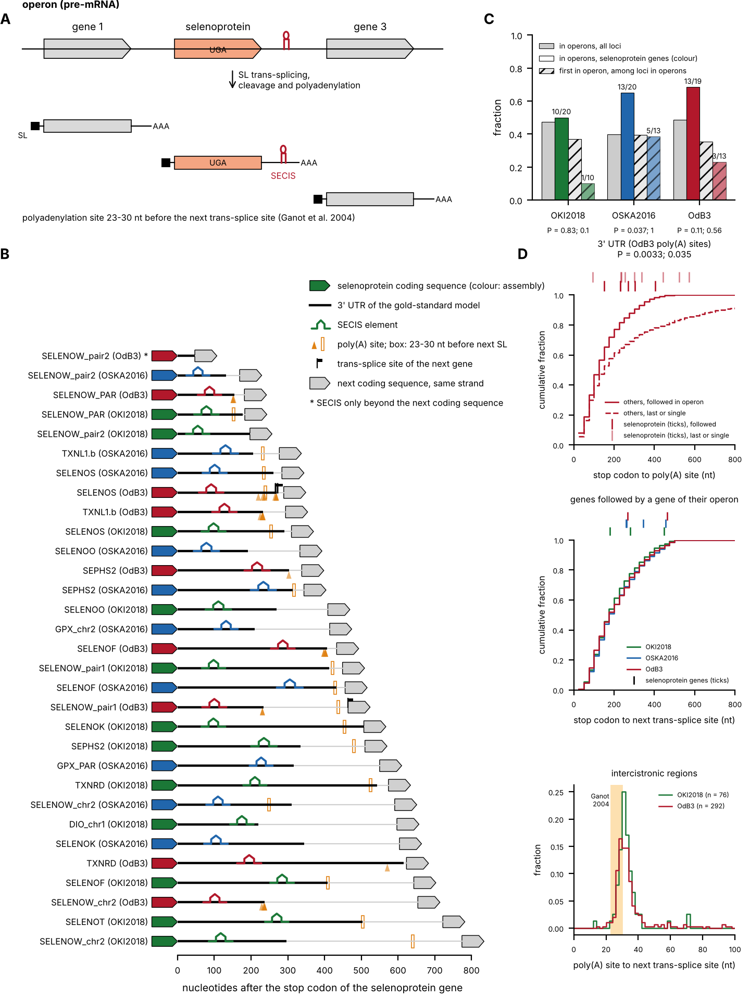

Figure OPERONS (`figures/operons.pdf`). Selenoprotein genes in the operons of the three *O. dioica* assemblies. A, an
operon and the processing of its pre-mRNA, after @Ganot2004: trans-splicing of the spliced leader (SL, black square)
to the 5′ end of each downstream mRNA and cleavage and polyadenylation of the upstream mRNA, 23 to 30 nucleotides
before the next trans-splice site; the SECIS element (stem-loop) of a selenoprotein gene must lie in the 3′ UTR of its
mRNA. B, each selenoprotein gene followed by another gene on the same strand within 800 nucleotides, in each assembly,
aligned on its stop codon and sorted by the distance to the next coding sequence: end of the coding sequence (arrow,
coloured by assembly), 3′ UTR of the gold-standard model (black line), SECIS element (best hit of the *Oikopleura*
model before the next coding sequence), polyadenylation sites in transcripts with a poly(A) tail (triangles; darker
where several transcripts end), the window 23 to 30 nucleotides before the first trans-splice site of the next gene
(outlined box), trans-splice sites of the next gene (flags) and next coding sequence on the same strand (grey arrow);
asterisk, SECIS element only beyond the next coding sequence (SELENOW_pair2 in OdB3, where the annotated coding
sequence CBY21828.1 starts inside it). C, fraction of the loci in operons (all annotated loci, grey; selenoprotein
genes, coloured) and, among the loci in operons, fraction first in their operon (hatched), with the P values of
Fisher's exact tests (in operons; first). D, from top: cumulative distributions of the distance from the stop codon
to the most supported polyadenylation site in OdB3, for the other genes followed by a gene of their operon (solid)
and for those last in their operon or outside operons (dashed), with the selenoprotein genes as ticks (dark, followed
in operon; light, last or single) and the P values of Mann-Whitney U tests; of the distance from the stop codon to the
first trans-splice site of the next gene, for the genes followed by a gene of their operon in the three assemblies,
with the selenoprotein genes as ticks; histogram of the distance from the polyadenylation site to the first
trans-splice site of the next gene (intercistronic region; 2-nucleotide bins) in OKI2018 and OdB3, against the 23 to
30 nucleotides of @Ganot2004 (shaded); OSKA2016, 9 distances, not drawn.

# Discussion

<!-- To write after the census (step 11 of the plan). Provisional paragraphs below. -->

## What the *Oikopleura* SECIS model has learned

> **Provisional paragraph (2026-10-27).**

The *Oikopleura* SECIS model may have abstracted the appendicularian SECIS element, or only recorded in a compact form
the elements that our searches found, so that the searches can be repeated on related genomes. The second is enough
for the census of this study; only the first would make the model a description that lasts rather than a step to be
replaced. Some results favour abstraction: the model detected windows of species (84 of 111) and of families (81 of
111) left out of its training; it scored at 29 to 37 bits the SECIS elements of TXNL1.b and KKSU, which were not in
training and differ from the seeds as much as seeds of different genes differ from each other; and the base pairs it
models are maintained in the evolution of *O. dioica* SECIS elements. Other results point to a record of our searches:
the seeds were selected through the model itself, by bootstrap from RF00031, so that their uniformity (all with the
form 2 arrangement and AAA below helix 3) may describe the model as much as the elements; 19 of the 111 training
windows have no hit with any of the models compared, and may hold SECIS elements of other shapes, such as those with
cytidines in place of the unpaired adenosines [@Korotkov2002] or GGGA in place of the AUGA of the internal loop
[@Novoselov2007]; and outside the
appendicularians the model finds few known SECIS elements (3 of 25 human selenoprotein genes, against 16 with
RF00031), although most of its best hits in ascidian and salp genomes follow selenoprotein genes. We do not settle
the question here. Whether one model can describe the SECIS elements of all eukaryotes, or several lineage-specific
models are needed, could be decided by work centred on the SECIS element itself across the tree of life, with
evaluations that hold out whole lineages and with experimental evidence of selenocysteine insertion; until then, we
present the model as a description of *Oikopleura* SECIS elements that reproduces our searches on related genomes.

## Selenocysteine at the protein level

> **Provisional paragraphs (2026-10-31).**

The selenoproteome described here rests on genomic and transcript evidence: in-frame TGA codons shared by the cryptic
species, SECIS elements after the coding sequences, transcripts that read through the codon, and orthology. None of it
shows that the TGA codons are translated as selenocysteine in *O. dioica*. Mass spectrometry of *O. dioica* proteins
could show it at three levels of increasing strength: a peptide of the protein shows that the gene is translated; a
peptide encoded after the TGA codon shows that the codon is read through; and the peptide that holds the selenocysteine,
with fragment ions on both sides of it and the isotope envelope that selenium gives to its precursor, shows
selenocysteine at that position [@Guo2018]. Whether such a validation will follow the release of this preprint is an
open question.

The selenoproteome itself indicates what such an experiment would need (Methods). In the gold-standard proteins of
OKI2018, trypsin gives a peptide of 7 to 30 residues that holds the selenocysteine for 17 of the 20 genes, and
chymotrypsin for the other three (GPX_chr1b, TXNL1.b and KKSU). In 14 genes, at least two tryptic peptides lie after the
selenocysteine. In the other six (SELENOK, SELENOO, SELENOS, TXNRD, TXNL1.b and KKSU), the selenocysteine is one of the
last three residues, so that only the selenocysteine peptide can show read-through; for TXNL1.b and KKSU, the two genes
outside the known families, this needs a protease other than trypsin. SELENOI, whose TGA codon was left undecided, is in
the same situation: its tryptic selenocysteine peptide would have 5 residues in OKI2018, 12 in OSKA2016 and 20 in OdB3,
given the codons that follow the TGA. The protein database would need the selenoproteins with selenocysteine at the TGA
position, and the same proteins with cysteine there, so that a cysteine-containing paralog or a wrong gene model is not
taken for a selenoprotein; the search would allow the conversion of selenocysteine to dehydroalanine, and the shift of
the monoisotopic peak that the six stable isotopes of selenium cause [@Guo2018].

What is known already brings caveats. Selenoproteins are few and often of low abundance, and their peptides are
outnumbered by cysteine peptides; the methods that enrich them, by alkylating selenocysteine selectively at low pH
[@Bak2018; @Guo2018], started from 2 mg of protein per sample [@Guo2018; @Si2025], which for animals a few millimetres
long means pools of many individuals. Selenocysteine peptides that are long or short escape detection: in mouse, the
44-residue peptide of GPX3 was not detected [@Guo2018], and in human, the tryptic peptide of TXNRD3, GCUG, is too short
[@Si2025]; in *O. dioica*, the tryptic peptides of SELENOS, TXNRD and SELENOO need a missed cleavage to reach seven
residues. The proteins differ between the cryptic species, so that the database has to match the species of the animals,
whose species-specific peptides would in turn confirm it. Finally, selenoprotein levels can depend on selenium supply,
as shown in cultured cells [@Guo2018], and may depend on stage and sex, so that the choice of material matters as much
as the depth of the analysis.

## Limitations

> **Provisional paragraph (2026-10-31).**

This study uses public genomes, annotations and transcripts, and no protein data. Selenocysteine insertion is therefore
inferred from the genes, their SECIS elements and their transcripts, not observed; how a mass-spectrometry validation
could be done, and what limits it, is discussed above.

# Methods

## Genome assemblies, annotations and transcripts

Genes are named by the symbols of their human orthologs (HGNC), given at their first mention (the human tRNA-Sec gene
is TRU-TCA1-1); appendicularian
orthologs take the same symbols, and selenoprotein families the root of their members' symbols (for example GPX for
glutathione peroxidases).

We analysed three assemblies of *O. dioica*: OKI2018 (RefSeq GCF_907165135.1, with its RefSeq annotation)
[@Bliznina2021], OSKA2016 (genome and transcript models from the ANISEED download archives
`Oidioi_genome_fasta_gff3.zip` and `Oidioi_transcripts_fasta_gff3.zip`) [@Wang2020] and OdB3 (GenBank
GCA_000209535.1, with its GenBank annotation) [@Denoeud2010]. At NCBI, the OKI2018 assembly is named OKI2018_I68;
it is the OKI2018_I69 assembly of Bliznina et al. [-@Bliznina2021], I69 being the identifier of the sequenced
individual, and we use the NCBI name for consistency with the database. The six other appendicularian genomes are
those of *Oikopleura longicauda* (GCA_004367895.1), *Oikopleura albicans* (GCA_004367875.1), *Oikopleura vanhoeffeni*
(GCA_004367855.1), *Bathochordaeus stygius* (GCA_004367955.1), *Mesochordaeus erythrocephalus* (GCA_004367975.1) and
*Fritillaria borealis* (GCA_004368075.1) [@Naville2019]; they have no public gene annotation. As non-target genomes
for SECIS models, we used four other tunicates: *Ciona intestinalis* (GCF_018327825.1), *Ciona savignyi*
(GCA_054131345.1), *Styela clava* (GCF_964204865.1) and *Thalia democratica* (GCF_965202585.1). These tunicates,
with *Ciona robusta* (KH assembly, GCF_000224145.3, the genome of the published *Ciona* selenoproteome, formerly named
*C. intestinalis*) and *Halocynthia roretzi* (GCA_013436055.1), were also analysed with the default settings, to compare the
appendicularians with other tunicates. As positive controls for the default settings, we used the human
(GRCh38.p14, GCF_000001405.40), mouse (GRCm39, GCF_000001635.27) and zebrafish (GRCz11, GCF_000002035.6) genomes, with
their RefSeq annotations. To test the settings of stage 2 on new assemblies of the three cryptic species of
*O. dioica*, we used the long-read assemblies KUM-M3-7f (Okinawa), AOM-5-5f (Osaka) and Bar2_p4 (Barcelona)
[@Plessy2024], which have no public gene annotation.

Transcript evidence came from one source per *O. dioica* assembly: for OKI2018, the Trinity transcriptome assembled
by Bliznina et al. [-@Bliznina2021] (109,877 sequences; Zenodo, <https://doi.org/10.5281/zenodo.23472675>); for OSKA2016,
the Trinity assembly of Wang et al. [-@Wang2015] (GEO GSE64421, 86,898 sequences); for OdB3, the cDNA collection of
the genome project (Genoscope, 207,355 sequences: 7,862 clone contigs and 199,493 single reads) [@Denoeud2010],
also distributed by the now offline OikoBase. All files were retrieved by a script that checks their MD5 sums.

## Selenoprotein gene pipeline

We wrote a Nextflow [@DiTommaso2017] pipeline, based on the nf-core template [@Ewels2020], that runs the following
steps on each genome; all tools run from container images. Stage 1 analysed all genomes (appendicularians,
other tunicates and vertebrate controls) in one run of release 0.2.0 with default parameters.

*Selenoprotein genes.* Selenoprofiles 4.5.8 [@Mariotti2010; @Tico2026] searched the profiles of eukaryotic
selenoprotein families and of the selenocysteine machinery (profile sets `eukarya` and `machinery`), with the Selenoprofiles data
set (profiles, Gene Ontology tables and UniRef50 tag database) downloaded from its server; the MD5 sums of the
archives used are recorded. Independently, miniprot 0.11 [@Li2023] aligned to the genome the selenocysteine-containing
sequences of the same profiles. A TGA codon was called a selenocysteine codon when miniprot aligned it to a query selenocysteine, or
when the query selenocysteine was the first residue after the end of the alignment and the next genomic codon was TGA, since
miniprot tends to stop before a C-terminal selenocysteine. Selenocysteine codons found by both methods at the same position were merged.

*SECIS elements.* Infernal 1.1.5 [@Nawrocki2013] `cmsearch` searched, with the Rfam SECIS model RF00031
[@Kalvari2020], the 6,000 nucleotides downstream of each Selenoprofiles prediction, at the Rfam gathering threshold.
A SECIS element counted as support for a prediction, not as a filter.

*tRNA-Sec.* Secmarker 1.0.0 [@Santesmasses2017] and `cmsearch` with the Rfam tRNA-Sec model RF01852 (gathering
threshold) searched each genome. Predictions overlapping on the same strand were merged into loci; a locus was
considered supported when found by both tools and, where Secmarker reported it, carrying the discriminator base G73.

*Annotation check.* For the genomes with an annotation, each selenocysteine codon predicted by Selenoprofiles was classified
according to the annotated coding sequences overlapping it, following the classes of Ticó et al. [-@Tico2026]: well
annotated (selenocysteine codon inside the CDS, in frame, with or without the selenocysteine declared), stop codon (CDS ending at the selenocysteine
codon), skipped (CDS on both sides of the codon but not over it), upstream or downstream (CDS entirely on one side),
out of frame, spliced (CDS boundary inside the codon) or absent. The same predictions were also assessed with
`selenoprofiles assess`, identifying annotated transcripts by the `Parent` of their CDS features.

*Transcript support.* Transcripts were aligned to their genome with minimap2 2.30 [@Li2018] (`-x splice
--secondary=no`). A transcript supported a selenocysteine codon when the three nucleotides of the codon lay inside one aligned
exon of its primary alignment; for each codon we recorded the number of supporting transcripts and the extension of
the longest one 3′ of the codon.

Results of all genomes were summarised with MultiQC [@Ewels2016]. The pipeline's test profile runs every process
on human chromosome 22 (with an annotation of SELENOO and a transcript covering its selenocysteine codon), the yeast
genome and a fragment of the *Escherichia coli* genome, with the SECIS threshold lowered to 15 bits; modules and
pipeline are also tested with nf-test [@Forer2025].

## Baseline curation

<!-- To complete: reference proteins, selenocysteine context, criteria; tables in curation/ of the analysis repository. -->

The baseline lists, for each of the three *O. dioica* assemblies, the selenocysteine codons of the selenoprotein genes, placed
by aligning curated reference proteins and checking the residues around the selenocysteine, and supported by transcripts and
by comparison between assemblies. Assembly errors at a gene were recorded, not corrected. Two genes outside the known
families, TXNL1.b and KKSU, were added after the UGA/SECIS screens, when they met a rule fixed in advance (Candidate
genes).

## Gold-standard gene models

> **Provisional section (2026-10-24, step 2; `curation/gold_standard.py`).**

For each curated selenocysteine codon of OKI2018, OSKA2016 and OdB3, the transcripts of the assembly were aligned to
it with minimap2 [@Li2018] (`-x splice:hq -un`, primary alignments), without preference for GT-AG splice sites,
which otherwise displaces the junctions of the atypical introns of *O. dioica* and creates false indels. Junctions
were then placed by moving each intron within 8 nucleotides to the position of lowest cost, the number of mismatches
between transcript and genome plus a splice-site cost of log10(f(GT-AG)/f(site))/2, with the intron frequencies of the
*O. dioica* reference annotation (GT-AG 87.6%, GA-AG 9%, GC-AG 2.7%, GG-AG 0.7%, other sites taken as 0.1%)
[@Denoeud2010], the factor 2 being the log10 cost of a mismatch at 1% divergence. A transcript supported the gene when
an aligned exon held the codon as TGA. Candidate models were the exon chains of the supporting transcripts, of the
annotated mRNAs and of the stage 1 Selenoprofiles predictions holding the codon, and the transcript chains extended
with the exons of overlapping annotated or predicted models beyond their ends, and, where the annotation split a
gene at the TGA, the annotated model ending at the codon joined to the next model downstream; an extension that
placed the start codon beyond a transcript whose own model was complete was kept only when the added residues
aligned to the same gene in another assembly. Each candidate was read on the genome sequence spliced along its chain: the frame of the
TGA was extended upstream to the first ATG after the previous stop codon (or the first ATG of the frame when the
chain has no stop upstream), and downstream to the next stop codon. Candidates were ranked by the presence of the
curated protein context of the selenocysteine, the absence of unsupported splice sites outside the four intron
classes, not being contradicted by most of the supporting transcripts, a length within 90% of the longest, a stop codon, an ATG start, transcript support, length, not the
annotated mRNA of another protein (an annotated mRNA whose coding sequence lies elsewhere, such as the upstream gene of
an operon) and, last, an annotated exon chain; 3′ UTR exons that overlapped the coding sequence of a downstream
annotated gene (read-through transcripts) were left out, and the UTRs were cut at the coding sequence of another
selenoprotein gene of the table when the exon chain reached it (one transcript holding both genes of the SELENOW
pair in OKI2018). Among the candidates equal to the first one on every criterion before length, the one whose
protein aligned best to the same gene in the other assemblies (mean global alignment score) replaced it when its
score was higher by 20 (about 10 bits), so that exons beyond the transcripts, taken from the annotation or from a
prediction, were chosen by similarity rather than by length. When the transcripts differed from the assembly by indels in the coding sequence, the
transcript protein replaced the assembly protein when its identity to the same gene in the other assemblies,
counted on the part of each reference protein that both proteins cover (global alignments with BLOSUM62 and free
end gaps, Biopython [@Cock2009]), was higher by more than 0.02, or, at a similar identity, when it was complete and
either more than 10% longer while the assembly protein was not complete, or more than twice as long (a frame broken by
the assembly); the model was then the transcript chain mapped onto the assembly. The models are
given in GFF3 with the selenocysteine declared (`transl_except`), with their proteins, 3′ UTRs, the 2,000
nucleotides of genome that follow each stop codon, and a table of all candidates.

## Appendicularian profiles of the selenocysteine machinery

Each Selenoprofiles profile of the machinery set (SEPHS2, PSTK, SecS, eEFSec, SECIS-binding protein 2 and SECp43) was
extended with appendicularian proteins: the predictions of the standard profiles in the appendicularian genomes other
than OdB3, labelled "homologue" or "selenocysteine" and at least half as long as the median sequence of the profile,
and the proteins reconstructed from *O. dioica* transcripts (PSTK from the OKI2018 and OSKA2016 transcriptomes, SEPHS2
with its selenocysteine from the OSKA2016 transcriptome). The added proteins were aligned to the standard profile with
MAFFT `--add --keeplength` [@Katoh2013], which keeps the columns of the profile and therefore its configuration, and
the extended alignments were built into profiles with `selenoprofiles build`, using all their sequences as BLAST
queries. The profiles keep the standard names; given to the pipeline with `--selenoprofiles_overrides`, they replace
the standard profiles of the same name.

## Census of the selenocysteine machinery

We ran Selenoprofiles with these profiles on the nine genomes. For each genome without a PSTK prediction, we
reran Selenoprofiles with the PSTK profile, keeping the predictions that its last filter discards, and compared
each of them (blastp [@Altschul1997]) with the PSTK proteins found in the other genomes and with KTI12, a related
kinase. This test needs proteins of a related family to compare with, and was not applied to the other genes. A discarded prediction counted as a fragment of the gene when its best hit was a protein of
the gene with an E-value of at most 10^-10^. tRNA-Sec loci were those of stage 1 found by both methods.

## Absence tests

For a machinery gene or associated factor missing from appendicularian genomes, the stage 1 predictions of the gene
in the other genomes were searched in each appendicularian genome and in the *O. dioica* transcriptomes with tblastn
(E-value at most 10^-3^). Hits less than 20 kb apart on the same strand formed a locus, whose translated hits
(genomes) or whose open reading frame around the best hit (transcripts) gave a candidate protein. Each candidate was
compared by blastp with the proteins of the gene (the profile sequences and the stage 1 predictions of the other
genomes) and with proteins of related families: TIA1-like RNA-binding proteins from the Selenoprofiles UniRef50
database for SECp43, KTI12 for PSTK. The margin, the score of the best hit to the gene minus that of the best hit to
the related family, classified the candidate as supported (at least 30 bits), ambiguous (10 to 30 bits) or a related
protein. The stage 1 predictions of the gene, scored in the same way, served as positive controls.

The same test was applied to the selenoprotein families predicted in other tunicates but in no appendicularian
(SELENON, SELENOH, MSRB, FrnE, SELENOL and SELENOI). The queries and references were the selenocysteine forms
predicted in stage 1 (for MSRB, the MSRB1-type forms only, without the profile sequences, since the MSRB profile
mixes MSRB1 with MSRB2 and MSRB3), and the related families were human RefSeq proteins: calmodulin (CALM1) for the
EF-hand of SELENON; SELENOW, SELENOV and SELENOT for SELENOH; MSRB2 and MSRB3 for MSRB; GSTK1 for FrnE; thioredoxin
(TXN) for SELENOL; CEPT1 and CHPT1 for SELENOI. For each candidate, the residue aligned to the selenocysteine of its
best reference was read in a local alignment (BLOSUM62, selenocysteine scored as cysteine) of its protein translated
with TGA as selenocysteine (for transcripts, the open reading frame read through TGA codons). The procedure is
`stage2/machinery_absence.py` of the analysis repository (`make machinery-absence`, `make selenoprotein-absence`).

## Orthology of the machinery genes

> **Provisional section (2026-10-22).** Draft of the methods of the reciprocal best hits, trees, long-branch
> analyses and domain analysis (`stage2/machinery_rbh.py`, `stage2/machinery_phylogeny.py`,
> `stage2/machinery_lba.py`, `stage2/machinery_domains.py`, `figures/phylogeny_collapsed.py`); to be checked before
> submission.

*Reciprocal best hits.* Each machinery protein predicted with the appendicularian profiles was compared by blastp
(legacy BLAST 2.2.26, E-value at most 10^-3^) [@Altschul1997] with the human RefSeq proteins of the GRCh38.p14
annotation, each assigned to its gene through that annotation. The best hit gave the human gene; the difference
between its score and that of the best hit to another gene gave a margin, and margins below 10 bits were called
ambiguous. The best human protein was then searched in the appendicularian genome with tblastn (E-value at most
10^-3^); the hit was reciprocal when its best locus overlapped the prediction.

*Trees.* Each tree combined the sequences of the Selenoprofiles profile (at most three per taxonomic group, the
longest kept); the stage 1 predictions in the other tunicates, in two cephalochordates and in the vertebrate controls;
the predictions of the appendicularian profiles in the nine appendicularian genomes; and the proteins reconstructed
from *O. dioica* transcripts. The other tunicates were the six analysed in stage 1 and four genomes added for this
analysis, *Botryllus schlosseri* (GCF_051294905.1), *Phallusia mammillata* (GCF_965637545.1), *Pegea* sp.
(GCA_034620365.1) and *Salpa thompsoni* (GCA_047495815.1); the cephalochordates were *Branchiostoma floridae*
(GCF_000003815.2) and *Branchiostoma lanceolatum* (GCF_035083965.1). These six genomes were run through the pipeline
with the default settings, like the other stage 1 genomes. For PSTK and the SECIS-binding proteins, which have no
selenocysteine, the RefSeq proteins of a genome replaced its predictions, which cover only the region of the profile:
for each gene whose proteins had PSTK or KTI12 (respectively SECISBP2 or SECISBP2L) as best human hit (blastp,
E-value at most 10^-5^), the longest isoform. Predictions shorter than half the median length of the profile
sequences were left out (a fifth for the SECIS-binding proteins, whose tunicate predictions often cover only the
C-terminal domain). The PSTK tree included KTI12 as outgroup: the human and *O. dioica* proteins, the KTI12 of the
RefSeq proteomes and the KTI12 entries of the Selenoprofiles UniRef50 database. The SEPHS tree included the 101 SPS1-
and SPS2-type proteins of Mariotti et al. [-@Mariotti2015], translated from the codon alignments of their
Supplemental Material S8 with selenocysteine codons as X, and human SEPHS1 and SEPHS2; it was rooted on the
prokaryotic selenophosphate synthetases. The tree of the SECIS-binding proteins included human SECISBP2 and SECISBP2L
and was rooted on the non-animal sequences of the profile. Taxonomic groups were assigned from genus names or genome
codes (`config/taxon_groups.tsv`).

The sequence sets were then curated, and each removal recorded with its reason. The stage 1 predictions in the human
genome were left out, human being represented by its RefSeq proteins of the family; identical sequences were kept
once, under the name of the genome or RefSeq record; and, after a first alignment, sequences covering less than half
of the core columns (columns where at least half of the sequences have a residue) were removed and the others
realigned. Appendicularian, curated and other tunicate sequences, the subject of the trees, were kept even when
partial.

Sequences were aligned with MAFFT 7.520 L-INS-i (`--localpair --maxiterate 1000`) [@Katoh2013] and trimmed with
ClipKIT 2.14.0 in gappy mode [@Steenwyk2020], which removed the columns with at least 90% gaps, among them insertions
found in a few sequences only, such as retained introns or rare isoforms (at least 50% gaps for the SECIS-binding
proteins). Trees were inferred with IQ-TREE 2.3.6 [@Minh2020], with ModelFinder [@Kalyaanamoorthy2017] restricted to
the LG, WAG and JTT matrices and 1,000 ultrafast bootstrap replicates [@Hoang2017]. The alignments had 83 sequences
and 419 sites for PSTK (selected model LG+F+I+R5), 117 and 454 for SEPHS (LG+R6) and 81 and 444 for the
SECIS-binding proteins (LG+I+R6). PSTK and SEPHS were also analysed under LG+C20+F+G [@Le2008]. In the
display trees, nodes with less than 50% support were collapsed into polytomies and clades of a single taxonomic
group were drawn as one tip, except for appendicularians, other tunicates and cephalochordates; supports were kept on
their bipartitions when the trees were rerooted.

*Long-branch analyses.* Each tree was reanalysed (1) under LG+C60+F+G with posterior mean site frequencies (PMSF)
[@Le2008; @Wang2017], with the maximum-likelihood tree as guide tree and 1,000 ultrafast
bootstrap replicates; (2) after removal of the fastest-evolving 10, 20, 30 and 40% of the sites [@Brinkmann1999], ranked by their empirical Bayesian rates (IQ-TREE `-wsr`) under the selected model on the
maximum-likelihood tree, each reduced alignment being analysed as above; and (3) for PSTK, without the long-branched
proteins of the insect-gut fungi *Smittium* and *Zancudomyces*. In each tree, we read as unrooted bipartitions the
support of the appendicularian clade (the largest clade of appendicularian sequences in the maximum-likelihood tree,
followed with the same sequences in every analysis), of that clade with the other tunicate proteins of the same form
(for SEPHS, the selenocysteine copies, the glycine forms being left out), and, for PSTK, of the family against KTI12.

AU tests [@Shimodaira2002] compared the unconstrained tree with the best trees found under topological
constraints (IQ-TREE `-g`), with 10,000 RELL replicates. For each family, the constraint grouped the appendicularian
clade with the other tunicate proteins of the same form. For SEPHS, two more constraints placed the appendicularian
selenocysteine clade inside the clade of all tunicate SEPHS, and at the position expected for an ortholog: grouped
with the tunicate selenocysteine copies, with the tunicate glycine forms and the second appendicularian copy as their
sister group. These two were tested under the selected model and under LG+C60+F+G with the site frequencies of the
PMSF analysis. The composition of each sequence was compared with that of the alignment by the chi-square test of
IQ-TREE, and path lengths were measured in the maximum-likelihood trees from the most recent common ancestor of the
tunicate and vertebrate SEPHS.

*Domain analysis* (`stage2/machinery_domains.py`). Each trimmed alignment was split in two at a domain boundary of
the human protein, taken from the InterPro entries of the CATH-Gene3D, SUPERFAMILY and Pfam databases for the UniProt
sequences: PSTK (Q8IV42), kinase domain (residues 1-263, P-loop NTPase domains at 20-88 and 140-263) and C-terminal
region (264-348); SEPHS2 (Q99611), N-terminal half (1-238, with the AIR synthase-related N-terminal domain, PF00586)
and C-terminal half (239-448, with the C-terminal domain, PF02769); SECISBP2 (Q96T21), region upstream of the L7Ae
domain (1-631) and L7Ae domain (632-854, PF01248). The UniProt coordinates were carried to the human sequence of the
alignment by a global pairwise alignment (Biopython, BLOSUM62), and each column was assigned to the domain of the
human residue it holds, or of the last human residue before it. Sequences with residues in less than 30% of the
columns of either part were left out (one PSTK, one SEPHS and five SECIS-binding proteins), so that both parts were
analysed on the same sequences (PSTK 82 sequences, 294 and 125 columns; SEPHS 116, 234 and 220; SECIS-binding
proteins 76, 253 and 191). For each part, a tree was inferred as above, constrained trees were searched as in the
long-branch analyses, and AU tests compared, on the data of that part, the trees of both parts, the full-length tree
pruned to the same sequences and the constrained trees. Clades with ultrafast bootstrap support of at least 95%, and
of at least 90%, in the tree of one part were tested for compatibility with the clades so supported in the tree of
the other part. The analysis was repeated under LG+C60+F+G with PMSF, the site frequencies of each part being
estimated on its maximum-likelihood tree; the full-length PMSF tree, pruned, was added to the tested trees.

## Orthology of the selenoprotein genes

> **Provisional section (2026-10-30).** Methods of the second round of hit validation (`stage2/machinery_rbh.py`,
> `stage2/machinery_phylogeny.py`, `stage2/machinery_lba.py`, `stage2/au_hypotheses.tsv`,
> `stage2/selenoprotein_orthology.py`, `stage2/selenoprotein_table.py`, `stage2/taxonomy.py`).

The methods of the machinery were applied to the selenoprotein families in which the final stage 2 run predicted
appendicularian genes (DIO, GPX, MsrA, SELENOF, SELENOK, SELENOL, SELENOO, SELENOS, SELENOT, SELENOU, SELENOW and
TXNRD), with the following differences. Best hits were computed for the predictions of the final run in the nine
appendicularian genomes and for the stage 1 predictions in the other genomes; the expected human genes of each family
were those of its name (for example GPX1 to GPX8, DIO1 to DIO3, SELENOW and SELENOV for SELENOW). The trees combined
the profile sequences (at most three per taxonomic group), the stage 1 predictions in the other tunicates, the
cephalochordates and the vertebrate controls, the predictions of the final run in the nine appendicularian genomes at
least 30% as long as the median profile sequence (the profiles of some families mix short and long proteins), and the
human RefSeq proteins of the family, with those of a related family as outgroup for TXNRD (GSR) and SELENOF (SELENOM),
and human MIEN1, the best human hit of part of the tunicate SELENOW, in the SELENOW tree. In OKI2018, OSKA2016 and OdB3,
the predictions that overlap a gold-standard gene of the family on the same strand were replaced by its gold-standard
protein, which took their best hits; the new *O. dioica* assemblies used as tests of stage 2 were left out. Trees
without outgroup were rooted at the midpoint for display.

Taxonomic groups were assigned from the sequence names in this order: the genome code or genus at the start of the
name; the Ensembl species prefix of a protein identifier and the UniProt species mnemonic of an entry name; any other
word of the name that is a known genus; and descriptive bacterial names (`config/taxon_groups.tsv`,
`config/taxon_codes.tsv`). Eight of the 1,053 sequences of the trees could not be assigned (profile sequences with no
species in the name). The machinery trees were built with the first rule only, which left more profile sequences unassigned and thus
outside the limit of three per group.

Each appendicularian clade (largest group of appendicularian sequences forming a side of a bipartition) was described
on the unrooted maximum-likelihood and PMSF trees by its support, its sister group (the smallest side of a bipartition
holding the clade and other sequences) and its nearest vertebrate genes (the human genes in the smallest such side
that holds vertebrate sequences with a known human gene: human proteins, and vertebrate predictions with their best
human hit). AU tests compared, for each family, the unconstrained tree with the best trees found under each of a set
of constraints, all in one test, under the selected model and under LG+C60+F+G with the PMSF site frequencies. Each
constraint was given as clades of leaf sets: the appendicularian clade, the appendicularian clades holding named
gold-standard proteins, the smallest clade holding named sequences, taxonomic groups (tunicates other than
appendicularians; chordates; animals) and differences of these sets. Where the reference group of a hypothesis did
not form a clade of the maximum-likelihood tree (for example chordate proteins with nematode or insect proteins among
them), a control constraint made the group a clade with the appendicularian clade outside it, so that a rejection of
the group's monophyly could be told apart from a rejection of the appendicularian position.

## Census of the selenoprotein genes

> **Provisional section (2026-10-30).** `stage1/collect.py --prefix stage2_final`, `stage2/census_contigs.py`,
> `stage2/census.py` (`make stage2-collect`, `census-contigs`, `census`).

*Loci.* The selenocysteine codons of the final stage 2 run (Selenoprofiles predictions labelled selenocysteine, and
miniprot calls) were merged into loci when they lay on the same contig and strand within 30 nucleotides of each other
or belonged to the same Selenoprofiles prediction. Each locus took the family and SECIS score of its Selenoprofiles
prediction, or else of its miniprot call. A locus was assigned to a gene: in OKI2018, OSKA2016 and OdB3, the
gold-standard gene that holds it, and in the three new *O. dioica* assemblies, the lifted gold-standard model that
holds it; otherwise the gold-standard genes of the smallest clade of appendicularian sequences that holds its
prediction and a gold-standard protein in the maximum-likelihood tree of its family (Orthology of the selenoprotein
genes); for SEPHS2, TXNL1.b and KKSU, families of one *O. dioica* gene without tree, that gene. The loci of the
UGA/SECIS screens that the final run did not predict (comparative-screen TGAs classified as homologs of a known
selenoprotein, candidates whose partner in another genome leads to a gene, and SECIS-scan hits classified as copies of
a known selenoprotein) were added without gene model, with the gene of their best gold-standard hit or of their
partner. For the other tunicates, the cephalochordates and the vertebrates, loci were made in the same way from the
selenocysteine codons of stage 1, without assignment or screen.

*Contig checks.* For each genome, 2,000 windows of 2, 5 and 10 kb were drawn at random positions on the contigs at
least that long (fixed seed). For each window and for each contig carrying a prediction (on the window of the largest
of these lengths that fits in it, centred on its predictions, and on the 2-kb window), we computed the GC content, the
composition distance (Euclidean distance between the centred log-ratio of its 136 canonical tetranucleotide counts,
plus one, and the component-wise median of the windows of the same length) and the open reading frame density
(fraction of its bases in stop-to-stop open reading frames of at least 100 codons in any of the six frames, other
bases than A, C, G, T ending a frame); and, for each contig, the open reading frame density of the whole contig.
Values were compared with the windows of the same genome and length as robust z-scores, (x − median) / (1.4826 ×
median absolute deviation). A contig was a composition outlier when the z-score of its composition distance exceeded
5 on either window, and ORF-dense when at least 60% of it, and at least 0.3 more than the median of the 2-kb windows of
its genome, was in such open reading frames, at a GC content of at most 50% and a length of at least 5 kb (in tests on
random sequence, the density was 0.03 at 40% GC and 0.84 at 65% GC, and 0.97 for coding sequence). The second
condition was added after the first results, because the median of the *F. borealis* windows is 0.80.

*Decisions.* The rules were fixed before the census, except the second condition of ORF density. A locus in a gold-standard gene was always counted. Another locus
was left out if its best human hit was in another family (MIEN1 counting as related to SELENOW and SEPHS1 to SEPHS2),
or if its contig was a composition outlier or ORF-dense and its nearest relatives in the tree of its family were all
non-animal (taxonomic groups as in the trees). Other flags were reported without effect: GC outlier (|z| > 5), no SECIS
hit, less than 500 nucleotides of contig after the codon, miniprot only, contig shorter than 3 kb.

*Horizontal gene transfer.* Every appendicularian sequence of the trees, whatever its label, whose nearest relatives
outside the appendicularians (the smallest side of a bipartition holding it and other sequences), or outside the
tunicates when its appendicularian clade lies in a clade of tunicate sequences, were all bacterial, archaeal or fungal
in the maximum-likelihood tree was listed. Its status was, in this order: contamination likely (composition outlier
or ORF-dense contig); other family (best human hit in another family: its animal relatives are not in the tree);
family not confirmed (no hit in the human proteome although the family has human members); placement not stable (the
PMSF tree does not give the same kind of nearest relatives); candidate without intron (a single coding exon); or
candidate.

## Operons

In each *O. dioica* assembly, the annotated transcripts with a coding sequence (RefSeq for OKI2018, ANISEED for
OSKA2016, GenBank for OdB3) were grouped into loci when their coding spans overlapped on the same strand; loci that
overlapped a gold-standard selenoprotein gene on its strand were replaced by it, and annotated mRNAs that hold such a
gene only in their 3′ UTR were kept as loci of their own. Consecutive loci on the same strand whose coding spans were
at most 500 nucleotides apart formed an operon: the intergenic distance of @Plessy2024, applied to coding spans
because the OSKA2016 annotation has no UTRs (@Ganot2004 used less than 300 bp between coding sequences for candidate
operons; the distances are in the table). The SECIS element of each gene was the best hit of the *Oikopleura* model
(at least 20 bits) in the 2,000 nucleotides after its stop codon that ends before the coding sequence of the next gene
on the same strand (the best hit of the window can be the SECIS of that gene). Trans-spliced transcripts were the
transcripts aligned for the gold-standard models (Gold-standard gene models) whose 5′ end carries the 3′ end
(GATTGTCTAACAG, at most one mismatch, within the first 80 nucleotides) of the *O. dioica* SL,
ACTCATCCCATTTTTGAGTCCGATTTCGATTGTCTAACAG [@Ganot2004]; the trans-splice site is the genome base after the SL in the
alignment, and its two preceding bases were checked for the AG acceptor. Polyadenylation sites were read in all the
transcripts of each assembly (Trinity assemblies for OKI2018 and OSKA2016, cDNA reads and clone contigs for OdB3;
genome alignments of Gold-standard gene models) that end with at least 10 A: the site is the last genome base aligned before the tail (genomic A that the
alignment extends into cannot be told from the tail). For each locus, the polyadenylation sites between its stop
codon and the next coding sequence on the same strand (or within 2,000 nucleotides) were counted, and the most
supported site (the 3′-most on ties) was used. Intercistronic regions were measured between the most supported
polyadenylation site of a gene followed by another gene of its operon and the first trans-splice site of that gene,
as the difference of their positions (one more than the number of nucleotides between the last base of the upstream
mRNA and the first base of the downstream exon). Distances from the stop codon to the polyadenylation site and to the
next trans-splice site were compared between selenoprotein genes and the other loci, separately for the genes
followed by another gene of their operon and for the others, by Mann-Whitney U tests; the table also compares the
annotated 3′ UTRs with those of the gold-standard models, which come from other sources. The proteins of the neighbours of each gene
were compared between the three assemblies by blastp (E ≤ 10^-10^). Selenoprotein genes were compared with the other
loci by Fisher's exact test. The procedure is `stage2/operons.py` of the analysis repository (`make operons`).

## SECIS scores against genomic background

For each prediction, Selenoprofiles writes the sequence downstream of the predicted coding sequence, up to 6,000
nucleotides or the end of the contig. We scored these 3′ sequences with Infernal 1.1.5 `cmsearch` on their top
strand, with the default filters, reporting all hits of at least 0 bits, and kept the best score of each sequence.
Predictions were grouped into those with a selenocysteine codon (label "selenocysteine") and the others (cysteine homologs,
predictions not aligned at the selenocysteine position, homologs of the selenocysteine machinery). As background, we drew from each genome
200 windows of 6,000 nucleotides, at positions chosen uniformly over the contigs of at least that length and on a
random strand, and scored them the same way. For the curated *O. dioica* selenoprotein genes, we scored the 6,000 nucleotides
that follow each selenocysteine codon on its strand.

*Validated hits* (provisional, 2026-10-24). For the SECIS analyses, a selenocysteine prediction was left out only on
evidence against it from the first round of hit validation: a best human hit (reciprocal best-hit analysis) in an
unrelated family, MIEN1 counting as related to SELENOW and SEPHS1 to SEPHS2, or nearest relatives in the tree of its
family (the smallest side of a bipartition holding it and non-appendicularian sequences) that are all bacterial,
archaeal, fungal or of other non-animal groups. The curated *O. dioica* genes were always kept. Taxonomic groups were
those of the machinery trees, assigned from the first word of the name. With the extended assignment used for the
second round (Orthology of the selenoprotein genes), the nearest relatives of 24 of the 111 selenocysteine
predictions, among them curated deiodinases, are of non-animal groups only (alveolate and amoebozoan deiodinases,
for example), and none are bacterial, archaeal or fungal only; their positions were tested in the second round.

## First appendicularian SECIS model

Training sequences were the 3′ sequences that follow Selenoprofiles predictions labelled "selenocysteine" in seven
oikopleurid genomes (OKI2018, OdB3, *O. longicauda*, *O. albicans*, *O. vanhoeffeni*, *B. stygius* and
*M. erythrocephalus*); OSKA2016 and *F. borealis* were held out. The background for training was 200 random windows
per training genome, drawn as above with a different random seed from the windows used for evaluation. Round 0
selected, as seeds, the best RF00031 hit of each training sequence scoring at least 15 bits. Each round then aligned
the seeds to the current model with `cmalign` (in the first round, RF00031, from which the consensus secondary
structure is inherited), built a model with `cmbuild` (default options), calibrated it with `cmcalibrate -L 0.2`, and
searched the training sequences and the background with `cmsearch` as above. The next seeds were the best hits of
the training sequences scoring above the best background hit of that round. Rounds stopped when the set of seed
sequences did not change, which happened at round 5; the best background hit was 29.3, 23.7, 21.6, 21.0 and 24.8 bits
in rounds 1 to 5. The final model was built from the last seeds and calibrated with default `cmcalibrate` settings.
The procedure is implemented in `stage2/build_secis_model.py` of the analysis repository.

## *Oikopleura* SECIS model

Positive windows were the 2,000 nucleotides that follow the stop codon of each selenoprotein gene on its strand: the
gold-standard models of OKI2018, OSKA2016 and OdB3, and, in *O. longicauda*, *O. albicans* and *O. vanhoeffeni*, the
selenocysteine predictions kept by the first round of hit validation, whose frame was extended on the genome to the
next stop codon (at most 600 nucleotides). Windows were shortened at the next selenoprotein coding sequence
downstream on the same strand and at contig ends, and left out when shorter than 100 nucleotides. Negative windows
were 200 random windows of 2,000 nucleotides per genome, in the six assemblies and in four non-target tunicates
(*C. intestinalis*, *C. savignyi*, *S. clava* and *T. democratica*), drawn uniformly over the contigs at least that
long, on a random strand, and drawn again when they overlapped a positive window; one random seed gave the windows
used for training and another those used for evaluation. Further negatives were the positive windows shuffled with
their dinucleotide composition preserved [@Altschul1985] and the windows after the stop codons of the cysteine
homologs kept by the first round of hit validation, except those overlapping a positive window. All windows were
scored with `cmsearch` on their top strand, reporting hits of at least 0 bits.

Training started from RF00031. Round 0 seeds were the best RF00031 hit of each training window scoring at least 15
bits. Each round aligned the seeds to the current model (`cmalign`), built a model (`cmbuild`), calibrated it
(`cmcalibrate -L 0.2`) and searched the training windows and the training random windows of the training genomes;
the next seeds were the best hit of each training window scoring above the best random-window hit. In decreasing
order of score, a seed was then dropped when it overlapped an earlier seed in the genome or was at least 90%
identical to one (identical bases over the length of the shorter sequence, in a global alignment with free end gaps;
Biopython [@Cock2009]). Rounds stopped when the seed set no longer changed, or after eight rounds.

Evaluation used one fold per family, whose positive windows in the six assemblies were left out, and one per
species, the three *O. dioica* assemblies being left out together because their SECIS elements are near-identical.
In each fold, all windows were scored with the model of the fold, with RF00031, with a model built from the RF00031
seed sequences and the final seeds of the fold aligned together to RF00031, and with the first appendicularian model.
For each model, the training threshold was the best score of the training random windows of the training genomes.
Left-out positive windows were counted above this threshold and above the best score of the evaluation negatives of
the fold: the evaluation random windows of the left-out genomes (of the six assemblies, for a family fold) and of
the non-target tunicates, the shuffled left-out windows and the left-out cysteine windows. Evaluation negatives
above the training threshold were counted per megabase. The final model was trained in the same way on all positive
windows and calibrated with the default `cmcalibrate` settings. The procedure is implemented in
`stage2/secis_model_training.py` of the analysis repository (`make secis-v2`); the model is
`results/models/oikopleura_secis.cm`.

## Description of the SECIS model

The seeds of the final model were realigned to it with `cmalign`. Identity between two seeds was counted over the
consensus positions where both have a residue, and seeds were grouped by single linkage at 0.7. For each base pair of
the consensus structure, we counted the seeds with a canonical pair (Watson–Crick or G·U), and computed the mutual
information between the two columns over one seed per group, with a p-value from 2,000 permutations of one column
(Benjamini–Hochberg correction over the 18 pairs). Decoys were the best hits of the model (`cmsearch --max`, top
strand) in 20 dinucleotide-shuffled copies [@Altschul1985] of each window after the stop codon of the gold-standard
models; the 76 best were aligned and analysed as the seeds. For the orthologous SECIS elements of the three
*O. dioica* assemblies, the best hit of the model in each window was found in the same way; the OKI2018 hit was
placed on the consensus positions by `cmalign`, and the windows of OSKA2016 and OdB3 were aligned to it by sequence
(local alignment of the hit and 50 nucleotides on each side; match 2, mismatch −3, gap opening −5, extension −2;
Biopython [@Cock2009]), so that the structure did not guide the alignment of the orthologs. At each base pair where
two assemblies shared a pair and the third differed, we counted one change from the shared pair (three-taxon
parsimony). For a change from a canonical pair at one base, the probability of keeping a canonical pair was that of
the new base being one of those that pair with the unchanged base, with transitions taking the fraction observed at
the other unpaired positions and the two transversions half of the rest each; for a change at both bases, the sum
over the canonical pairs of the products of these probabilities. The observed numbers of changes that kept a
canonical pair were compared with the sums of these probabilities by one-sided binomial tests (SciPy). With
OSKA2016 or OdB3 as reference instead of OKI2018, the conclusions were the same (single changes, 19 of 33 kept,
p = 7 × 10^-5^; double changes, 10 of 12 and 12 of 14, p = 0.005 and 0.002). Hits of the genome scans at the genome
threshold were classed by the gene upstream on the same strand (within 3 kb of its stop codon) and by the frames of
the comparative screen. The procedure is `stage2/secis_model_description.py` and `figures/secis_model_figures.py` of
the analysis repository (`make secis-description`).

For the hits at the genome threshold without a selenoprotein gene upstream, we recorded the annotated transcripts at
the hit and upstream on the same strand (OKI2018, OSKA2016, OdB3 and the annotated non-target genomes), compared the
5,000 nucleotides upstream of the hit with the human RefSeq proteome and the gold-standard proteins by blastx (legacy
BLAST 2.2.26, top strand, E ≤ 10^-5^; best human and best gold-standard hit, with the stop codons inside the
alignment), counted the copies of the hit and 50 nucleotides on each side in its own genome (blastn, at least 80%
identity over at least 80% of the query), and searched the same sequence in the other *Oikopleura* assemblies (best
blastn alignment, and a genome-scan hit within 300 nucleotides of it). The procedure is `stage2/secis_orphan_hits.py`
(`make secis-orphans`).

## UGA/SECIS screens

Genomes were scanned with `cmsearch` (both strands, default filters, hits of 15 bits or more) and the *Oikopleura*
model: the six *Oikopleura* assemblies, the held-out *B. stygius*, *M. erythrocephalus* and *F. borealis*, and four
non-target tunicates, each with a copy in which every window of 1,000 nucleotides was shuffled with its dinucleotide
counts preserved [@Altschul1985]. From the hits of the shuffled *Oikopleura* copies, pooled per megabase (both
strands), two thresholds were set for each genome: the genome threshold, the lowest integer score with at most one
expected false hit in that genome, and the comparative threshold, with at most 100 (not below 15 bits).

Transcript sets were the annotated transcripts (RefSeq for OKI2018, ANISEED for OSKA2016, GenBank for OdB3; CDS rows
for models without exons), extended by 1,000 nucleotides of genome after their 3′ end (and 300 before the 5′ end of
CDS-only models) and searched on their sense strand, and the transcript assemblies (OKI2018 Trinity, OSKA2016
transcripts, OdB3 ESTs), searched on both strands. Controls were the RefSeq mRNAs of human and *C. intestinalis*,
searched with the *Oikopleura* model and with RF00031. On each transcript strand with a SECIS hit of at least 20
bits, every TGA upstream of the hit was read as selenocysteine in a frame from the first ATG after the previous stop
codon of the frame (TAA, TAG or TGA), or from the first ATG or codon of the transcript when there was none, to the next
stop codon, which had to end before the SECIS. Frames of at least 40 codons with at least 10 codons before the TGA
were kept (the spliced leader of *O. dioica* mRNAs [@Ganot2004] holds a TGA in one frame); a frame was left out when
it overlapped, in another reading frame, a longer such frame or a longer ordinary open reading frame. Frames with at
least 10 codons after the TGA were called internal, the others C-terminal.

For the comparative screen, the 5,000 nucleotides before each genome-scan hit at the comparative threshold, on its
strand, were compared by tblastx (legacy BLAST 2.2.26, no filter) with those of the other species, the three
*O. dioica* assemblies counting as one. A TGA aligned to a TGA on the forward frames of both regions, in an alignment
with E ≤ 10^-5^ and at least 10 aligned residues on one side of it, was kept unless a stronger alignment of the same
regions overlapped it in another frame, and when the open stretch around it held at least 20 codons; each TGA was
assigned to the nearest SECIS hit downstream. The held-out genomes were compared with all species but did not serve
as partners of the *Oikopleura* assemblies. Candidate proteins were compared by blastp (E ≤ 10^-3^) with the human
RefSeq proteome and the gold-standard proteins, and the residue aligned to the selenocysteine was read in a local
alignment (BLOSUM62). A frame was known when its TGA was the selenocysteine codon of a gold-standard gene, lay in the
coding sequence of a stage 1 selenocysteine prediction, or was an annotated selenocysteine of a control; for
*O. dioica* transcripts without genome position, when its protein was at least 80 % identical to a gold-standard
protein with the selenocysteines aligned. Other frames were classed as another TGA of a known gene, another frame of
a transcript with a known frame, a copy of a known selenoprotein (partner at a known codon, or selenocysteine aligned
to that of a gold-standard or human selenoprotein), a TGA upstream of the SECIS of a known gene (comparative screen,
known gene ending at most 3 kb before the hit), or a candidate. Candidates of the same gene were linked between
species when their selenocysteines aligned (blastp E ≤ 10^-5^, selenocysteine read as cysteine). The procedure is
`stage2/uga_secis_screen.py` of the analysis repository (`make secis-scan`, `make uga-screen`).

## Candidate genes

The rule for TXNL1.b was set before the screens and applied to it and to KKSU: in each of the three *O. dioica*
assemblies, the codon at the curated position must be TGA, and the best hit of the *Oikopleura* SECIS model
(`cmsearch`, sense strand) in the 2,000 nucleotides after the next stop codon of its frame must reach 20 bits, the
threshold for 3′ windows; a gene meeting it in the three assemblies was added to the baseline. The candidate proteins
(the OKI2018 frames and the *O. albicans* frame of KKSU from the comparative screen, selenocysteine read as X) were
compared by tblastn (legacy BLAST 2.2.26, no filter, E ≤ 10^-5^) with 21 genomes: the six *Oikopleura* assemblies,
the three held-out appendicularians, ten other tunicates and two *Branchiostoma* species. For each genome, the
best locus was kept, and the codon aligned to the selenocysteine was read in the genome (in the frame of the
alignment beyond its end when the alignment stopped at most five codons before it), with the codons up to the next
stop codon and the best hits of the *Oikopleura* model and of RF00031 (0 bits or more) in the 2,000 nucleotides
after that stop codon. The proteins were also compared by blastp (E ≤ 10^-5^) with the RefSeq proteomes of 11
species (three vertebrates, six tunicates and two *Branchiostoma*), and the residue aligned to the selenocysteine
was read in a local alignment (BLOSUM62), or at the same offset beyond its end when the alignment stopped at most
five residues before it.

SELENOI, found by the absence tests, has no curated position. The transcripts of the three *O. dioica* transcript
sets that encode it were aligned to their assembly as for the gold-standard models (`minimap2 -x splice:hq -un`,
junctions placed by the same procedure), and in each the open reading frame read through TGA that aligned best to
the candidate protein (local alignment, BLOSUM62) gave the codon aligned to its selenocysteine, which was mapped to
the assembly; the rule was applied at that position. The best SECIS hits of the *Oikopleura* model and of RF00031
(0 bits or more) were also searched in each transcript after the stop codon that follows that codon. The procedures
are `stage2/candidate_transcripts.py` and `stage2/candidate_genes.py` of the analysis repository
(`make candidate-genes`).

## TXNL1 homologs and paralogs

Human TXNL1 (NP_004777.1), its thioredoxin part (residues 1 to 117; Pfam PF00085 at 12 to 104) and its PITH part
(118 to 289) were compared by blastp (legacy BLAST 2.2.26, no filter, E ≤ 10^-3^) with the proteins of each
*O. dioica* assembly (annotated coding sequences translated from the genome, and the gold-standard proteins) and by
tblastn with its genome, and TXNL1.b was compared with the human RefSeq proteome (hits grouped by gene) and with its
own assembly; each best subject was compared back with the human proteome (`stage2/txnl1_homologs.py`,
`make txnl1-homologs`). TXNL1.a, the best blastp hit of human TXNL1 outside the TXNL1.b locus, and TXNL1.b of OKI2018
were then compared by tblastn (E ≤ 10^-5^) with the 21 genomes of the previous section, colinear HSPs within 20 kb
forming a site, and by blastp with the RefSeq proteomes; for each site or protein, we recorded the coverage of the
thioredoxin and PITH parts of TXNL1.a (boundary at the residue aligned to human residue 117), the residue or codon
aligned to the selenocysteine of TXNL1.b, and the best human gene (blastp). The PITH regions of the TXNL1 and PITHD1
proteins (one protein per gene, curated RefSeq entries first, then the longest; for *O. dioica*, OKI2018 only) and of
the genome sites without an annotated protein (at least 60 residues, taken from the best HSP at each position of the
query) were aligned with MAFFT L-INS-i [@Katoh2013], trimmed with ClipKIT (gappy mode, 0.9) [@Steenwyk2020] and
analysed with IQ-TREE 2 (ModelFinder, 1,000 ultrafast bootstrap replicates) [@Minh2020; @Kalyaanamoorthy2017;
@Hoang2017]. The tree was rooted on the clade of the sequences whose best human gene is PITHD1 (by at least 10 bits
over the next gene), and supports were read by bipartition after rooting (`stage2/txnl1_paralogs.py`,
`make txnl1-paralogs`). The coding introns of TXNL1.b and TXNL1.a (residue after the intron and phase) were compared
on the coordinates of TXNL1.a, those of TXNL1.b carried through the local alignment of the two proteins
(`stage2/txnl1_introns.py`, `make txnl1-introns`).

## Stage 2 profiles

> **Provisional section (2026-10-29; `stage2/build_profiles.py`, `make stage2-inputs`).**

Selenoprofiles profiles were built from the standard ones and appendicularian proteins: the gold-standard proteins of
the families of the gold standard (the profile of a gene being its name up to the first underscore, without dots,
since Selenoprofiles reads the family of a prediction up to the first dot: TXNL1.b goes to the profile TXNL1b); for
the machinery, the stage 1 predictions labelled "homologue" or "selenocysteine" and at least half as long as the
median sequence of the standard profile, and the proteins reconstructed from transcripts (Appendicularian profiles of
the selenocysteine machinery), of the three *O. dioica* assemblies (evaluation profiles) or of the six *Oikopleura*
assemblies (final profiles), replaced in a gold-standard assembly by its gold-standard protein when there is one;
and, for the final profiles only, the selenocysteine predictions of *O. longicauda*, *O. albicans* and
*O. vanhoeffeni* kept in step 1 (with the same length rule) and the *O. albicans* KKSU frame of the comparative
screen. Proteins of *B. stygius*, *M. erythrocephalus* and *F. borealis* were never used. For standard families, the
proteins were added to the standard alignment with MAFFT `--add --keeplength` [@Katoh2013], which keeps its columns
and therefore the column-based filters of its configuration; a protein whose selenocysteine fell outside the
selenocysteine column of the standard alignment would have been removed (none was). KKSU and TXNL1b were aligned with
MAFFT L-INS-i, and their configuration replaced the default filter on the alignment-weighted sequence identity
(AWSI), which needs more sequences, by the exclusion of pseudogenes alone. Each alignment was built into a profile
with `selenoprofiles build` (all sequences as BLAST queries), loading the standard configuration; the keys that the
build does not write back were restored (the Gene Ontology terms of the GPX profile, without which its filter fails),
and the SELENOS filter, which requires 5 of 9 residues conserved in vertebrates, was changed to require them only from
predictions not labelled selenocysteine, that is, without a TGA aligned to the selenocysteine of the profile
(`stage2/profile_config_overrides.tsv`). We built evaluation
profiles from the three *O. dioica* assemblies (E0), three sets each without one of them (leave-one-species-out), and
the final profiles; the proteins of each build are listed in `results/tables/stage2_profile_members.tsv`. A copy of
the *Oikopleura* SECIS model was given gathering, trusted and noise cutoffs of 20 bits, so that the pipeline, which
searches with `--cut_ga`, reports and includes hits from 20 bits.

After the census, the SELENOK genes that the UGA/SECIS screens found in *O. longicauda*, *O. albicans* and
*O. vanhoeffeni* (UGA/SECIS screens; The selenoproteomes of appendicularians) were added to the profiles for the
deposit (release profiles). Regions of 9 kb around the screen codons were aligned with each gold-standard SELENOK
protein by GeneWise [@Birney2004] (selenocysteine read as cysteine, sense strand), and the model of best score was
kept. Its last exon was joined to the exon of the screen codon through a donor (GT, GC or GA, the *O. dioica* intron
classes) within 40 nucleotides of its end and an acceptor (AG) within 400 nucleotides upstream of the TGA, with the
TGA in frame and no TAA or TAG before it, choosing the joint whose protein had the best global alignment score to
the query (BLOSUM62, end gaps free); the start codon was taken up to 10 codons upstream of the model, in frame and
without stop codon, or among its first two codons. The three proteins were added to the final profiles as curated
members (the *M. erythrocephalus* model, from a held-out genome, was not). The final and release SELENOK profiles were
compared by running Selenoprofiles with that profile alone on OKI2018 and the six other appendicularian genomes, and
listing its candidate predictions before filtering (`stage2/diagnose_refiltering.py`). The procedures are
`stage2/extract_regions.py`, `stage2/region_gene_models.py` and `stage2/build_profiles.py` of the analysis repository
(`make selenok-regions`, `selenok-models`, `stage2-release-profiles`, `selenok-diagnose`).

## Test assemblies and reference genes

> **Provisional section (2026-10-29; `stage2/truth_sets.py`, `make stage2-truth`).**

The test assemblies KUM-M3-7f, AOM-5-5f and Bar2_p4 were downloaded from Zenodo
(<https://doi.org/10.5281/zenodo.10241527>, archive `Oidioi_genomes.tar.gz`) [@Plessy2024]. For each, the genomic
region of each gold-standard gene of the same species (coding sequence and 500 nucleotides on each side) was aligned
to the assembly with minimap2 [@Li2018] (`-x asm20 -c --cs=long`); the coding segments and the selenocysteine codon
were carried over base by base through the best alignment, completed by the other alignments of the region on the
same sequence and strand, in the same order and within 50 kb, a segment end falling in an indel being placed from the
nearest aligned base within 30 nucleotides. The carried-over model was read on the assembly and classified as
complete, complete with in-frame indels, disrupted (frameshift or premature stop codon) or partial, and the codon at
the carried-over selenocysteine position was recorded; a gene was a reference when this codon was TGA. For
*O. longicauda*, *O. albicans* and *O. vanhoeffeni*, the references were the stage 1 selenocysteine predictions kept in
step 1 and the KKSU sites of the comparative screen.

## Stage 2 runs and benchmark

> **Provisional section (2026-10-29; `stage2/run/`, `stage2/benchmark.py`, `stage2/diagnose_refiltering.py`).**

The pipeline (release 0.2.0) ran with the profiles of a build (`--selenoprofiles_overrides`), the profile sets
`eukarya` and `machinery` and the profiles KKSU and TXNL1b, the *Oikopleura* SECIS model with its cutoffs, and
Selenoprofiles writing 2,000 nucleotides of 3′ sequence (`-three_prime_length 2000`); miniprot kept the options of the
pipeline (`-I`), and a variant with splice signals weighted by 0.5 (`-C 0.5`) was tested. The runs were: the default
settings on the three new assemblies; the E0 profiles on the twelve appendicularian assemblies; each
leave-one-species-out set on the left-out gold-standard assembly and the new assembly of the same species; and the
final profiles on the twelve assemblies. A reference codon was found when a selenocysteine codon of the run had the
same contig, strand and position, called by Selenoprofiles with the label "selenocysteine" or by miniprot. For the
complete reference models, the Selenoprofiles prediction holding the codon was compared with the reference: identical
introns, and the fractions of reference coding bases it covers and of its coding bases inside the reference, stop
codons excluded. To find which filter removed a prediction, Selenoprofiles was run with one profile and an action
that records, before filtering, the measures and the value of each clause of the profile's filters. To find why
miniprot missed codons, the gold-standard proteins of the three *O. dioica* assemblies, with selenocysteine as U and,
as a control, as cysteine, were aligned to each of these assemblies with the pipeline's options (`-I --gff`), with
miniprot 0.18 and with 0.11, the version of the pipeline (`stage2/miniprot_junctions.py`, `scripts/miniprot_v011.sh`);
the alignments of the final pipeline run were read in the same way. For the best alignment of each protein over each
gold-standard gene, the codon was called with the pipeline's rule (selenocysteine aligned to a TGA codon, or
immediately after the end of the alignment with TGA as next codon), and the alignment was compared with the
gold-standard model: the codon against the selenocysteine, the intron overlapping the gold-standard intron nearest to
the codon, and frameshifts (counted from the alignment for miniprot 0.11, which does not report them).

## In silico digestion

The gold-standard proteins of the three *O. dioica* assemblies were digested in silico (`stage2/ms_peptides.py`) with
trypsin (after K or R, not before P), Arg-C (after R, not before P), Glu-C (after E), chymotrypsin (after F, Y or W, not
before P) and Asp-N (before D), with up to one missed cleavage. For each protein and protease, the shortest peptide of 7
to 30 residues that holds the selenocysteine was recorded (peptides of 26 to 30 residues only when no shorter one
exists), with the number of tryptic peptides of 7 to 30 residues, without missed cleavage, that lie entirely after the
selenocysteine.

## Data and code availability

The pipeline is available at <https://github.com/oist/LuscombeU_Selenoproteins_Pipeline> (release 0.2.0 for
stage 1). The analysis, from data download to figures, is at <https://github.com/oist/LuscombeU_Oikopleura_Selenoproteins>.
The OKI2018 Trinity transcriptome is on Zenodo (<https://doi.org/10.5281/zenodo.23472675>).
The settings recommended for appendicularian genomes (profiles, SECIS model, pipeline configuration, expected
selenoproteome of *O. dioica*) are described in `stage2/recommended/README.md` of the analysis repository and will be
deposited on Zenodo. [Other Zenodo DOIs to add: pipeline release, machinery profiles and SECIS models.]

# Acknowledgements

We thank Léa Picard for discussion on the phylogenies, and Amir Ghaffarian and Nicholas M. Luscombe for the AI
infrastructure in the research unit. We are grateful for the help and support provided by the Scientific Computing
and Data Analysis section of Core Facilities at OIST.

<!--
Notes for the next pieces
- References to add: review of selenocysteine insertion; selenocysteine biosynthesis (PSTK, SecS); Rfam; Infernal; SECISearch3; miniprot;
  minimap2; Nextflow; nf-core; MultiQC; reference-list entry for the Zenodo record of the OKI2018 transcriptome
  (title and creators to copy from the record).
- SelenoDB 2.0 and the Selenoprofiles expectation table were used for the chordate comparison (Ciona gene lists;
  vertebrates); say so in the Methods.
-->
